# AUTOSAR Classic Platform 以太网通信技术笔记

## 📚 目录

1. [AUTOSAR Ethernet通信概述](#1-autosar-ethernet通信概述)
2. [OSI模型与AUTOSAR映射](#2-osi模型与autosar映射)
3. [物理层模块 - EthTrcv](#3-物理层模块---ethtrcv)
4. [数据链路层模块](#4-数据链路层模块)
5. [网络层模块](#5-网络层模块)
6. [传输层模块](#6-传输层模块)
7. [应用层模块](#7-应用层模块)
8. [跨层管理模块](#8-跨层管理模块)
9. [配置与集成实践](#9-配置与集成实践)
10. [故障诊断与优化](#10-故障诊断与优化)
11. [学习路径与资源](#11-学习路径与资源)

---

## 1. AUTOSAR Ethernet通信概述

### 📖 1.1 什么是AUTOSAR Classic Platform？

**AUTOSAR Classic Platform (CP)** 是一个标准化的汽车软件架构，专为传统的ECU（电子控制单元）设计。在现代汽车中，以太网通信正逐渐成为高带宽数据传输的主要方式。

### 🎯 1.2 为什么选择以太网？

| 对比项 | CAN总线 | 以太网 |
|--------|---------|--------|
| 带宽 | 1Mbps | 100Mbps-10Gbps |
| 拓扑结构 | 总线型 | 星型/交换 |
| 应用场景 | 控制信号 | 多媒体、诊断、SOA |
| 成本 | 低 | 中等 |
| 实时性 | 高 | 中等（可通过TSN提升） |

### 🏗️ 1.3 AUTOSAR CP以太网架构概览

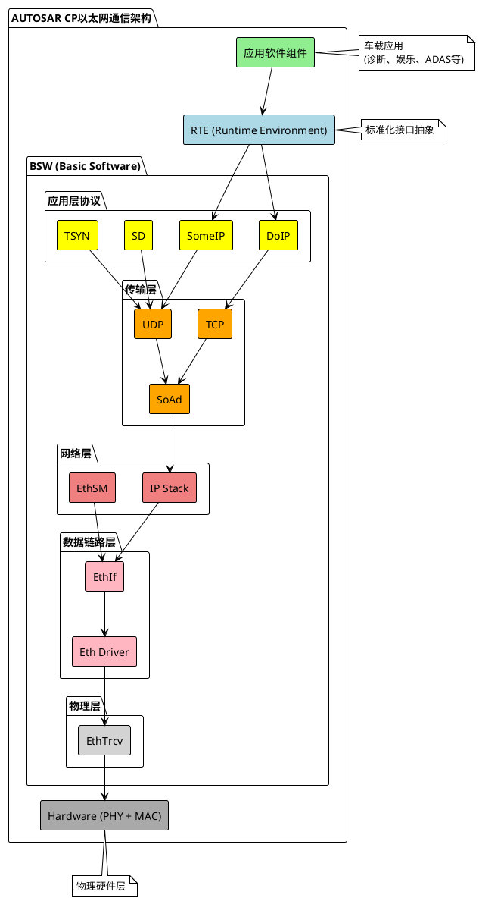

---

## 2. OSI模型与AUTOSAR映射

### 📊 2.1 完整映射关系

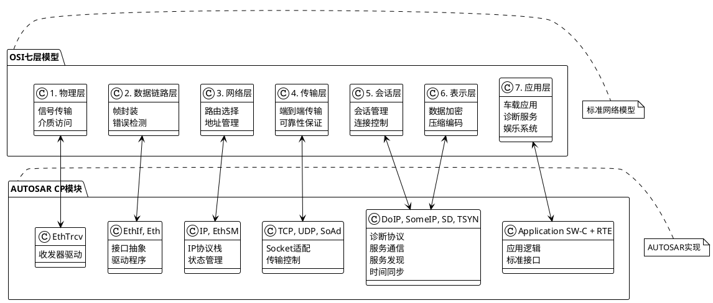

### 📋 2.2 模块职责详表

| OSI层 | AUTOSAR模块 | 主要职责 | 关键接口 |
|-------|-------------|----------|----------|
| 物理层 | `EthTrcv` | PHY芯片控制、链路检测 | `EthTrcv_SetTransceiverMode()` |
| 数据链路层 | `Eth`, `EthIf` | MAC帧收发、接口抽象 | `Eth_Transmit()`, `EthIf_GetCtrlMode()` |
| 网络层 | `IP`, `EthSM` | IP封装、状态管理 | `SoAd_OpenSoCon()`, `EthSM_RequestComMode()` |
| 传输层 | `TCP`, `UDP`, `SoAd` | Socket管理、传输控制 | `SoAd_IfTransmit()`, `SoAd_TpTransmit()` |
| 应用层 | `DoIP`, `SomeIP`, `SD`, `TSYN` | 应用协议、服务管理 | `DoIP_ActivationLineSwitch()`, `Sd_ServerServiceSetState()` |

---

## 3. 物理层模块 - EthTrcv

### 🔌 3.1 模块概述

**EthTrcv (Ethernet Transceiver Driver)** 是AUTOSAR CP中的底层驱动模块，负责控制以太网PHY芯片，提供物理层的基本功能。

### ⚙️ 3.2 主要功能

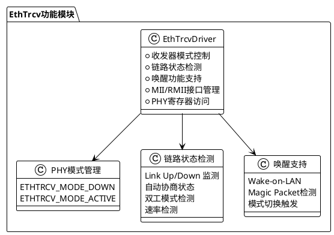

### 🔧 3.3 关键API接口

#### 初始化与配置
```c
/* EthTrcv初始化 */
void EthTrcv_Init(const EthTrcv_ConfigType* ConfigPtr);

/* 设置收发器模式 */
Std_ReturnType EthTrcv_SetTransceiverMode(
    uint8 TrcvIdx, 
    EthTrcv_ModeType CtrlMode
);

/* 获取收发器模式 */
Std_ReturnType EthTrcv_GetTransceiverMode(
    uint8 TrcvIdx, 
    EthTrcv_ModeType* TrcvModePtr
);
```

#### 链路状态管理
```c
/* 获取链路状态 */
Std_ReturnType EthTrcv_GetLinkState(
    uint8 TrcvIdx, 
    EthTrcv_LinkStateType* LinkStatePtr
);

/* 获取波特率 */
Std_ReturnType EthTrcv_GetBaudRate(
    uint8 TrcvIdx, 
    EthTrcv_BaudRateType* BaudRatePtr
);

/* 获取双工模式 */
Std_ReturnType EthTrcv_GetDuplexMode(
    uint8 TrcvIdx, 
    EthTrcv_DuplexModeType* DuplexModePtr
);
```

### 📋 3.4 配置参数示例

```c
/* EthTrcv配置结构体示例 */
const EthTrcv_ConfigType EthTrcv_Config = {
    .EthTrcvGeneral = {
        .EthTrcvDevErrorDetect = TRUE,
        .EthTrcvGetVersionInfoApi = TRUE,
        .EthTrcvIndex = 0,
        .EthTrcvMainFunctionPeriod = 0.01, /* 10ms */
    },
    
    .EthTrcvConfigSet = {
        .EthTrcvConfig = {
            .EthTrcvPhyAddress = 0x01,
            .EthTrcvMaxBaudRate = ETHTRCV_BAUD_RATE_1000MBIT,
            .EthTrcvSupportedBaudRate = ETHTRCV_BAUD_RATE_1000MBIT,
            .EthTrcvDuplexMode = ETHTRCV_DUPLEX_MODE_FULL,
            .EthTrcvWakeupSupport = TRUE,
        }
    }
};
```

### 🔄 3.5 状态机与工作流程

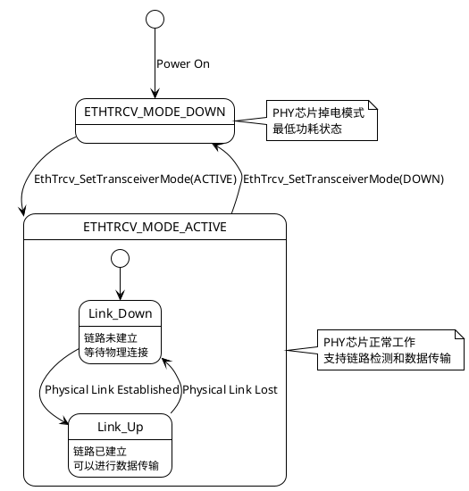

### 💡 3.6 实践要点总结

✅ **配置最佳实践**
- 根据硬件选择正确的PHY地址
- 配置合适的主函数调用周期（建议10-20ms）
- 启用链路状态变化通知功能

⚠️ **常见问题**
- PHY地址配置错误导致通信失败
- MII/RMII时钟配置不匹配
- 唤醒功能配置与硬件不符

🔧 **调试建议**
- 使用示波器检查PHY时钟信号
- 监控链路状态变化事件
- 验证PHY寄存器读写功能

### 📝 3.7 自测问题

1. **Q: EthTrcv模块在OSI模型中属于哪一层？主要作用是什么？**
   
   A: 属于物理层（Layer 1），主要作用是控制以太网PHY芯片，管理物理链路状态，提供收发器模式控制和唤醒功能支持。

2. **Q: ETHTRCV_MODE_DOWN和ETHTRCV_MODE_ACTIVE两种模式的区别是什么？**
   
   A: DOWN模式是低功耗状态，PHY芯片基本掉电；ACTIVE模式是正常工作状态，支持链路检测和数据传输。

3. **Q: 在EthTrcv配置中，EthTrcvPhyAddress参数的作用是什么？**
   
   A: PHY地址是用于通过MDIO接口访问特定PHY芯片的地址标识，每个PHY芯片都有唯一的地址。

---

## 4. 数据链路层模块

### 📦 4.1 模块架构概览

数据链路层在AUTOSAR CP中主要包含三个核心模块：`Eth`（以太网驱动）、`EthIf`（以太网接口）和`EthSM`（以太网状态管理）。

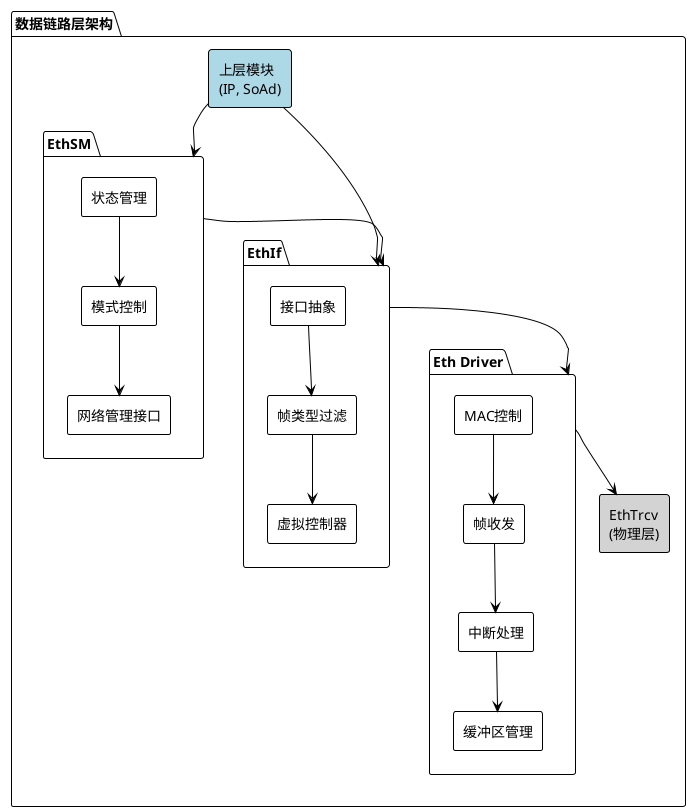

---

### 🚗 4.2 Eth Driver（以太网驱动）

#### 功能概述
Eth Driver是最底层的MAC控制器驱动，直接与硬件交互，负责以太网帧的发送和接收。

#### 🔧 关键API接口

**初始化与配置**
```c
/* Eth驱动初始化 */
void Eth_Init(const Eth_ConfigType* CfgPtr);

/* 设置控制器模式 */
Std_ReturnType Eth_SetControllerMode(
    uint8 CtrlIdx, 
    Eth_ModeType CtrlMode
);

/* 获取控制器模式 */
Std_ReturnType Eth_GetControllerMode(
    uint8 CtrlIdx, 
    Eth_ModeType* CtrlModePtr
);
```

**帧发送接口**
```c
/* 提供发送缓冲区 */
BufReq_ReturnType Eth_ProvideTxBuffer(
    uint8 CtrlIdx,
    Eth_FrameType FrameType,
    uint8 Priority,
    Eth_BufIdxType* BufIdxPtr,
    uint8** BufPtr,
    uint16* LenBytePtr
);

/* 发送以太网帧 */
Std_ReturnType Eth_Transmit(
    uint8 CtrlIdx,
    Eth_BufIdxType BufIdx,
    Eth_FrameType FrameType,
    boolean TxConfirmation,
    uint16 LenByte,
    const uint8* PhysAddrPtr
);

/* 发送确认 */
void Eth_TxConfirmation(uint8 CtrlIdx, Eth_BufIdxType BufIdx);
```

**帧接收接口**
```c
/* 接收处理 */
void Eth_Receive(uint8 CtrlIdx, Eth_RxStatusType* RxStatusPtr);

/* 接收指示 */
void Eth_RxIndication(
    uint8 CtrlIdx,
    Eth_FrameType FrameType,
    boolean IsBroadcast,
    const uint8* PhysAddrPtr,
    const Eth_DataType* DataPtr,
    uint16 LenByte
);
```

#### 📋 配置参数详解

```c
/* Eth驱动配置示例 */
const Eth_ConfigType Eth_Config = {
    .EthGeneral = {
        .EthDevErrorDetect = TRUE,
        .EthGetDropCountApi = TRUE,
        .EthGetEtherStatsApi = TRUE,
        .EthIndex = 0,
        .EthMainFunctionPeriod = 0.001, /* 1ms */
        .EthMaxCtrlsSupported = 1,
        .EthVersionInfoApi = TRUE
    },
    
    .EthConfigSet = {
        .EthCtrlConfig = {
            .EthCtrlIdx = 0,
            .EthCtrlEnableMii = TRUE,
            .EthCtrlEnableRxInterrupt = TRUE,
            .EthCtrlEnableTxInterrupt = TRUE,
            .EthCtrlMacLayerType = ETH_MAC_LAYER_TYPE_XMAC,
            .EthCtrlMacLayerSubType = ETH_MAC_LAYER_SUB_TYPE_STANDARD,
            
            /* MAC地址配置 */
            .EthCtrlPhysAddr = {0x00, 0x11, 0x22, 0x33, 0x44, 0x55},
            
            /* 接收配置 */
            .EthCtrlRxBufLenByte = 1536,
            .EthCtrlRxBufTotal = 32,
            
            /* 发送配置 */ 
            .EthCtrlTxBufLenByte = 1536,
            .EthCtrlTxBufTotal = 16,
            
            /* DMA配置 */
            .EthCtrlEnableDemEventDetect = TRUE
        }
    }
};
```

---

### 🔗 4.3 EthIf（以太网接口）

#### 功能概述
EthIf提供上层模块与Eth Driver之间的标准化接口，支持多个虚拟控制器和帧类型过滤。

#### 核心功能特性

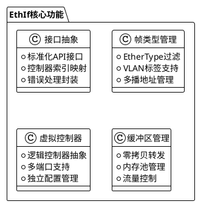

#### 🔧 关键API接口

```c
/* EthIf初始化 */
void EthIf_Init(const EthIf_ConfigType* ConfigPtr);

/* 控制器模式设置 */
Std_ReturnType EthIf_SetControllerMode(
    uint8 CtrlIdx, 
    Eth_ModeType CtrlMode
);

/* 获取控制器模式 */
Std_ReturnType EthIf_GetControllerMode(
    uint8 CtrlIdx, 
    Eth_ModeType* CtrlModePtr
);

/* 帧发送 */
Std_ReturnType EthIf_Transmit(
    uint8 CtrlIdx,
    Eth_FrameType FrameType,
    boolean TxConfirmation,
    uint16 LenByte,
    const uint8* DataPtr,
    const uint8* PhysAddrPtr
);

/* 更新物理地址过滤 */
Std_ReturnType EthIf_UpdatePhysAddrFilter(
    uint8 CtrlIdx,
    const uint8* PhysAddrPtr,
    Eth_FilterActionType Action
);
```

---

### 🎛️ 4.4 EthSM（以太网状态管理）

#### 功能概述
EthSM负责以太网控制器的状态管理，协调网络管理需求和实际硬件状态。

#### 状态机设计

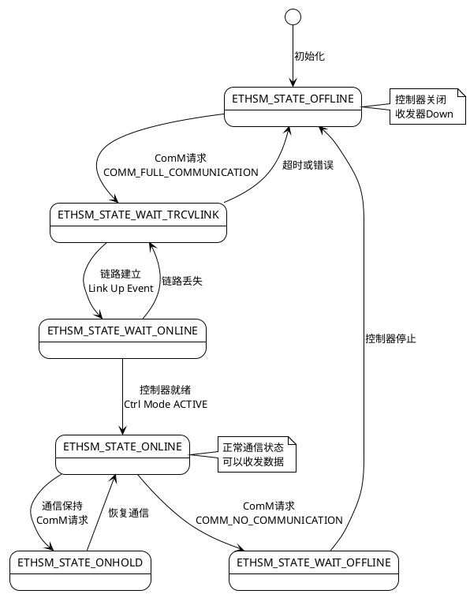

#### 🔧 关键API接口

```c
/* EthSM初始化 */
void EthSM_Init(const EthSM_ConfigType* ConfigPtr);

/* 请求通信模式 */
Std_ReturnType EthSM_RequestComMode(
    NetworkHandleType NetworkHandle, 
    ComM_ModeType ComM_Mode
);

/* 获取当前通信模式 */
Std_ReturnType EthSM_GetCurrentComMode(
    NetworkHandleType NetworkHandle, 
    ComM_ModeType* ComM_ModePtr
);

/* 获取当前内部状态 */
Std_ReturnType EthSM_GetCurrentInternalMode(
    NetworkHandleType NetworkHandle, 
    EthSM_NetworkModeStateType* EthSM_InternalMode
);

/* 主函数 */
void EthSM_MainFunction(void);
```

### 💡 4.5 数据链路层实践要点

#### ✅ 配置最佳实践

**Eth Driver配置要点：**
- 根据系统需求配置合适的缓冲区数量和大小
- 启用必要的中断支持以提高实时性
- 正确配置MAC地址，确保网络唯一性

**EthIf配置要点：**
- 合理设置帧类型过滤，减少不必要的处理开销
- 配置虚拟控制器映射，支持多应用场景
- 启用必要的统计和错误检测功能

**EthSM配置要点：**
- 设置合适的状态切换超时时间
- 配置与ComM的正确集成
- 启用网络管理功能支持

#### ⚠️ 常见问题与解决方案

1. **MAC地址冲突**
   - 问题：多个节点使用相同MAC地址
   - 解决：使用厂商分配的唯一MAC地址前缀

2. **缓冲区溢出**
   - 问题：接收缓冲区不足导致丢帧
   - 解决：增加缓冲区数量或优化处理流程

3. **状态切换异常**
   - 问题：EthSM状态机卡在中间状态
   - 解决：检查超时配置和错误处理逻辑

### 📝 4.6 自测问题

1. **Q: 数据链路层三个模块的分工是什么？**
   
   A: Eth Driver负责硬件抽象和帧收发；EthIf提供标准接口和帧过滤；EthSM管理状态切换和网络管理集成。

2. **Q: EthSM的ONLINE状态表示什么？需要满足哪些条件？**
   
   A: ONLINE状态表示以太网已就绪可以正常通信。需要：链路已建立、控制器处于ACTIVE模式、ComM请求FULL_COMMUNICATION。

3. **Q: 如何优化以太网驱动的性能？**
   
   A: 合理配置缓冲区大小和数量、启用中断处理、使用DMA传输、优化主函数调用周期、启用硬件加速功能。

---

*第4章节完成。接下来将继续详细介绍网络层模块的内容...* 

## 5. 网络层模块

### 🌐 5.1 网络层架构概览

网络层是AUTOSAR CP以太网通信的核心，主要包含IP协议栈、Socket Adapter (SoAd)等关键模块。

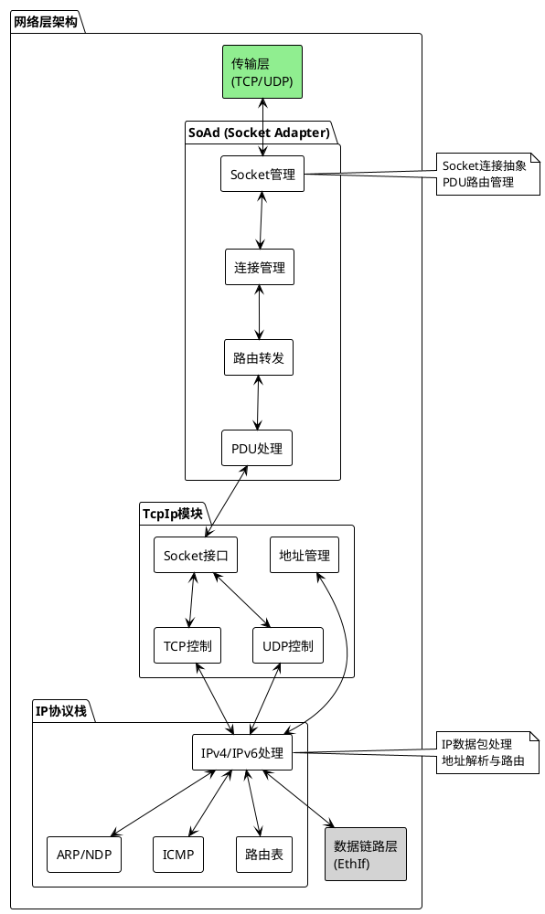

---

### 🔌 5.2 SoAd (Socket Adapter)

#### 功能概述
SoAd是AUTOSAR CP中的关键模块，提供Socket抽象接口，管理TCP/UDP连接，实现PDU路由功能。

#### 核心概念

**Socket Connection（套接字连接）**
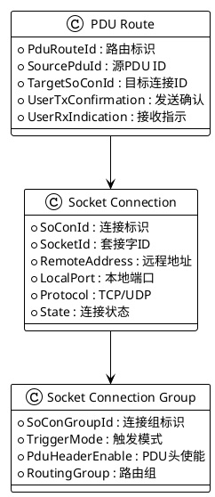

#### 🔧 关键API接口

**初始化与配置**
```c
/* SoAd初始化 */
void SoAd_Init(const SoAd_ConfigType* ConfigPtr);

/* 获取版本信息 */
void SoAd_GetVersionInfo(Std_VersionInfoType* VersionInfo);

/* 主函数 */
void SoAd_MainFunction(void);
```

**Socket连接管理**
```c
/* 打开Socket连接 */
Std_ReturnType SoAd_OpenSoCon(SoAd_SoConIdType SoConId);

/* 关闭Socket连接 */
Std_ReturnType SoAd_CloseSoCon(
    SoAd_SoConIdType SoConId, 
    boolean Abort
);

/* 请求IP地址分配 */
Std_ReturnType SoAd_RequestIpAddrAssignment(
    SoAd_SoConIdType SoConId,
    TcpIp_IpAddrAssignmentType Type,
    const TcpIp_SockAddrType* LocalIpAddrPtr,
    uint8 Netmask,
    const TcpIp_SockAddrType* DefaultRouterPtr
);

/* 释放IP地址分配 */
Std_ReturnType SoAd_ReleaseIpAddrAssignment(SoAd_SoConIdType SoConId);
```

**数据传输接口**
```c
/* IF方式传输（UDP） */
Std_ReturnType SoAd_IfTransmit(
    PduIdType TxPduId,
    const PduInfoType* PduInfoPtr
);

/* TP方式传输（TCP） */
Std_ReturnType SoAd_TpTransmit(
    PduIdType TxPduId,
    const PduInfoType* PduInfoPtr
);

/* 取消传输 */
Std_ReturnType SoAd_TpCancelTransmit(PduIdType TxPduId);

/* 取消接收 */
Std_ReturnType SoAd_TpCancelReceive(PduIdType RxPduId);
```

#### 📋 配置参数详解

```c
/* SoAd配置示例 */
const SoAd_ConfigType SoAd_Config = {
    .SoAdGeneral = {
        .SoAdDevErrorDetect = TRUE,
        .SoAdGetAndResetMeasurementDataApi = FALSE,
        .SoAdIPv6AddressEnabled = FALSE,
        .SoAdMainFunctionPeriod = 0.01, /* 10ms */
        .SoAdVersionInfoApi = TRUE
    },
    
    /* Socket连接配置 */
    .SoAdSocketConnection = {
        [0] = {
            .SoConId = 0,
            .SoAdSocketAutomaticSoConSetup = TRUE,
            .SoAdSocketSoConModeChgNotification = TRUE,
            .SoAdSocketTcpInitiate = FALSE, /* TCP服务端 */
            .SoAdSocketTcpNoDelay = TRUE,
            
            /* 远程地址配置 */
            .SoAdSocketRemoteAddress = {
                .SoAdSocketRemoteIpAddress = {192, 168, 1, 100},
                .SoAdSocketRemotePort = 8080
            },
            
            /* 本地地址配置 */
            .SoAdSocketLocalAddress = {
                .SoAdSocketLocalIpAddress = {192, 168, 1, 10},
                .SoAdSocketLocalPort = 8080
            },
            
            .SoAdSocketProtocol = TCPIP_IPPROTO_UDP,
            .SoAdSocketUdpListenOnly = FALSE,
            .SoAdSocketFramePriority = 0
        }
    },
    
    /* PDU路由配置 */
    .SoAdPduRoute = {
        [0] = {
            .SoAdTxPduId = 0,
            .SoAdTxPduCollectionSemantics = SOAD_COLLECT_QUEUED,
            .SoAdTxPduHeaderId = 0x1234,
            .SoAdTxPduTriggerMode = SOAD_TRIGGER_ALWAYS,
            .SoAdTxUpperLayerType = SOAD_UPPER_LAYER_IF,
            
            /* 目标Socket连接 */
            .SoAdPduRouteDest = {
                [0] = {
                    .SoAdTxSoConId = 0,
                    .SoAdTxPduRef = &SomeModule_PduConfig[0]
                }
            }
        }
    }
};
```

#### 状态管理

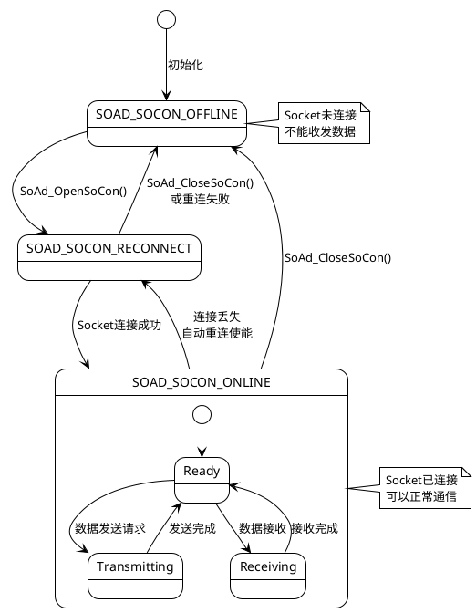

---

### 🌐 5.3 TcpIp协议栈

#### 功能概述
TcpIp模块提供完整的TCP/IP协议栈实现，包括IPv4/IPv6处理、TCP/UDP传输、Socket接口等。

#### 核心功能架构

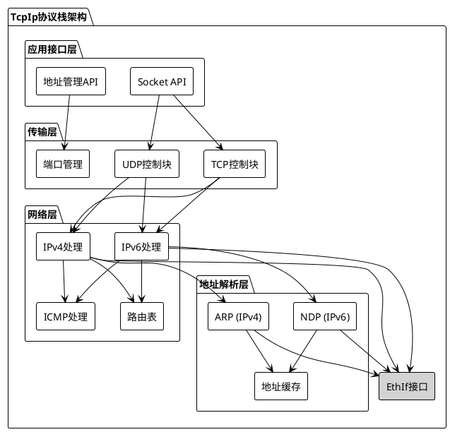

#### 🔧 关键API接口

**Socket管理**
```c
/* 创建Socket */
Std_ReturnType TcpIp_Socket(
    TcpIp_DomainType Domain,
    TcpIp_ProtocolType Protocol,
    TcpIp_SocketIdType* SocketIdPtr
);

/* 绑定Socket到本地地址 */
Std_ReturnType TcpIp_Bind(
    TcpIp_SocketIdType SocketId,
    TcpIp_LocalAddrIdType LocalAddrId,
    uint16* PortPtr
);

/* TCP连接 */
Std_ReturnType TcpIp_TcpConnect(
    TcpIp_SocketIdType SocketId,
    const TcpIp_SockAddrType* RemoteAddrPtr
);

/* TCP监听 */
Std_ReturnType TcpIp_TcpListen(
    TcpIp_SocketIdType SocketId,
    uint16 MaxChannels
);

/* 关闭Socket */
Std_ReturnType TcpIp_Close(
    TcpIp_SocketIdType SocketId,
    boolean Abort
);
```

**数据传输**
```c
/* UDP发送数据 */
Std_ReturnType TcpIp_UdpTransmit(
    TcpIp_SocketIdType SocketId,
    const uint8* DataPtr,
    const TcpIp_SockAddrType* RemoteAddrPtr,
    uint16 TotalLength
);

/* TCP发送数据 */
Std_ReturnType TcpIp_TcpTransmit(
    TcpIp_SocketIdType SocketId,
    const uint8* DataPtr,
    uint32 AvailableLength,
    boolean ForceRetrieve
);

/* TCP接收数据 */
Std_ReturnType TcpIp_TcpReceived(
    TcpIp_SocketIdType SocketId,
    uint32 Length
);
```

**地址管理**
```c
/* 请求IP地址 */
Std_ReturnType TcpIp_RequestIpAddrAssignment(
    TcpIp_LocalAddrIdType LocalAddrId,
    TcpIp_IpAddrAssignmentType Type,
    const TcpIp_SockAddrType* LocalIpAddrPtr,
    uint8 Netmask,
    const TcpIp_SockAddrType* DefaultRouterPtr
);

/* 释放IP地址 */
Std_ReturnType TcpIp_ReleaseIpAddrAssignment(TcpIp_LocalAddrIdType LocalAddrId);

/* 获取IP地址 */
Std_ReturnType TcpIp_GetIpAddr(
    TcpIp_LocalAddrIdType LocalAddrId,
    TcpIp_SockAddrType* IpAddrPtr,
    uint8* NetmaskPtr,
    TcpIp_SockAddrType* DefaultRouterPtr
);
```

#### 配置示例

```c
/* TcpIp协议栈配置 */
const TcpIp_ConfigType TcpIp_Config = {
    .TcpIpGeneral = {
        .TcpIpDevErrorDetect = TRUE,
        .TcpIpGetAndResetMeasurementDataApi = FALSE,
        .TcpIpMainFunctionPeriod = 0.001, /* 1ms */
        .TcpIpVersionInfoApi = TRUE
    },
    
    /* 本地地址配置 */
    .TcpIpLocalAddr = {
        [0] = {
            .TcpIpLocalAddrId = 0,
            .TcpIpAddressType = TCPIP_UNICAST,
            .TcpIpDomain = TCPIP_AF_INET, /* IPv4 */
            
            /* 静态IP配置 */
            .TcpIpStaticIpAddress = {
                .TcpIpStaticIpAddressConfig = {192, 168, 1, 10},
                .TcpIpStaticIpNetmask = 24,
                .TcpIpStaticIpDefaultRouter = {192, 168, 1, 1}
            },
            
            /* DHCP配置 */
            .TcpIpDhcpAddressAssignment = TRUE,
            .TcpIpAutoIpAddressAssignment = FALSE
        }
    },
    
    /* TCP配置 */
    .TcpIpTcp = {
        .TcpIpTcpEnabled = TRUE,
        .TcpIpTcpKeepAlive = TRUE,
        .TcpIpTcpKeepAliveTime = 7200,
        .TcpIpTcpMaxRtx = 3,
        .TcpIpTcpNagleEnabled = FALSE,
        .TcpIpTcpReceiveWindowMax = 65535,
        .TcpIpTcpRetransmissionTimeout = 3.0,
        .TcpIpTcpSynMaxRtx = 5
    },
    
    /* UDP配置 */
    .TcpIpUdp = {
        .TcpIpUdpEnabled = TRUE,
        .TcpIpUdpChecksumEnabled = TRUE
    }
};
```

### 💡 5.4 网络层实践要点

#### ✅ 配置最佳实践

**SoAd配置建议：**
- 合理规划Socket连接数量，避免资源浪费
- 为不同应用配置独立的连接组
- 启用自动重连功能提高系统健壮性
- 配置合适的PDU头部标识，支持多路复用

**TcpIp配置建议：**
- 根据网络环境选择合适的IP地址分配方式
- 配置TCP参数以平衡性能和可靠性
- 启用必要的网络诊断功能
- 合理设置主函数调用周期

#### ⚠️ 常见问题与解决方案

1. **Socket连接失败**
   - 检查IP地址和端口配置
   - 验证网络连通性
   - 确认防火墙设置

2. **数据传输丢包**
   - 检查网络质量
   - 调整TCP重传参数
   - 优化缓冲区配置

3. **IP地址分配失败**
   - 检查DHCP服务器配置
   - 验证静态IP设置
   - 确认网络接口状态

### 📝 5.5 自测问题

1. **Q: SoAd模块的主要作用是什么？与TcpIp模块的关系如何？**
   
   A: SoAd提供Socket抽象和PDU路由功能，是上层应用与TcpIp协议栈之间的适配层。TcpIp提供底层的TCP/IP协议实现。

2. **Q: 如何在AUTOSAR CP中实现UDP多播通信？**
   
   A: 在SoAd中配置多播地址的Socket连接，在TcpIp中启用多播支持，并配置相应的多播路由。

3. **Q: TCP和UDP在Socket配置上有哪些关键差异？**
   
   A: TCP需要配置连接管理参数（如重传、窗口大小），UDP主要配置地址绑定；TCP是面向连接的，UDP是无连接的。

---

## 6. 传输层模块

### 🚚 6.1 传输层概述

传输层在AUTOSAR CP中主要负责端到端的数据传输控制，提供可靠（TCP）或快速（UDP）的数据传输服务。

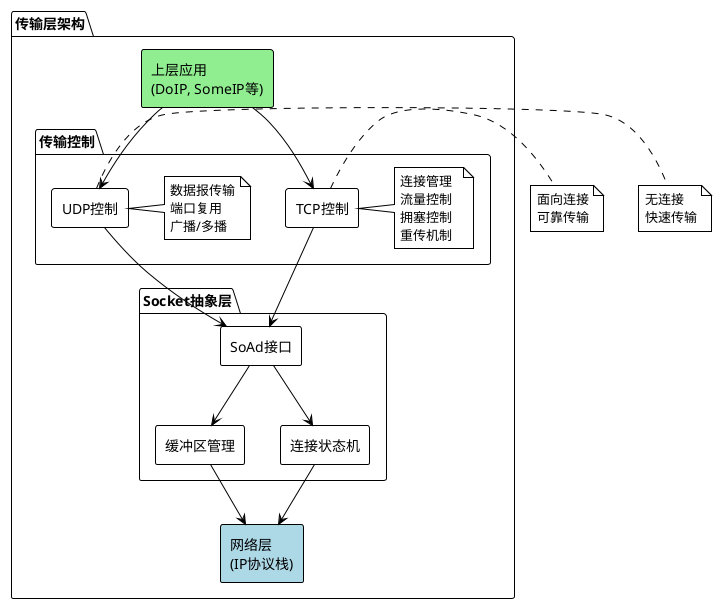

---

### 🔗 6.2 TCP传输控制

#### TCP特性与优势

| 特性 | 描述 | AUTOSAR实现 |
|------|------|-------------|
| 面向连接 | 建立连接后传输数据 | SoAd连接管理 |
| 可靠传输 | 保证数据不丢失、不重复、有序 | TCP协议栈重传机制 |
| 流量控制 | 防止发送方过快发送 | 窗口大小控制 |
| 拥塞控制 | 适应网络拥塞情况 | 慢启动、拥塞避免算法 |

#### TCP连接状态机

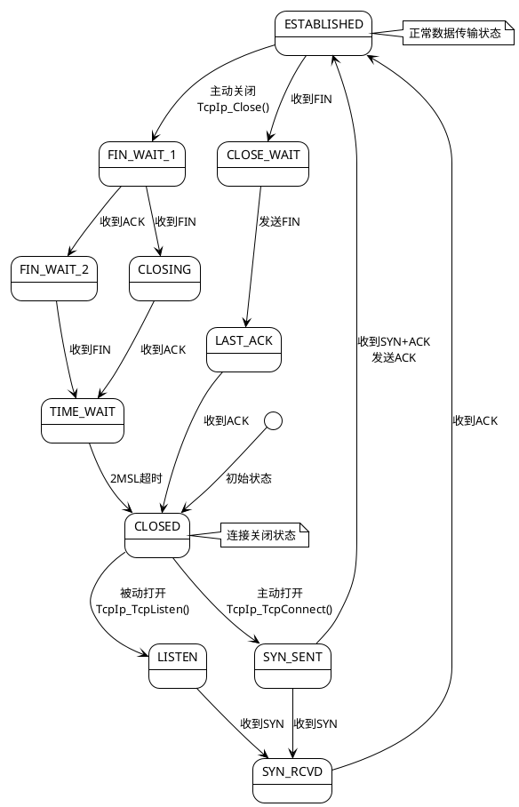

#### TCP配置参数详解

```c
/* TCP连接配置示例 */
typedef struct {
    /* 连接参数 */
    uint16 TcpMaxSegmentSize;          /* 最大段大小 */
    uint32 TcpReceiveWindowSize;       /* 接收窗口大小 */
    uint16 TcpConnectionTimeout;       /* 连接超时 */
    
    /* 重传参数 */
    uint8  TcpMaxRetransmissions;      /* 最大重传次数 */
    uint16 TcpRetransmissionTimeout;   /* 重传超时 */
    
    /* Keep-Alive参数 */
    boolean TcpKeepAliveEnabled;       /* Keep-Alive使能 */
    uint32  TcpKeepAliveTime;         /* Keep-Alive时间 */
    uint16  TcpKeepAliveInterval;     /* Keep-Alive间隔 */
    uint8   TcpKeepAliveProbes;       /* Keep-Alive探测次数 */
    
    /* Nagle算法 */
    boolean TcpNagleAlgorithmEnabled; /* Nagle算法使能 */
} TcpConnectionConfig;

/* 实际配置示例 */
const TcpConnectionConfig TcpConfig = {
    .TcpMaxSegmentSize = 1460,         /* 以太网MTU-40 */
    .TcpReceiveWindowSize = 65536,     /* 64KB */
    .TcpConnectionTimeout = 75,        /* 75秒 */
    
    .TcpMaxRetransmissions = 3,        /* 重传3次 */
    .TcpRetransmissionTimeout = 3000,  /* 3秒 */
    
    .TcpKeepAliveEnabled = TRUE,
    .TcpKeepAliveTime = 7200,         /* 2小时 */
    .TcpKeepAliveInterval = 75,       /* 75秒 */
    .TcpKeepAliveProbes = 9,          /* 9次探测 */
    
    .TcpNagleAlgorithmEnabled = FALSE /* 汽车应用禁用Nagle */
};
```

---

### 📦 6.3 UDP传输控制

#### UDP特性与应用

| 特性 | 描述 | 适用场景 |
|------|------|----------|
| 无连接 | 直接发送数据报 | 实时通信 |
| 低开销 | 头部仅8字节 | 资源受限环境 |
| 支持广播/多播 | 一对多通信 | 服务发现、状态广播 |
| 简单快速 | 无复杂控制机制 | 时间敏感应用 |

#### UDP应用场景分析

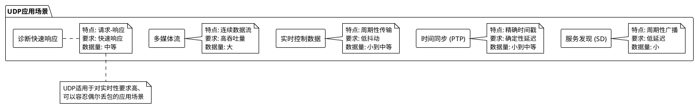

#### UDP配置与优化

```c
/* UDP Socket配置示例 */
typedef struct {
    /* 基本配置 */
    TcpIp_DomainType Domain;          /* IPv4/IPv6 */
    TcpIp_LocalAddrIdType LocalAddrId; /* 本地地址ID */
    uint16 LocalPort;                 /* 本地端口 */
    
    /* 多播配置 */
    boolean MulticastEnabled;         /* 多播使能 */
    TcpIp_SockAddrType MulticastAddr; /* 多播地址 */
    uint8 MulticastTtl;              /* 多播TTL */
    
    /* 广播配置 */
    boolean BroadcastEnabled;         /* 广播使能 */
    
    /* 缓冲区配置 */
    uint16 TxBufferSize;             /* 发送缓冲区大小 */
    uint16 RxBufferSize;             /* 接收缓冲区大小 */
    
    /* QoS配置 */
    uint8 DscpValue;                 /* DSCP优先级 */
    uint8 TrafficClass;              /* 流量类别 */
} UdpSocketConfig;

/* Service Discovery UDP配置示例 */
const UdpSocketConfig SdUdpConfig = {
    .Domain = TCPIP_AF_INET,
    .LocalAddrId = 0,
    .LocalPort = 30490,              /* SD标准端口 */
    
    .MulticastEnabled = TRUE,
    .MulticastAddr = {
        .domain = TCPIP_AF_INET,
        .addr[0] = 224,              /* SD多播地址 */
        .addr[1] = 244,              /* 224.244.224.245 */
        .addr[2] = 224,
        .addr[3] = 245,
        .port = 30490
    },
    .MulticastTtl = 1,               /* 本地网段 */
    
    .BroadcastEnabled = FALSE,
    
    .TxBufferSize = 1472,            /* UDP最大载荷 */
    .RxBufferSize = 1472,
    
    .DscpValue = 0x2E,               /* AF41 - 高优先级 */
    .TrafficClass = 0
};
```

---

### 🔄 6.4 传输层数据流处理

#### 发送数据流程

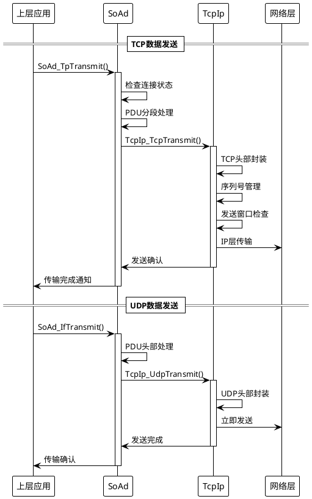

#### 接收数据流程

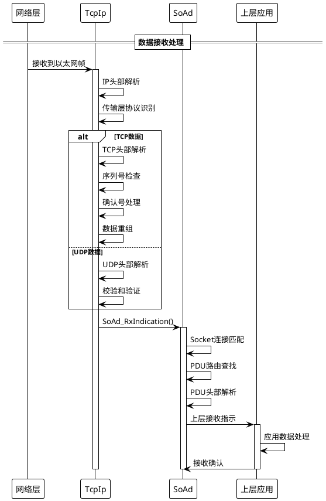

### 💡 6.5 传输层性能优化

#### TCP性能优化策略

1. **发送端优化**
```c
/* TCP发送优化配置 */
typedef struct {
    /* 禁用Nagle算法，减少延迟 */
    boolean TcpNoDelay;
    
    /* 优化发送缓冲区大小 */
    uint32 TcpSendBufferSize;
    
    /* 启用TCP窗口缩放 */
    boolean TcpWindowScaling;
    
    /* 选择性确认 */
    boolean TcpSelectiveAck;
} TcpSendOptimization;

const TcpSendOptimization TcpSendOpt = {
    .TcpNoDelay = TRUE,              /* 汽车应用推荐 */
    .TcpSendBufferSize = 65536,      /* 64KB */
    .TcpWindowScaling = TRUE,        /* 高速网络推荐 */
    .TcpSelectiveAck = TRUE          /* 提高重传效率 */
};
```

2. **接收端优化**
```c
/* TCP接收优化配置 */
typedef struct {
    /* 接收窗口大小 */
    uint32 TcpReceiveWindowSize;
    
    /* 接收缓冲区数量 */
    uint16 TcpReceiveBufferCount;
    
    /* 延迟确认 */
    boolean TcpDelayedAck;
    uint16 TcpDelayedAckTimeout;
} TcpReceiveOptimization;

const TcpReceiveOptimization TcpRecvOpt = {
    .TcpReceiveWindowSize = 131072,   /* 128KB */
    .TcpReceiveBufferCount = 32,      /* 32个缓冲区 */
    .TcpDelayedAck = TRUE,           /* 减少ACK数量 */
    .TcpDelayedAckTimeout = 40       /* 40ms延迟 */
};
```

#### UDP性能优化策略

1. **多播优化**
```c
/* UDP多播优化 */
typedef struct {
    /* 多播环回控制 */
    boolean MulticastLoopback;
    
    /* 多播跳数限制 */
    uint8 MulticastTtl;
    
    /* 多播接口绑定 */
    TcpIp_LocalAddrIdType MulticastInterface;
    
    /* 接收缓冲区优化 */
    uint32 MulticastReceiveBufferSize;
} UdpMulticastOptimization;

const UdpMulticastOptimization UdpMcastOpt = {
    .MulticastLoopback = FALSE,       /* 避免自环 */
    .MulticastTtl = 1,               /* 本地网段 */
    .MulticastInterface = 0,          /* 默认接口 */
    .MulticastReceiveBufferSize = 8192 /* 8KB缓冲区 */
};
```

### 📝 6.6 自测问题

1. **Q: 在汽车以太网应用中，为什么通常禁用TCP的Nagle算法？**
   
   A: Nagle算法会延迟小包发送以提高网络效率，但汽车应用对实时性要求高，需要立即发送数据，因此通常禁用Nagle算法以减少延迟。

2. **Q: UDP和TCP在AUTOSAR SoAd中的接口调用有什么区别？**
   
   A: UDP使用SoAd_IfTransmit()接口（IF方式），TCP使用SoAd_TpTransmit()接口（TP方式）。UDP是无连接的立即发送，TCP需要连接管理和分段传输。

3. **Q: 如何在AUTOSAR中配置UDP多播通信？**
   
   A: 需要在SoAd中配置多播地址的Socket连接，在TcpIp中启用多播支持，设置合适的TTL值，并配置多播路由。

---

*传输层模块内容完成。接下来将介绍应用层模块的内容...*

## 7. 应用层模块

### 🌟 7.1 应用层概述

AUTOSAR CP应用层包含多个关键协议模块，为汽车应用提供专门的通信服务。

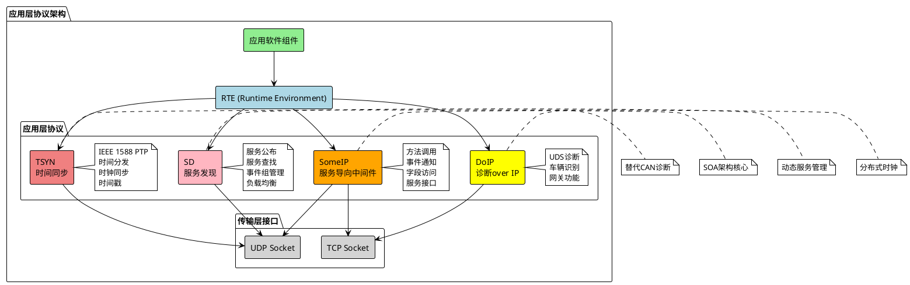

---

### 🔧 7.2 DoIP (Diagnostics over IP)

#### 功能概述
DoIP是AUTOSAR CP中的诊断通信协议，通过以太网实现UDS诊断功能，逐渐替代传统的CAN诊断。

#### 核心特性

| 特性 | 描述 | 优势 |
|------|------|------|
| 高带宽 | 以太网传输 | 支持大数据诊断 |
| 远程诊断 | TCP/IP网络 | 支持OTA更新 |
| 多ECU诊断 | 统一网关 | 简化诊断架构 |
| 标准化接口 | ISO 13400 | 兼容性好 |

#### DoIP协议栈架构

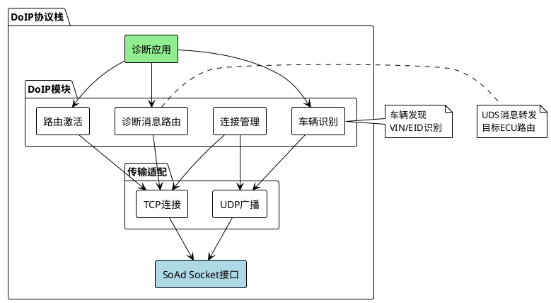

#### 🔧 关键API接口

**初始化与配置**
```c
/* DoIP初始化 */
void DoIP_Init(const DoIP_ConfigType* ConfigPtr);

/* 激活线路切换 */
Std_ReturnType DoIP_ActivationLineSwitch(void);

/* 获取版本信息 */
void DoIP_GetVersionInfo(Std_VersionInfoType* VersionInfo);

/* 主函数 */
void DoIP_MainFunction(void);
```

**诊断消息处理**
```c
/* 诊断消息传输请求 */
Std_ReturnType DoIP_TpTransmit(
    PduIdType TxPduId,
    const PduInfoType* PduInfoPtr
);

/* 取消传输 */
Std_ReturnType DoIP_TpCancelTransmit(PduIdType TxPduId);

/* 取消接收 */
Std_ReturnType DoIP_TpCancelReceive(PduIdType RxPduId);
```

#### 配置参数详解

```c
/* DoIP配置示例 */
const DoIP_ConfigType DoIP_Config = {
    .DoIPGeneral = {
        .DoIPDevErrorDetect = TRUE,
        .DoIPVersionInfoApi = TRUE,
        .DoIPMainFunctionPeriod = 0.01, /* 10ms */
        
        /* 车辆识别信息 */
        .DoIPVehicleIdentificationNumber = "1HGBH41JXMN109186",
        .DoIPEntityIdentificationNumber = {0x00, 0x01, 0x02, 0x03, 0x04, 0x05},
        .DoIPGroupIdentificationNumber = {0xAA, 0xBB, 0xCC, 0xDD, 0xEE, 0xFF},
        
        /* 时间参数 */
        .DoIPVehicleAnnouncementInterval = 500,     /* 500ms */
        .DoIPVehicleAnnouncementCount = 3,          /* 3次 */
        .DoIPActivationLineInactiveTime = 2000,     /* 2秒 */
        .DoIPDiagnosticMessageTimeout = 2000,       /* 2秒 */
        .DoIPRoutingActivationTimeout = 1000        /* 1秒 */
    },
    
    /* 连接配置 */
    .DoIPConnection = {
        [0] = {
            .DoIPConnectionId = 0,
            .DoIPTesterSA = 0x0E00,                 /* 测试仪源地址 */
            .DoIPTesterMaxRequestLength = 4095,     /* 最大请求长度 */
            .DoIPTesterMaxResponseLength = 4095,    /* 最大响应长度 */
            
            /* Socket连接关联 */
            .DoIPSoAdTxPduId = 0,
            .DoIPSoAdRxPduId = 0,
            .DoIPSoConRef = &SoAd_SoConConfig[0]
        }
    },
    
    /* 目标ECU配置 */
    .DoIPTargetAddress = {
        [0] = {
            .DoIPTargetAddressType = DOIP_TARGET_TYPE_FUNCTIONAL,
            .DoIPTargetAddressValue = 0xDF00,       /* 功能寻址 */
            .DoIPTargetEcu = &EcuInstance[0]
        },
        [1] = {
            .DoIPTargetAddressType = DOIP_TARGET_TYPE_PHYSICAL,
            .DoIPTargetAddressValue = 0x0001,       /* 物理寻址 */
            .DoIPTargetEcu = &EcuInstance[1]
        }
    }
};
```

#### DoIP通信流程

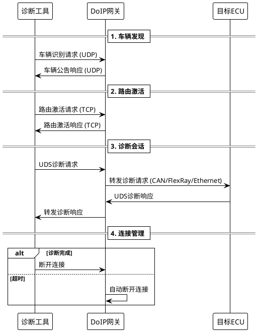

---

### 🎯 7.3 SomeIP (Scalable service-Oriented MiddlewarE over IP)

#### 功能概述
SomeIP是AUTOSAR CP的核心SOA中间件，提供基于服务的通信机制，支持方法调用、事件通知和字段访问。

#### 核心概念

**服务接口设计**
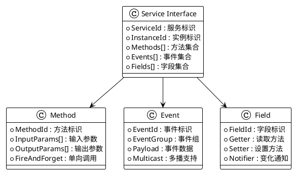

#### SomeIP消息格式

```c
/* SomeIP消息头结构 */
typedef struct {
    uint32 ServiceId;       /* 服务ID (16位) + 方法/事件ID (16位) */
    uint32 Length;          /* 消息长度 (从Request ID开始) */
    uint32 RequestId;       /* 客户端ID (16位) + 会话ID (16位) */
    uint8  ProtocolVersion; /* 协议版本 (固定0x01) */
    uint8  InterfaceVersion;/* 接口版本 */
    uint8  MessageType;     /* 消息类型 */
    uint8  ReturnCode;      /* 返回码 */
} SomeIP_HeaderType;

/* 消息类型定义 */
#define SOMEIP_MESSAGE_TYPE_REQUEST          0x00
#define SOMEIP_MESSAGE_TYPE_REQUEST_NO_RETURN 0x01
#define SOMEIP_MESSAGE_TYPE_NOTIFICATION     0x02
#define SOMEIP_MESSAGE_TYPE_RESPONSE         0x80
#define SOMEIP_MESSAGE_TYPE_ERROR           0x81
```

#### 🔧 关键API接口

**服务提供端**
```c
/* SomeIP服务端初始化 */
void SomeIp_Init(const SomeIp_ConfigType* ConfigPtr);

/* 提供服务 */
Std_ReturnType SomeIp_OfferService(
    uint16 ServiceId,
    uint16 InstanceId
);

/* 停止服务 */
Std_ReturnType SomeIp_StopOfferService(
    uint16 ServiceId,
    uint16 InstanceId
);

/* 发送事件 */
Std_ReturnType SomeIp_SendEventGroupNotification(
    uint16 ServiceId,
    uint16 InstanceId,
    uint16 EventGroupId,
    const uint8* DataPtr,
    uint16 Length
);

/* 响应方法调用 */
Std_ReturnType SomeIp_SendMethodResponse(
    uint16 ServiceId,
    uint16 InstanceId,
    uint16 MethodId,
    uint32 RequestId,
    const uint8* DataPtr,
    uint16 Length
);
```

**服务消费端**
```c
/* 查找服务 */
Std_ReturnType SomeIp_FindService(
    uint16 ServiceId,
    uint16 InstanceId
);

/* 停止查找服务 */
Std_ReturnType SomeIp_StopFindService(
    uint16 ServiceId,
    uint16 InstanceId
);

/* 调用方法 */
Std_ReturnType SomeIp_CallMethod(
    uint16 ServiceId,
    uint16 InstanceId,
    uint16 MethodId,
    const uint8* DataPtr,
    uint16 Length,
    uint32* RequestIdPtr
);

/* 订阅事件组 */
Std_ReturnType SomeIp_SubscribeEventGroup(
    uint16 ServiceId,
    uint16 InstanceId,
    uint16 EventGroupId
);
```

#### 配置示例

```c
/* SomeIP服务配置 */
const SomeIp_ConfigType SomeIp_Config = {
    .SomeIpGeneral = {
        .SomeIpDevErrorDetect = TRUE,
        .SomeIpVersionInfoApi = TRUE,
        .SomeIpMainFunctionPeriod = 0.01 /* 10ms */
    },
    
    /* 服务实例配置 */
    .SomeIpServiceInstance = {
        [0] = {
            .ServiceId = 0x1234,
            .InstanceId = 0x0001,
            .MajorVersion = 1,
            .MinorVersion = 0,
            
            /* 方法配置 */
            .Methods = {
                [0] = {
                    .MethodId = 0x0001,
                    .FireAndForget = FALSE,
                    .ReliableTransport = TRUE,  /* TCP */
                    .SoAdTxPduId = 0,
                    .SoAdRxPduId = 0
                }
            },
            
            /* 事件配置 */
            .Events = {
                [0] = {
                    .EventId = 0x8001,
                    .EventGroupId = 0x0001,
                    .MulticastTransport = TRUE, /* UDP多播 */
                    .SoAdTxPduId = 1,
                    .MulticastAddress = {224, 1, 1, 1},
                    .MulticastPort = 30501
                }
            },
            
            /* 字段配置 */
            .Fields = {
                [0] = {
                    .FieldId = 0x0001,
                    .HasGetter = TRUE,
                    .HasSetter = TRUE,
                    .HasNotifier = TRUE,
                    .GetterMethodId = 0x0002,
                    .SetterMethodId = 0x0003,
                    .NotifierEventId = 0x8002
                }
            }
        }
    }
};
```

---

### 🔍 7.4 SD (Service Discovery)

#### 功能概述
SD是SomeIP的服务发现协议，负责服务的动态发布、查找和管理，支持负载均衡和故障恢复。

#### 核心功能

```plantuml
@startuml
!theme plain

package "Service Discovery功能" {
  rectangle "服务发布" as Offer
  note right of Offer
    周期性公告
    服务可用性
    实例信息
  end note
  
  rectangle "服务查找" as Find
  note right of Find
    主动查询
    被动监听
    服务匹配
  end note
  
  rectangle "事件组管理" as EventGroup
  note right of EventGroup
    订阅管理
    多播配置
    生命周期
  end note
  
  rectangle "负载均衡" as LoadBalance
  note right of LoadBalance
    多实例选择
    性能监控
    故障切换
  end note
}

Offer --> Find : 服务公告
Find --> EventGroup : 订阅请求
EventGroup --> LoadBalance : 实例选择

note bottom : SD通过UDP广播/多播\n实现分布式服务管理
@enduml
```

#### SD消息类型

```c
/* SD消息类型 */
typedef enum {
    SD_MESSAGE_TYPE_FIND_SERVICE = 0x00,
    SD_MESSAGE_TYPE_OFFER_SERVICE = 0x01,
    SD_MESSAGE_TYPE_SUBSCRIBE_EVENTGROUP = 0x06,
    SD_MESSAGE_TYPE_SUBSCRIBE_EVENTGROUP_ACK = 0x07,
    SD_MESSAGE_TYPE_SUBSCRIBE_EVENTGROUP_NACK = 0x08,
    SD_MESSAGE_TYPE_STOP_SUBSCRIBE_EVENTGROUP = 0x09
} Sd_MessageType;

/* SD入口类型 */
typedef struct {
    uint8  Type;           /* 入口类型 */
    uint8  Index1stOption; /* 第一个选项索引 */
    uint8  Index2ndOption; /* 第二个选项索引 */
    uint8  NumberOptions;  /* 选项数量 */
    uint16 ServiceId;      /* 服务ID */
    uint16 InstanceId;     /* 实例ID */
    uint8  MajorVersion;   /* 主版本号 */
    uint32 TTL;           /* 生存时间 */
    uint32 MinorVersion;   /* 次版本号 */
} Sd_EntryType;
```

#### 🔧 关键API接口

```c
/* SD初始化 */
void Sd_Init(const Sd_ConfigType* ConfigPtr);

/* 客户端服务设置状态 */
Std_ReturnType Sd_ClientServiceSetState(
    uint16 ClientServiceHandleId,
    Sd_ClientServiceSetStateType State
);

/* 服务端服务设置状态 */
Std_ReturnType Sd_ServerServiceSetState(
    uint16 ServerServiceHandleId,
    Sd_ServerServiceSetStateType State
);

/* 消费端事件组设置状态 */
Std_ReturnType Sd_ConsumedEventGroupSetState(
    uint16 ConsumedEventGroupHandleId,
    Sd_ConsumedEventGroupSetStateType State
);

/* 主函数 */
void Sd_MainFunction(void);
```

#### SD通信流程

```plantuml
@startuml
!theme plain

participant "服务提供者" as Provider
participant "SD模块" as SD
participant "服务消费者" as Consumer

== 服务发布阶段 ==
Provider -> SD: Sd_ServerServiceSetState(AVAILABLE)
SD -> SD: 开始周期性服务公告
SD -> Consumer: OfferService (UDP多播)

== 服务查找阶段 ==
Consumer -> SD: Sd_ClientServiceSetState(REQUESTED)
SD -> SD: 发送FindService
SD -> Provider: FindService (UDP多播)
Provider -> Consumer: OfferService响应

== 事件订阅阶段 ==
Consumer -> SD: Sd_ConsumedEventGroupSetState(REQUESTED)
SD -> Provider: SubscribeEventGroup
Provider -> Consumer: SubscribeEventGroupAck
Provider -> Consumer: 事件数据 (UDP多播)

== 服务停止阶段 ==
Provider -> SD: Sd_ServerServiceSetState(DOWN)
SD -> Consumer: StopOfferService (TTL=0)
@enduml
```

---

### ⏰ 7.5 TSYN (Time Synchronization)

#### 功能概述
TSYN模块实现IEEE 1588 PTP协议，为分布式汽车系统提供精确的时间同步服务。

#### PTP时间同步原理

```plantuml
@startuml
!theme plain

participant "Master Clock" as Master
participant "Slave Clock" as Slave

== 时间同步过程 ==
Master -> Slave: Sync消息 + t1时间戳
note right: 主时钟发送同步消息

Master -> Slave: Follow_Up消息 + 精确t1
note right: 发送精确的发送时间

Slave -> Master: Delay_Req消息 + t3时间戳  
note left: 从时钟请求延迟测量

Master -> Slave: Delay_Resp消息 + t4时间戳
note right: 响应延迟请求

note over Slave: 计算时钟偏差和网络延迟\nOffset = ((t2-t1) - (t4-t3))/2\nDelay = ((t2-t1) + (t4-t3))/2
@enduml
```

#### 🔧 关键API接口

```c
/* TSYN初始化 */
void TSync_Init(const TSync_ConfigType* ConfigPtr);

/* 设置全局时间 */
Std_ReturnType TSync_SetGlobalTime(
    TSync_SynchronizedTimeBaseType timeBaseId,
    const TSync_TimeStampType* timeStampPtr,
    const TSync_UserDataType* userDataPtr
);

/* 获取全局时间 */
Std_ReturnType TSync_GetCurrentTime(
    TSync_SynchronizedTimeBaseType timeBaseId,
    TSync_TimeStampType* timeStampPtr,
    TSync_UserDataType* userDataPtr
);

/* 获取同步状态 */
Std_ReturnType TSync_GetSyncState(
    TSync_SynchronizedTimeBaseType timeBaseId,
    TSync_SyncStateType* syncStatePtr
);

/* 主函数 */
void TSync_MainFunction(void);
```

### 💡 7.6 应用层实践要点

#### ✅ 配置最佳实践

**DoIP配置建议：**
- 合理设置超时参数，平衡响应性和稳定性
- 配置正确的车辆识别信息
- 优化诊断消息路由规则

**SomeIP配置建议：**
- 设计合理的服务接口，避免过度细化
- 选择合适的传输协议（TCP vs UDP）
- 配置事件的合理发送频率

**SD配置建议：**
- 设置合适的TTL值和公告周期
- 配置多播地址避免冲突
- 启用负载均衡和故障恢复

**TSYN配置建议：**
- 选择合适的时钟源和同步精度
- 配置网络延迟补偿参数
- 设置时钟质量等级

### 📝 7.7 自测问题

1. **Q: DoIP相比传统CAN诊断有哪些优势？**
   
   A: 更高的带宽、支持远程诊断、统一的网关架构、支持大数据传输、便于OTA更新。

2. **Q: SomeIP的三种通信模式是什么？各自适用什么场景？**
   
   A: 方法调用（同步请求-响应）、事件通知（异步推送）、字段访问（状态读写）。分别适用于命令执行、状态监控、配置管理。

3. **Q: 为什么需要Service Discovery协议？**
   
   A: 在动态的汽车网络环境中，服务的位置和可用性会变化，SD协议实现服务的自动发现、负载均衡和故障恢复。

---

*应用层模块内容完成。接下来将介绍跨层管理模块和配置实践...*

## 8. 跨层管理模块

### 🎛️ 8.1 ComM (Communication Manager)

#### 功能概述
ComM是AUTOSAR CP的通信管理器，负责协调所有通信接口的模式切换，实现系统级的通信管理。

```plantuml
@startuml
!theme plain
skinparam backgroundColor white

package "ComM架构" {
  rectangle "ECU状态管理" as EcuSM #lightgreen
  
  rectangle "ComM核心" as ComM_Core
  note right of ComM_Core
    网络请求管理
    模式仲裁
    状态同步
    用户管理
  end note
  
  package "网络管理" {
    rectangle "EthSM" #lightblue
    rectangle "CanSM" #lightblue
    rectangle "FrSM" #lightblue
  }
  
  rectangle "BswM\n(BSW模式管理)" as BswM #orange
}

EcuSM --> ComM_Core
ComM_Core --> EthSM
ComM_Core --> CanSM
ComM_Core --> FrSM
ComM_Core --> BswM

note right of ComM_Core : 统一通信模式管理\n协调多网络接口
@enduml
```

#### 🔧 关键API接口

```c
/* ComM初始化 */
void ComM_Init(const ComM_ConfigType* ConfigPtr);

/* 请求通信模式 */
Std_ReturnType ComM_RequestComMode(
    ComM_UserHandleType User,
    ComM_ModeType ComMode
);

/* 获取最大允许模式 */
Std_ReturnType ComM_GetMaxComMode(
    ComM_UserHandleType User,
    ComM_ModeType* ComMode
);

/* 获取请求的通信模式 */
Std_ReturnType ComM_GetRequestedComMode(
    ComM_UserHandleType User,
    ComM_ModeType* ComMode
);

/* 获取当前通信模式 */
Std_ReturnType ComM_GetCurrentComMode(
    ComM_UserHandleType User,
    ComM_ModeType* ComMode
);

/* 主函数 */
void ComM_MainFunction(void);
```

---

### 📮 8.2 PduR (PDU Router)

#### 功能概述
PduR是AUTOSAR CP的PDU路由器，负责在不同的通信模块之间转发PDU。

```plantuml
@startuml
!theme plain

package "PduR路由架构" {
  rectangle "上层模块" as Upper {
    DoIP
    SomeIP
    Dcm
    Com
  }
  
  rectangle "PduR核心" as PduR_Core
  note right of PduR_Core
    路由表管理
    PDU转发
    缓冲管理
    网关功能
  end note
  
  rectangle "下层模块" as Lower {
    SoAd
    CanIf
    FrIf
    LinIf
  }
}

Upper --> PduR_Core
PduR_Core --> Lower

note right of PduR_Core : 协议无关的PDU转发\n支持多网络网关
@enduml
```

#### 配置示例

```c
/* PduR路由配置 */
const PduR_ConfigType PduR_Config = {
    .PduRGeneral = {
        .PduRDevErrorDetect = TRUE,
        .PduRVersionInfoApi = TRUE,
        .PduRZeroCostOperation = FALSE
    },
    
    /* 路由路径配置 */
    .PduRRoutingPaths = {
        /* DoIP到SoAd路由 */
        [0] = {
            .PduRSrcPduId = 0,
            .PduRDestPduId = 0,
            .PduRSrcModuleType = PDUR_DOIP,
            .PduRDestModuleType = PDUR_SOAD,
            .PduRDefaultValue = 0x00,
            .PduRRoutingPathEnabled = TRUE
        },
        
        /* SomeIP到SoAd路由 */
        [1] = {
            .PduRSrcPduId = 1,
            .PduRDestPduId = 1,
            .PduRSrcModuleType = PDUR_SOMEIP,
            .PduRDestModuleType = PDUR_SOAD,
            .PduRDefaultValue = 0x00,
            .PduRRoutingPathEnabled = TRUE
        }
    },
    
    /* 网关配置 */
    .PduRGatewayPaths = {
        /* CAN到Ethernet网关 */
        [0] = {
            .PduRGwSrcPduId = 0,
            .PduRGwDestPduId = 0,
            .PduRGwSrcIf = PDUR_CANIF,
            .PduRGwDestIf = PDUR_SOAD,
            .PduRGwBufferSize = 64,
            .PduRGwDataProvision = PDUR_DIRECT
        }
    }
};
```

---

### 🔧 8.3 BswM (BSW Mode Manager)

#### 功能概述
BswM管理AUTOSAR BSW模块的模式切换，协调系统级的模式管理。

#### 模式管理架构

```plantuml
@startuml
!theme plain

[*] --> STARTUP : 系统启动

STARTUP --> FULL_COM : 网络可用\nComM_FULL_COMMUNICATION

FULL_COM --> SILENT_COM : 静默模式\nComM_SILENT_COMMUNICATION

SILENT_COM --> FULL_COM : 恢复通信

FULL_COM --> NO_COM : 关闭通信\nComM_NO_COMMUNICATION

NO_COM --> FULL_COM : 请求通信

FULL_COM --> SHUTDOWN : 系统关闭

NO_COM --> SHUTDOWN : 系统关闭

note right of FULL_COM : 所有通信接口激活
note right of SILENT_COM : 监听模式，不发送数据
note right of NO_COM : 所有通信接口关闭
@enduml
```

---

## 9. 配置与集成实践

### ⚙️ 9.1 系统级配置策略

#### 配置层次结构

```plantuml
@startuml
!theme plain

package "AUTOSAR配置层次" {
  rectangle "ECU配置" as ECU_Config #lightgreen
  note right of ECU_Config
    系统架构
    资源分配
    安全配置
  end note
  
  rectangle "BSW配置" as BSW_Config #lightblue
  note right of BSW_Config
    模块参数
    接口配置
    通信矩阵
  end note
  
  rectangle "RTE配置" as RTE_Config #yellow
  note right of RTE_Config
    接口映射
    事件配置
    数据类型
  end note
  
  rectangle "SWC配置" as SWC_Config #orange
  note right of SWC_Config
    应用逻辑
    端口接口
    内部行为
  end note
}

ECU_Config --> BSW_Config
BSW_Config --> RTE_Config
RTE_Config --> SWC_Config

note bottom : 配置从系统级向应用级逐层细化
@enduml
```

#### 以太网配置最佳实践

**1. 网络架构设计**
```c
/* 网络拓扑配置策略 */
typedef struct {
    /* 物理层配置 */
    EthTrcv_BaudRateType BaudRate;        /* 带宽规划 */
    EthTrcv_DuplexModeType DuplexMode;    /* 全双工推荐 */
    
    /* 数据链路层配置 */
    uint8 MacAddress[6];                  /* 唯一MAC地址 */
    uint16 VlanId;                        /* VLAN标签 */
    uint8 Priority;                       /* QoS优先级 */
    
    /* 网络层配置 */
    TcpIp_SockAddrType IpAddress;        /* IP地址规划 */
    uint8 SubnetMask;                     /* 子网划分 */
    TcpIp_SockAddrType Gateway;          /* 网关配置 */
    
    /* 应用层配置 */
    uint16 ServicePorts[10];              /* 服务端口分配 */
    boolean SecurityEnabled;              /* 安全功能 */
} EthernetNetworkConfig;
```

**2. 性能优化配置**
```c
/* 性能优化参数 */
const EthPerformanceConfig EthPerfConfig = {
    /* 缓冲区优化 */
    .TxBufferCount = 32,                  /* 发送缓冲区数量 */
    .RxBufferCount = 64,                  /* 接收缓冲区数量 */
    .BufferSize = 1536,                   /* 缓冲区大小 */
    
    /* 中断优化 */
    .TxInterruptEnabled = TRUE,           /* 发送中断 */
    .RxInterruptEnabled = TRUE,           /* 接收中断 */
    .InterruptCoalescing = TRUE,          /* 中断合并 */
    
    /* DMA优化 */
    .DmaEnabled = TRUE,                   /* DMA使能 */
    .DmaBurstLength = 8,                  /* DMA突发长度 */
    
    /* 主函数周期 */
    .MainFunctionPeriod = 0.001           /* 1ms周期 */
};
```

---

### 🧪 9.2 集成测试策略

#### 分层测试方法

```plantuml
@startuml
!theme plain

package "测试策略" {
  rectangle "单元测试" as Unit
  note right of Unit
    模块API测试
    边界条件验证
    错误处理测试
  end note
  
  rectangle "集成测试" as Integration
  note right of Integration
    模块间接口测试
    数据流验证
    状态机测试
  end note
  
  rectangle "系统测试" as System
  note right of System
    端到端通信
    性能基准测试
    负载压力测试
  end note
  
  rectangle "验收测试" as Acceptance
  note right of Acceptance
    功能需求验证
    非功能需求验证
    用户场景测试
  end note
}

Unit --> Integration
Integration --> System
System --> Acceptance

note right : 从底层到顶层\n逐层验证功能
@enduml
```

#### 测试工具推荐

| 测试层级 | 推荐工具 | 主要功能 |
|----------|----------|----------|
| 单元测试 | VectorCAST, Unity | 代码覆盖率、自动化测试 |
| 网络测试 | Wireshark, CANoe.Ethernet | 协议分析、流量监控 |
| 性能测试 | iperf3, netperf | 带宽测试、延迟测量 |
| 压力测试 | CAPL脚本, Python | 负载生成、稳定性测试 |

---

## 10. 故障诊断与优化

### 🔍 10.1 常见问题诊断

#### 网络连接问题

```plantuml
@startuml
!theme plain

start
:网络连接异常;

:检查物理连接;
if (Link状态?) then (Down)
  :检查网线、PHY配置;
  :验证EthTrcv设置;
  stop
else (Up)
  :检查MAC配置;
endif

:检查IP地址配置;
if (IP地址获取?) then (失败)
  :检查DHCP配置;
  :验证静态IP设置;
  stop
else (成功)
  :检查路由配置;
endif

:检查应用层服务;
if (服务发现?) then (失败)
  :检查SD配置;
  :验证多播设置;
  stop
else (成功)
  :网络正常;
endif

stop
@enduml
```

#### 性能问题分析

**1. 延迟过高**
```c
/* 延迟优化检查清单 */
typedef struct {
    /* 硬件层面 */
    boolean DmaEnabled;               /* 是否启用DMA */
    boolean InterruptEnabled;         /* 是否启用中断 */
    uint16 MainFunctionPeriod;        /* 主函数周期 */
    
    /* 协议层面 */
    boolean TcpNoDelayEnabled;        /* TCP_NODELAY设置 */
    uint16 TcpWindowSize;            /* TCP窗口大小 */
    boolean UdpChecksumDisabled;     /* UDP校验和优化 */
    
    /* 应用层面 */
    uint16 ServiceDiscoveryPeriod;   /* SD周期 */
    uint16 SomeIPEventFrequency;     /* 事件发送频率 */
} PerformanceOptimization;
```

**2. 丢包问题**
```c
/* 丢包诊断参数 */
typedef struct {
    /* 统计信息 */
    uint32 TxPacketCount;           /* 发送包数量 */
    uint32 RxPacketCount;           /* 接收包数量 */
    uint32 TxDropCount;             /* 发送丢包数量 */
    uint32 RxDropCount;             /* 接收丢包数量 */
    uint32 ErrorCount;              /* 错误计数 */
    
    /* 缓冲区状态 */
    uint16 TxBufferUsage;           /* 发送缓冲区使用率 */
    uint16 RxBufferUsage;           /* 接收缓冲区使用率 */
    
    /* 网络质量 */
    uint16 LinkQuality;             /* 链路质量 */
    uint32 Bandwidth;               /* 实际带宽 */
} PacketLossStatistics;
```

---

### 📊 10.2 性能监控与优化

#### 关键性能指标(KPI)

```plantuml
@startuml
!theme plain

package "性能监控KPI" {
  rectangle "网络层KPI" as Net_KPI
  note right of Net_KPI
    带宽利用率: < 80%
    包丢失率: < 0.1%
    链路延迟: < 10ms
    抖动: < 1ms
  end note
  
  rectangle "传输层KPI" as Transport_KPI
  note right of Transport_KPI
    TCP连接时间: < 100ms
    TCP重传率: < 1%
    UDP包顺序: > 99%
    Socket连接数: < 限制
  end note
  
  rectangle "应用层KPI" as App_KPI
  note right of App_KPI
    服务发现时间: < 3s
    方法调用延迟: < 50ms
    事件通知延迟: < 20ms
    时间同步精度: < 1μs
  end note
  
  rectangle "系统资源KPI" as Sys_KPI
  note right of Sys_KPI
    CPU利用率: < 70%
    内存使用率: < 80%
    中断频率: 适中
    主函数负载: < 50%
  end note
}
@enduml
```

#### 优化策略

**1. 网络层优化**
- 使用合适的MTU大小
- 启用硬件卸载功能
- 配置QoS优先级
- 优化路由表设置

**2. 传输层优化**
- 调整TCP窗口大小
- 禁用不必要的校验
- 使用零拷贝技术
- 优化缓冲区管理

**3. 应用层优化**
- 减少不必要的服务发现
- 批量处理事件通知
- 优化数据序列化
- 使用异步处理

---

## 11. 学习路径与资源

### 🎓 11.1 学习路径规划

#### 初级阶段 (1-2个月)

```plantuml
@startuml
!theme plain

start
:基础网络知识;
note right: OSI模型\nTCP/IP协议栈\n以太网基础

:AUTOSAR基础;
note right: AUTOSAR架构\n模块概念\n配置方法

:环境搭建;
note right: 开发工具\n仿真环境\n调试方法

:简单实验;
note right: 基本配置\n数据收发\n状态监控

stop
@enduml
```

#### 中级阶段 (2-4个月)

```plantuml
@startuml
!theme plain

start
:深入模块学习;
note right: 各层模块详细功能\nAPI接口使用\n配置参数理解

:协议实现;
note right: DoIP诊断\nSomeIP通信\n服务发现

:性能优化;
note right: 参数调优\n问题诊断\n性能测试

:项目实践;
note right: 实际项目开发\n集成测试\n问题解决

stop
@enduml
```

#### 高级阶段 (4-6个月)

```plantuml
@startuml
!theme plain

start
:架构设计;
note right: 系统架构设计\n模块定制开发\n安全性考虑

:高级特性;
note right: TSN技术\n时间同步\n安全通信

:标准制定;
note right: 参与标准制定\n最佳实践总结\n技术分享

:团队指导;
note right: 团队培训\n技术指导\n知识传承

stop
@enduml
```

---

### 📚 11.2 学习资源推荐

#### 官方文档
- **AUTOSAR规范文档**
  - SWS_EthIf - 以太网接口规范
  - SWS_SoAd - Socket适配器规范  
  - SWS_DoIP - IP诊断规范
  - SWS_SomeIP - SomeIP协议规范

#### 技术书籍
- 《Automotive Ethernet》- Colt Correa
- 《AUTOSAR Compendium》- AUTOSAR官方
- 《TCP/IP Illustrated》- Richard Stevens
- 《Computer Networks》- Andrew Tanenbaum

#### 在线资源
- AUTOSAR官网：https://www.autosar.org
- Vector学院：以太网培训课程
- IEEE 802.3标准文档
- Wireshark官方文档

#### 实践工具
- **开发环境**：Vector DaVinci Developer, EB tresos
- **仿真工具**：CANoe.Ethernet, CarMaker
- **调试工具**：Wireshark, tcpdump, iperf3
- **测试框架**：VectorCAST, Google Test

---

### 🎯 11.3 实践项目建议

#### 入门项目
1. **基础通信实验**
   - 配置以太网接口
   - 实现UDP数据收发
   - 监控网络状态

2. **服务发现实验**
   - 配置SD协议
   - 实现服务发布/查找
   - 验证多播通信

#### 进阶项目
1. **诊断网关开发**
   - 实现DoIP协议
   - 开发CAN到Ethernet网关
   - 集成诊断应用

2. **SOA通信系统**
   - 设计SomeIP服务接口
   - 实现方法调用和事件通知
   - 优化通信性能

#### 高级项目
1. **车载以太网TSN**
   - 实现时间敏感网络
   - 配置流量整形
   - 验证实时性能

2. **安全通信系统**
   - 实现SecOC协议
   - 设计密钥管理
   - 验证安全机制

---

### ✅ 11.4 学习效果评估

#### 知识点检查清单

**基础知识 (必须掌握)**
- [ ] OSI七层模型与AUTOSAR映射关系
- [ ] 各层模块的功能和接口
- [ ] 基本配置方法和参数含义
- [ ] 常见问题的诊断和解决

**实践技能 (能够操作)**
- [ ] 独立配置AUTOSAR以太网通信
- [ ] 使用调试工具分析网络问题
- [ ] 进行性能测试和优化
- [ ] 开发简单的通信应用

**高级能力 (深入理解)**
- [ ] 设计复杂的通信架构
- [ ] 定制开发特殊功能模块
- [ ] 解决复杂的集成问题
- [ ] 指导团队技术实施

#### 实战考核项目

1. **综合通信系统设计**
   - 要求：设计包含DoIP、SomeIP、SD的完整系统
   - 评估：架构合理性、配置正确性、性能表现

2. **问题诊断与优化**
   - 要求：分析给定的网络问题并提出解决方案
   - 评估：问题定位准确性、解决方案可行性

3. **技术方案评审**
   - 要求：评审他人的技术方案并提出改进建议
   - 评估：技术深度、实用性、创新性

---

## 📝 总结

这份AUTOSAR Classic Platform以太网通信技术笔记涵盖了从物理层到应用层的完整知识体系，包括：

### 🎯 **核心内容回顾**
1. **理论基础** - OSI模型与AUTOSAR映射、协议原理
2. **模块详解** - 每层模块的功能、接口、配置
3. **实践指导** - 配置示例、调试方法、性能优化  
4. **应用实现** - DoIP、SomeIP、SD、TSYN等协议应用

### 💡 **关键技术要点**
- 分层架构设计确保模块化和可重用性
- Socket抽象层简化上层应用开发
- 服务导向架构(SOA)是未来发展方向
- 性能优化需要全栈考虑

### 🚀 **发展趋势**
- TSN技术提升实时性能
- 安全通信成为必需
- 软件定义网络(SDN)概念引入
- 与云端连接的需求增长

希望这份笔记能够帮助您系统掌握AUTOSAR CP以太网通信技术，在实际项目中取得成功！

---

*文档版本：v1.0*  
*最后更新：2024年12月*  
*编写目的：AUTOSAR CP以太网技术学习与实践指导*