# AUTOSAR Documentation

This document combines all AUTOSAR related markdown files into a single comprehensive documentation.

---

# arxml.md

# arxml.py 文件解析

## 简介

`arxml.py` 是 AUTOSAR 库的核心模块，负责处理 AUTOSAR XML (ARXML) 文件的加载、解析和保存。该模块提供了一套全面的 API，用于创建、查询和修改 AUTOSAR 元素，并管理它们之间的关系。作为 AUTOSAR 元素对象模型的基础，它允许开发者以面向对象的方式操作 AUTOSAR 配置数据，而无需直接处理复杂的 XML 结构。

## 架构概览

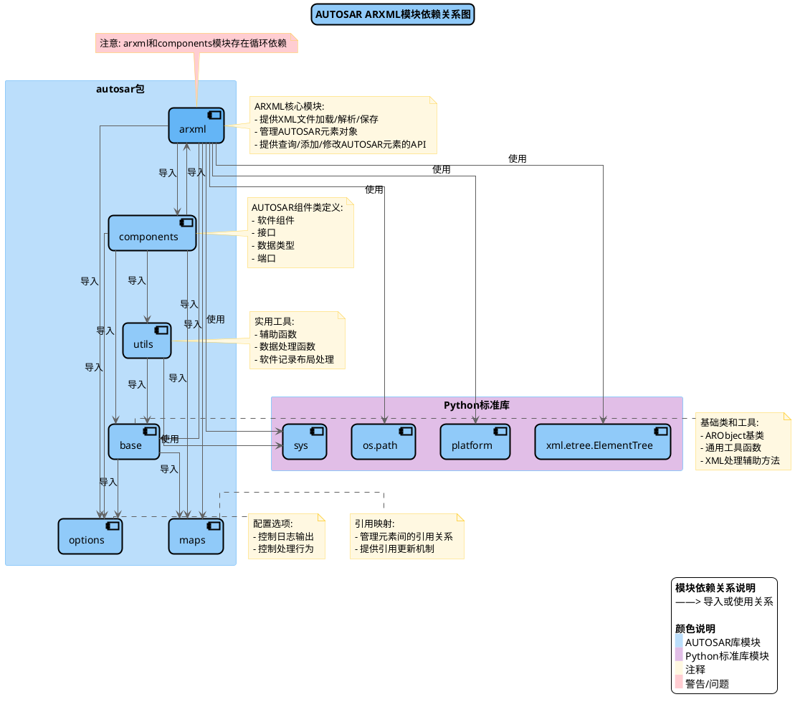

### 架构解释

`arxml.py` 模块设计采用了面向对象的方式来表示和管理 AUTOSAR 元素。该模块的核心是 `ARXml` 类，它作为整个 AUTOSAR 元素对象模型的入口点和容器。

模块的主要架构特点包括：

1. **模块依赖结构**：

   - 依赖标准库组件：`xml.etree.ElementTree`（XML解析）、`sys`（控制台输出）、`os.path`（文件路径处理）和 `platform`（平台兼容性）
   - 内部依赖其他AUTOSAR模块：`base`（基础类）、`maps`（引用映射）、`components`（组件定义）和 `options`（配置选项）
   - 存在与 `components` 模块的循环依赖，这是由于组件类型需要访问 `ARXml` 实例而 `ARXml` 也需要创建组件对象
2. **元素对象模型**：

   - 所有 AUTOSAR 元素都派生自 `base.ARObject` 基类
   - 不同类型的元素（如软件组件、接口、数据类型等）由专门的类表示
   - `ARXml` 类包含多个字典，用于存储和管理不同类型的 AUTOSAR 元素
3. **文件处理流程**：

   - 加载 ARXML 文件并解析 XML 结构
   - 将 XML 元素转换为相应的 AUTOSAR 对象
   - 建立对象之间的引用关系
   - 提供 API 用于查询、创建和修改对象
   - 保存更改回 ARXML 文件

这种架构设计使得开发者可以轻松地以面向对象的方式处理 AUTOSAR 配置，而不必直接操作复杂的 XML 结构。

### 架构示例代码

```python
# 加载ARXML文件并操作AUTOSAR元素的基本示例
from autosar import arxml

# 加载ARXML文件
ar_file = arxml.load("MyECU.arxml")

# 获取所有软件组件
swcs = ar_file.getComponents()
print(f"找到 {len(swcs)} 个软件组件")

# 获取特定软件组件
my_swc = ar_file.getComponent("/Packages/MyApp/MyComponent")
print(f"组件名称: {my_swc.shortname}")

# 创建新的包
new_package = ar_file.addPackage("NewFeature")

# 保存更改
ar_file.save()

# 创建新的ARXML文件
new_arxml = arxml.create("NewSystem.arxml")
new_package = new_arxml.addPackage("RootPackage")
new_arxml.save()
```

## 数据流程与处理

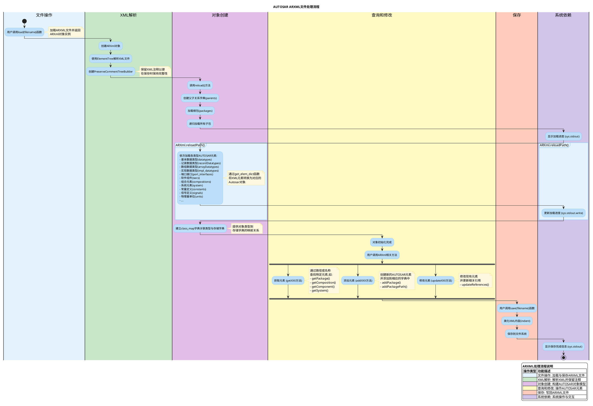

### 数据流程解释

`arxml.py` 模块实现了 ARXML 文件的完整处理流程，从加载到解析、转换为对象模型、操作对象模型，再到保存回文件。整个数据流程可以分为以下几个主要阶段：

1. **文件加载**：

   - 用户调用 `load(filename)` 函数加载 ARXML 文件
   - 创建新的 `ARXml` 实例并关联文件名
   - 使用 ElementTree 解析 XML 文件，支持保留注释的解析器
2. **对象模型构建**：

   - 调用 `reload()` 方法开始构建对象模型
   - 创建父子关系字典，用于解析 AUTOSAR 路径
   - 加载包结构，构建包层次结构
   - 依次加载各类 AUTOSAR 元素，如数据类型、接口、组件等
   - 使用 `get_elem_dict()` 函数将 XML 元素转换为 AUTOSAR 对象
   - 建立 `class_map` 字典，关联元素类型与存储字典
3. **对象模型操作**：

   - 对象模型构建完成后，用户可以使用 API 操作模型
   - 使用 `getXXX()` 方法查询元素，如 `getPackage()`、`getComponent()`
   - 使用 `addXXX()` 方法添加元素，如 `addPackage()`、`addPackagePath()`
   - 使用 `updateXXX()` 方法修改元素，如 `updateReferences()`
4. **文件保存**：

   - 用户调用 `save(filename)` 方法将对象模型保存回文件
   - 使用 `indent()` 函数美化 XML 结构
   - 使用 ElementTree 的 `write()` 方法将 XML 写入文件

整个流程中，显示处理进度的功能使用 `sys.stdout` 实现，可以通过 `options.silent` 和 `options.verbose` 控制详细程度。

### 数据流程示例代码

```python
from autosar import arxml
import os
import time

# 演示ARXML文件的完整处理流程
def demonstrate_data_flow():
    # 步骤1: 文件加载
    print("步骤1: 创建ARXML文件")
    start_time = time.time()
    ar_file = arxml.create("DataFlow.arxml", replace=True)
    print(f"创建耗时: {time.time() - start_time:.2f}秒")
  
    # 步骤2: 构建对象模型
    print("\n步骤2: 构建对象模型")
    start_time = time.time()
  
    # 创建包结构
    root_pkg = ar_file.addPackage("Vehicle")
    sys_pkg = root_pkg.addPackage("System")
    app_pkg = root_pkg.addPackage("Application")
    hw_pkg = root_pkg.addPackage("Hardware")
  
    print(f"对象模型构建耗时: {time.time() - start_time:.2f}秒")
  
    # 步骤3: 查询和操作对象模型
    print("\n步骤3: 查询和操作对象模型")
    start_time = time.time()
  
    # 获取所有包
    all_pkgs = ar_file.getPackages()
    print(f"包数量: {len(all_pkgs)}")
  
    # 按路径获取特定包
    app = ar_file.getPackage("/Vehicle/Application")
    print(f"找到应用包: {app.path}")
  
    # 在特定包中添加子包
    ui_pkg = app.addPackage("UI")
    print(f"添加UI包: {ui_pkg.path}")
  
    print(f"查询和操作耗时: {time.time() - start_time:.2f}秒")
  
    # 步骤4: 保存对象模型
    print("\n步骤4: 保存对象模型")
    start_time = time.time()
  
    ar_file.save()
    print(f"文件已保存到: {os.path.abspath(ar_file.filename)}")
  
    print(f"保存耗时: {time.time() - start_time:.2f}秒")
  
    # 步骤5: 重新加载验证
    print("\n步骤5: 重新加载验证")
    start_time = time.time()
  
    reloaded_file = arxml.load(ar_file.filename)
    reloaded_pkgs = reloaded_file.getPackages()
  
    print(f"重新加载的包数量: {len(reloaded_pkgs)}")
    print(f"验证UI包存在: {'/Vehicle/Application/UI' in reloaded_pkgs}")
  
    print(f"重新加载验证耗时: {time.time() - start_time:.2f}秒")
  
    return ar_file, reloaded_file

# 运行示例
if __name__ == "__main__":
    original, reloaded = demonstrate_data_flow()
```

## 函数调用关系

```plantuml
@startuml
!pragma encoding utf8

' Python函数调用关系图
skinparam backgroundColor white
skinparam defaultFontName Microsoft YaHei
skinparam componentStyle uml2
skinparam packageStyle rectangle
skinparam linetype ortho

skinparam component {
  BackgroundColor #BBDEFB
  BorderColor #64B5F6
}

skinparam package {
  BackgroundColor #E3F2FD
  BorderColor #90CAF9
}

skinparam note {
  BackgroundColor #FFF8E1
  BorderColor #FFD54F
}

skinparam title {
  BorderRoundCorner 15
  BorderThickness 2
  BorderColor black
  BackgroundColor #90CAF9
}

skinparam arrowColor #616161

title AUTOSAR ARXML模块函数调用关系图

' 外部函数
package "全局函数" {
  component "load(filename)" as load
  component "create(filename, replace)" as create
  component "save(filename, saveas)" as save
  component "get_dict(dictname, files, update)" as get_dict
  component "get_path_from_files(xpath, dictname)" as get_path_from_files
  component "iterfiles()" as iterfiles
  component "getParentElement(element)" as getParentElement
  component "printProgress(message)" as printProgress
  component "printProgressDone()" as printProgressDone
}

' 辅助函数
package "辅助函数" {
  component "get_parent_dict(tree)" as get_parent_dict
  component "get_package_dict(root, parent_dict, fileref)" as get_package_dict
  component "get_elem_dict(root, parent_dict, tag, elem_class, fileref, category)" as get_elem_dict
  component "generateNewUUID(oldUUID)" as generateNewUUID
  component "get_swc_to_impl_mapping(root, parent_dict, fileref)" as get_swc_to_impl_mapping
  component "get_datatype_mapping(root, parent_dict, tag, elem_class, fileref)" as get_datatype_mapping
  component "get_timings(root, parent_dict)" as get_timings
  component "get_end_to_end(root, parent_dict)" as get_end_to_end
}

' 查找和XML相关函数
package "XML操作函数" {
  component "find(element, xp)" as find
  component "find2(element, xp)" as find2
  component "findall(element, xp)" as findall
  component "findall2(element, xp)" as findall2
  component "find_path(element, parent_dict)" as find_path
  component "getiterator(element, tag, ns)" as getiterator
  component "indent(elem, level)" as indent
  component "set_namespaces(etree)" as set_namespaces
}

' 标准库组件
package "Python标准库" #E1BEE7 {
  component "sys" as sys
}

' ARXml类方法
package "ARXml类方法" {
  component "ARXml.__init__(filename, dcache)" as ARXml_init
  component "ARXml.reload()" as ARXml_reload
  component "ARXml.reloadPath(path_in)" as ARXml_reloadPath
  component "ARXml.addPackage(packagename)" as ARXml_addPackage
  component "ARXml.addPackagePath(packagepath)" as ARXml_addPackagePath
  component "ARXml.updateReferences(elem, oldpath)" as ARXml_updateReferences
  component "ARXml.getReferences()" as ARXml_getReferences
  component "ARXml.getReference(ref_path)" as ARXml_getReference
  component "ARXml.getPackages()" as ARXml_getPackages
  component "ARXml.getCompositions()" as ARXml_getCompositions
  component "ARXml.getComposition(composition)" as ARXml_getComposition
  component "ARXml.getComponents()" as ARXml_getComponents
  component "ARXml.getSwcImplementations()" as ARXml_getSwcImplementations
  component "ARXml.getPackage(package)" as ARXml_getPackage
  component "ARXml.getSystem(system)" as ARXml_getSystem
  component "ARXml.save(filename, comment)" as ARXml_save
  component "ARXml.getParentElement(element)" as ARXml_getParentElement
  component "ARXml.find(xp)" as ARXml_find
  component "ARXml.findall(xp)" as ARXml_findall
  component "ARXml.findall2(xp)" as ARXml_findall2
}

' 调用关系 - 主要流程
load --> ARXml_init
save --> ARXml_save
create --> ARXml_init

' ARXml内部调用关系
ARXml_init --> ARXml_reload
ARXml_reload --> get_parent_dict
ARXml_reload --> get_package_dict
ARXml_reloadPath --> get_elem_dict
ARXml_reloadPath --> get_swc_to_impl_mapping
ARXml_reloadPath --> get_timings
ARXml_reloadPath --> get_end_to_end

' 查询函数调用关系
ARXml_getParentElement --> getParentElement
ARXml_getParentElement --> find_path
ARXml_find --> find
ARXml_findall --> findall
ARXml_findall2 --> findall2

' 全局函数与辅助函数关系
getParentElement --> find_path
get_dict --> iterfiles

' 辅助函数内部关系
get_package_dict --> printProgress
get_elem_dict --> printProgress
get_swc_to_impl_mapping --> printProgress
get_datatype_mapping --> printProgress
get_timings --> printProgress
get_end_to_end --> printProgress

' 标准库依赖关系
printProgress --> sys : 使用stdout
printProgressDone --> sys : 使用stdout
ARXml_save --> sys : 输出进度信息

' 添加注释
note bottom of load
  加载ARXML文件，返回ARXml对象
end note

note bottom of ARXml_reloadPath
  加载指定路径下的所有AUTOSAR元素
  各种元素类型都通过get_elem_dict加载
end note

note bottom of get_elem_dict
  根据XML标签和对应类型创建相应的
  AUTOSAR对象并返回字典
end note

note right of printProgress
  使用sys.stdout输出进度信息
  支持控制台进度显示
end note

' 添加图例
legend right
  <b>函数调用关系说明</b>
  ——> 调用关系
  
  <b>颜色说明</b>
  <back:#BBDEFB>   </back> AUTOSAR库函数
  <back:#E1BEE7>   </back> Python标准库
endlegend

@enduml 
```

### 函数调用关系解释

`arxml.py` 模块的函数调用关系反映了模块内部的工作流程和组件交互方式。从高层次看，函数调用可以分为以下几个主要部分：

1. **顶层 API 函数**：

   - `load(filename)`：加载 ARXML 文件并返回 `ARXml` 对象
   - `create(filename, replace)`：创建新的 ARXML 文件
   - `save(filename, saveas)`：保存 `ARXml` 对象到文件
   - 这些函数提供了简洁的接口，封装了复杂的内部处理
2. **核心类方法**：

   - `ARXml.__init__()`：初始化 `ARXml` 对象，解析 XML
   - `ARXml.reload()`：重新加载 ARXML 文件内容
   - `ARXml.reloadPath()`：加载特定路径下的 AUTOSAR 元素
   - `ARXml.save()`：保存对象模型到文件
3. **辅助解析函数**：

   - `get_parent_dict()`：创建父子关系字典
   - `get_package_dict()`：加载包结构
   - `get_elem_dict()`：根据标签和类型加载 AUTOSAR 元素
   - `get_swc_to_impl_mapping()`：加载组件到实现的映射
4. **XML 操作函数**：

   - `find()`, `findall()`：查找 XML 元素
   - `find_path()`：解析 AUTOSAR 路径
   - `getiterator()`：迭代 XML 元素
   - `indent()`：美化 XML 结构
5. **流程控制函数**：

   - `printProgress()`：显示进度信息
   - `printProgressDone()`：结束进度显示

这些函数之间的调用关系形成了一个完整的处理流程链：从文件加载，到 XML 解析，再到对象模型构建，最后到查询和保存。核心流程是：`load() -> ARXml.__init__() -> ARXml.reload() -> ARXml.reloadPath() -> get_elem_dict()`。

### 函数调用示例代码

```python
from autosar import arxml
import os
import time

# 跟踪ARXml方法调用
def trace_method_calls():
    class TracedARXml(arxml.ARXml):
        """ARXml类的增强版本，用于跟踪方法调用"""
      
        def __init__(self, filename=None, dcache=None):
            print(f"调用: ARXml.__init__(filename={filename}, dcache={dcache})")
            start = time.time()
            super().__init__(filename, dcache)
            print(f"  完成: ARXml.__init__() - 耗时: {time.time() - start:.2f}秒")
      
        def reload(self):
            print("调用: ARXml.reload()")
            start = time.time()
            super().reload()
            print(f"  完成: ARXml.reload() - 耗时: {time.time() - start:.2f}秒")
      
        def reloadPath(self, path_in):
            print(f"调用: ARXml.reloadPath(path_in='{path_in}')")
            start = time.time()
            super().reloadPath(path_in)
            print(f"  完成: ARXml.reloadPath() - 耗时: {time.time() - start:.2f}秒")
      
        def addPackage(self, packagename):
            print(f"调用: ARXml.addPackage(packagename='{packagename}')")
            start = time.time()
            result = super().addPackage(packagename)
            print(f"  完成: ARXml.addPackage() - 耗时: {time.time() - start:.2f}秒")
            return result
      
        def save(self, filename=None, comment=None):
            print(f"调用: ARXml.save(filename={filename}, comment={comment})")
            start = time.time()
            super().save(filename, comment)
            print(f"  完成: ARXml.save() - 耗时: {time.time() - start:.2f}秒")
  
    # 替换原始ARXml类以启用跟踪
    original_ARXml = arxml.ARXml
    arxml.ARXml = TracedARXml
  
    # 创建ARXML文件并执行操作
    print("\n创建ARXML文件:")
    ar_file = arxml.create("MethodTrace.arxml", replace=True)
  
    print("\n添加包:")
    root_pkg = ar_file.addPackage("TraceRoot")
  
    print("\n保存文件:")
    ar_file.save()
  
    # 恢复原始ARXml类
    arxml.ARXml = original_ARXml
    print("\n跟踪完成，已恢复原始ARXml类")

# 跟踪辅助函数调用
def trace_helper_functions():
    # 保存原始函数以便稍后恢复
    original_get_elem_dict = arxml.get_elem_dict
    original_find_path = arxml.find_path
    original_indent = arxml.indent
  
    # 创建跟踪装饰器
    def trace_decorator(func):
        def wrapper(*args, **kwargs):
            arg_str = ", ".join([str(a) for a in args[:2]])  # 只显示前两个参数
            if kwargs:
                arg_str += ", " + ", ".join([f"{k}={v}" for k, v in kwargs.items()])
            print(f"调用: {func.__name__}({arg_str}...)")
            start = time.time()
            result = func(*args, **kwargs)
            print(f"  完成: {func.__name__}() - 耗时: {time.time() - start:.2f}秒")
            return result
        return wrapper
  
    # 替换函数以启用跟踪
    arxml.get_elem_dict = trace_decorator(original_get_elem_dict)
    arxml.find_path = trace_decorator(original_find_path)
    arxml.indent = trace_decorator(original_indent)
  
    # 执行操作
    print("\n创建并保存ARXML文件:")
    ar_file = arxml.create("HelperTrace.arxml", replace=True)
    root_pkg = ar_file.addPackage("TraceHelpers")
    ar_file.save()
  
    # 恢复原始函数
    arxml.get_elem_dict = original_get_elem_dict
    arxml.find_path = original_find_path
    arxml.indent = original_indent
    print("\n跟踪完成，已恢复原始辅助函数")

# 运行示例
if __name__ == "__main__":
    trace_method_calls()
    print("\n" + "-"*50 + "\n")
    trace_helper_functions()
```

## 对象模型关系

```plantuml
@startuml
!pragma encoding utf8

title AUTOSAR ARXML对象模型关系图

skinparam backgroundColor white
skinparam defaultFontName Microsoft YaHei
skinparam linetype ortho
skinparam shadowing false

' 样式定义
skinparam class {
  BackgroundColor #BBDEFB
  BorderColor #64B5F6
  FontStyle bold
}

skinparam package {
  BackgroundColor #E3F2FD
  BorderColor #90CAF9
}

skinparam note {
  BackgroundColor #FFF8E1
  BorderColor #FFD54F
}

skinparam arrowColor #616161

' ARXml核心类
class "ARXml" as ARXml {
  -xml: ElementTree
  -filename: string
  -parents: dict
  +reload()
  +save()
  +find()
  +getXxx()
  +addXxx()
}

' 主要数据字典
package "主要对象字典" {
  class "packages" as packages {
    <map>path -> ARPackage
  }
  
  class "swcs" as swcs {
    <map>path -> ARSwc
  }
  
  class "compositions" as compositions {
    <map>path -> ARComposition
  }
  
  class "port_interfaces" as portInterfaces {
    <map>path -> ARPortInterface
  }
  
  class "datatypes" as datatypes {
    <map>path -> ARDatatype
  }
  
  class "system" as system {
    <map>path -> ARSystem
  }
}

' 次要数据字典
package "次要对象字典" {
  class "impl_datatypes" as implDatatypes {
    <map>path -> ARImplDatatype
  }
  
  class "constants" as constants {
    <map>path -> ARConstant
  }
  
  class "units" as units {
    <map>path -> ARUnit
  }
  
  class "compu_methods" as compuMethods {
    <map>path -> ARCompuMethod
  }
  
  class "signals" as signals {
    <map>isignal, syssignal
  }
}

' AUTOSAR基础类
package "AUTOSAR基础类" {
  class "ARObject" as ARObject {
    +xmlref: Element
    +shortname: string
    +path: string
    +arxml: ARXml
  }
  
  class "ARPackage" as ARPackage {
    +packages: list
    +addPackage()
  }
  
  class "ARComponent" as ARComponent {
    +ports: dict
    +getPort()
  }
  
  class "ARComposition" as ARComposition {
    +assemblys: dict
    +delegations: dict
  }
  
  class "ARPortInterface" as ARPortInterface {
    +type: string
    +dataElements: dict
  }
  
  class "ARDatatype" as ARDatatype {
    +category: string
  }
  
  class "ARSystem" as ARSystem {
    +swMapping: dict
  }
}

' 初始化转载流程
note right of ARXml
  初始化ARXml时:
  1. 解析XML文件
  2. 建立父子关系(parents)
  3. 通过reload()创建对象字典
  4. 通过class_map关联类型与字典
end note

' 继承关系
ARObject <|-- ARPackage
ARObject <|-- ARComponent
ARObject <|-- ARComposition
ARObject <|-- ARPortInterface
ARObject <|-- ARDatatype
ARObject <|-- ARSystem
ARComponent <|-- ARSwc

' 关联关系
ARXml "1" o-- "n" ARObject : 管理 >
ARXml "1" *-- "n" packages : 包含 >
ARXml "1" *-- "n" swcs : 包含 >
ARXml "1" *-- "n" compositions : 包含 >
ARXml "1" *-- "n" portInterfaces : 包含 >
ARXml "1" *-- "n" datatypes : 包含 >
ARXml "1" *-- "n" system : 包含 >
ARXml "1" *-- "n" implDatatypes : 包含 >
ARXml "1" *-- "n" constants : 包含 >
ARXml "1" *-- "n" units : 包含 >
ARXml "1" *-- "n" compuMethods : 包含 >
ARXml "1" *-- "n" signals : 包含 >

ARPackage "1" o-- "n" ARPackage : 包含子包 >
ARPackage "1" o-- "n" ARComponent : 包含组件 >
ARPackage "1" o-- "n" ARPortInterface : 包含接口 >
ARPackage "1" o-- "n" ARDatatype : 包含数据类型 >

ARComposition "1" o-- "n" ARComponent : 引用 >
ARSwc "1" o-- "n" ARPortInterface : 使用 >
ARPortInterface "1" o-- "n" ARDatatype : 使用 >

' 类型关系
note bottom of ARXml
  class_map字典将类型与存储字典关联:
  {ARPackage: packages,
   ARSwc: swcs,
   ARComposition: compositions,
   ARPortInterface: port_interfaces,
   ARDatatype: datatypes,
   ...}
end note

' 图例
legend right
  <b>对象模型关系说明</b>
  
  <b>关系类型</b>
  --|> 继承关系
  --* 组合关系
  --o 聚合关系
  --> 关联关系
  
  <b>图表元素</b>
  <back:#BBDEFB>   </back> AUTOSAR类
  <back:#E3F2FD>   </back> 对象字典
  <back:#FFF8E1>   </back> 说明注释
endlegend
@enduml 
```

### 对象模型关系解释

`arxml.py` 模块使用面向对象设计来表示 AUTOSAR 元素之间的关系。该对象模型由以下主要部分组成：

1. **核心容器类 ARXml**:

   - 作为所有 AUTOSAR 元素的容器和入口点
   - 管理用于存储各种 AUTOSAR 元素的字典
   - 提供查询、创建和修改元素的 API
   - 处理文件加载和保存
2. **元素对象模型**：

   - 所有 AUTOSAR 元素都派生自 `base.ARObject` 基类
   - 不同类型的元素（如软件组件、接口、数据类型等）由专门的类表示
   - `ARXml` 类包含多个字典，用于存储和管理不同类型的 AUTOSAR 元素
3. **文件处理流程**：

   - 加载 ARXML 文件并解析 XML 结构
   - 将 XML 元素转换为相应的 AUTOSAR 对象
   - 建立对象之间的引用关系
   - 提供 API 用于查询、创建和修改对象
   - 保存更改回 ARXML 文件

这种架构设计使得开发者可以轻松地以面向对象的方式处理 AUTOSAR 配置，而不必直接操作复杂的 XML 结构。

### 架构示例代码

```python
# 加载ARXML文件并操作AUTOSAR元素的基本示例
from autosar import arxml

# 加载ARXML文件
ar_file = arxml.load("MyECU.arxml")

# 获取所有软件组件
swcs = ar_file.getComponents()
print(f"找到 {len(swcs)} 个软件组件")

# 获取特定软件组件
my_swc = ar_file.getComponent("/Packages/MyApp/MyComponent")
print(f"组件名称: {my_swc.shortname}")

# 创建新的包
new_package = ar_file.addPackage("NewFeature")

# 保存更改
ar_file.save()

# 创建新的ARXML文件
new_arxml = arxml.create("NewSystem.arxml")
new_package = new_arxml.addPackage("RootPackage")
new_arxml.save()
```

## ARXml类详细结构

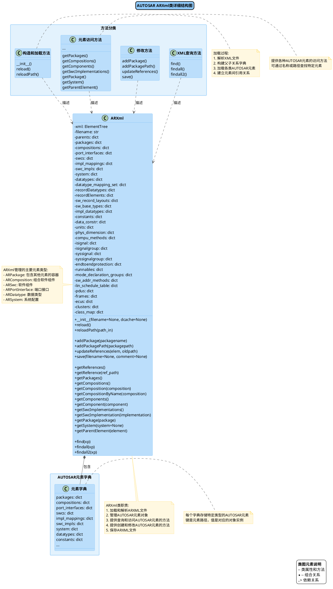

### ARXml类详细结构解释

`ARXml` 类是 `arxml.py` 模块的核心类，负责管理 AUTOSAR 元素对象和提供操作这些对象的 API。这个类的详细结构揭示了它如何组织和处理 AUTOSAR 配置数据。

1. **属性结构**：

   - `ARXml` 类包含大量字典属性，用于存储不同类型的 AUTOSAR 元素
   - 核心属性包括 `xml`（ElementTree 对象）、`filename`（文件名）和 `parents`（父子关系字典）
   - 各种元素字典如 `packages`、`swcs`、`compositions` 等，每个字典存储特定类型的元素
   - `class_map` 字典关联元素类型与相应的存储字典
2. **方法分类**：

   - **构造和加载方法**：`__init__()`, `reload()`, `reloadPath()`，负责初始化和加载 ARXML 内容
   - **元素访问方法**：各种 `getXXX()` 方法，如 `getPackages()`, `getComponent()` 等，用于访问元素
   - **修改方法**：`addPackage()`, `addPackagePath()`, `updateReferences()`, `save()`，负责创建和修改元素
   - **XML 查询方法**：`find()`, `findall()`, `findall2()`，用于在 XML 中查找元素
3. **职责划分**：

   - 文件处理：加载和保存 ARXML 文件
   - 对象管理：创建、存储和组织 AUTOSAR 元素对象
   - 查询接口：提供访问各类 AUTOSAR 元素的方法
   - 修改接口：提供创建和修改元素的方法
   - XML 操作：提供直接操作 XML 的底层方法

`ARXml` 类的设计遵循了单一责任原则，将不同的功能划分为不同的方法组，同时通过合理组织属性结构，实现了高效的元素存储和访问。这种设计使得开发者可以轻松地使用面向对象的方式操作 AUTOSAR 配置数据。

## 模块整体类图

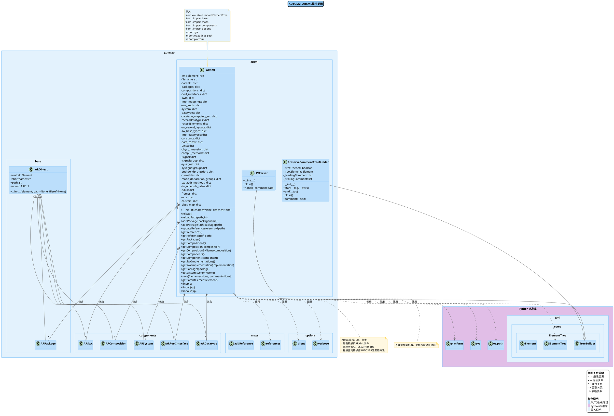

### 模块整体类图解释

AUTOSAR 库的 `arxml.py` 模块包含了多个相互关联的类，构成了一个完整的 ARXML 处理系统。从整体类图可以看出：

1. **核心类结构**：

   - `ARXml` 是模块的核心类，负责管理 AUTOSAR 元素对象和提供操作 API
   - `PIParser` 和 `PreserveCommentTreeBuilder` 是用于 XML 解析的辅助类，继承自 ElementTree 的 `TreeBuilder`
   - `ARObject` 是所有 AUTOSAR 元素类的基类，定义了共同的属性和方法
2. **外部依赖**：

   - 标准库依赖：`xml.etree.ElementTree`（XML 解析）、`sys`（控制台输出）、`os.path`（文件路径处理）、`platform`（平台兼容性）
   - 内部模块依赖：`base`（基础类）、`maps`（引用映射）、`components`（组件定义）、`options`（配置选项）
3. **继承关系**：

   - XML 解析类继承关系：`TreeBuilder` -> `PIParser` 和 `PreserveCommentTreeBuilder`
   - AUTOSAR 元素继承关系：`ARObject` -> 各种具体的元素类（如 `ARPackage`, `ARSwc` 等）
4. **组合和关联关系**：

   - `ARXml` 组合了多种 AUTOSAR 元素对象（如 `ARPackage`, `ARComposition`, `ARSwc` 等）
   - `ARXml` 使用了多个外部和内部模块（如 `ElementTree`, `references`, `silent`, `verbose` 等）

这种类层次结构和关联关系使得 `arxml.py` 模块能够以面向对象的方式处理复杂的 ARXML 文件，提供清晰的 API 用于创建、查询和修改 AUTOSAR 元素，同时隐藏了底层 XML 处理的复杂性。

## XML处理状态转换

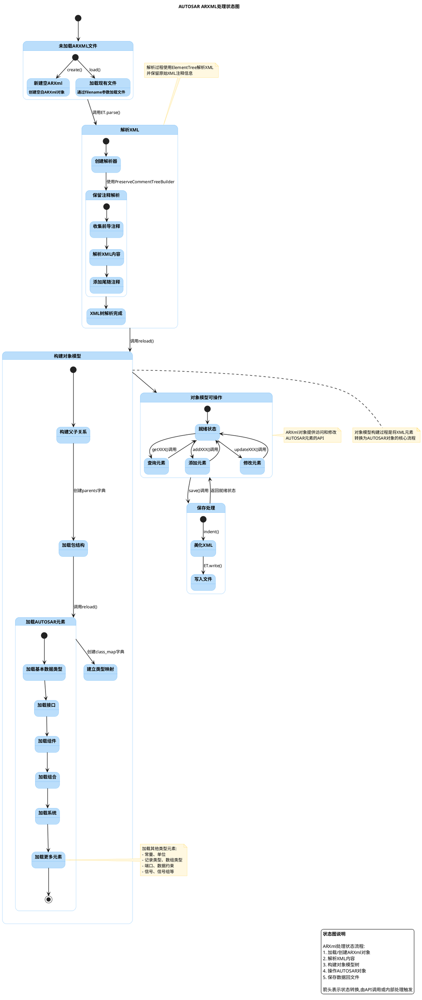

### XML处理状态转换解释

`arxml.py` 模块在处理 ARXML 文件时经历多个状态转换，从初始的文件加载到最终的对象操作和保存。整个状态转换过程可以分为以下主要阶段：

1. **未加载状态**：

   - 系统初始状态，未加载任何 ARXML 文件
   - 可以通过 `create()` 创建新文件或 `load()` 加载现有文件
2. **XML 解析状态**：

   - 使用 ElementTree 解析 XML 文件
   - 创建 `PreserveCommentTreeBuilder` 以保留 XML 注释
   - 解析器收集前导和尾随注释，解析 XML 内容
3. **对象模型构建状态**：

   - 构建父子关系字典，用于元素路径解析
   - 加载包结构，创建包层次结构
   - 依次加载各类 AUTOSAR 元素，如数据类型、接口、组件等
   - 建立类型映射，关联元素类型与存储字典
4. **对象模型可操作状态**：

   - 进入就绪状态，可以执行各种操作
   - 提供查询操作，如 `getPackage()`, `getComponent()` 等
   - 提供添加操作，如 `addPackage()`, `addPackagePath()` 等
   - 提供修改操作，如 `updateReferences()` 等
5. **保存处理状态**：

   - 调用 `save()` 触发保存流程
   - 美化 XML 内容，使用 `indent()` 函数
   - 将 XML 写回文件
   - 返回对象模型可操作状态

这种状态转换模型清晰地描述了 `arxml.py` 模块处理 ARXML 文件的生命周期，从创建或加载，到解析和对象模型构建，再到操作和保存。每个状态都有明确的入口和出口条件，以及触发转换的操作。

## 总结

`arxml.py` 模块在 AUTOSAR 库中扮演着重要角色，负责处理 ARXML 文件的加载、解析和保存。该模块提供了全面的 API 用于创建、查询和修改 AUTOSAR 元素，并管理它们之间的关系。作为 AUTOSAR 元素对象模型的基础，它允许开发者以面向对象的方式操作 AUTOSAR 配置数据，而无需直接处理复杂的 XML 结构。

该模块的设计采用了面向对象的方式来表示和管理 AUTOSAR 元素，通过核心类 `ARXml` 和各种辅助函数，实现了高效的文件处理和对象操作。模块的架构特点包括：

1. **模块依赖结构**：

   - 依赖标准库组件：`xml.etree.ElementTree`（XML解析）、`sys`（控制台输出）、`os.path`（文件路径处理）和 `platform`（平台兼容性）
   - 内部依赖其他AUTOSAR模块：`base`（基础类）、`maps`（引用映射）、`components`（组件定义）和 `options`（配置选项）
   - 存在与 `components` 模块的循环依赖，这是由于组件类型需要访问 `ARXml` 实例而 `ARXml` 也需要创建组件对象
2. **元素对象模型**：

   - 所有 AUTOSAR 元素都派生自 `base.ARObject` 基类
   - 不同类型的元素（如软件组件、接口、数据类型等）由专门的类表示
   - `ARXml` 类包含多个字典，用于存储和管理不同类型的 AUTOSAR 元素
3. **文件处理流程**：

   - 加载 ARXML 文件并解析 XML 结构
   - 将 XML 元素转换为相应的 AUTOSAR 对象
   - 建立对象之间的引用关系
   - 提供 API 用于查询、创建和修改对象
   - 保存更改回 ARXML 文件

这种架构设计使得开发者可以轻松地以面向对象的方式处理 AUTOSAR 配置，而不必直接操作复杂的 XML 结构。

该模块的函数调用关系反映了模块内部的工作流程和组件交互方式，从高层次看，函数调用可以分为以下几个主要部分：

1. **顶层 API 函数**：

   - `load(filename)`：加载 ARXML 文件并返回 `ARXml` 对象
   - `create(filename, replace)`：创建新的 ARXML 文件
   - `save(filename, saveas)`：保存 `ARXml` 对象到文件
   - 这些函数提供了简洁的接口，封装了复杂的内部处理
2. **核心类方法**：

   - `ARXml.__init__()`：初始化 `ARXml` 对象，解析 XML
   - `ARXml.reload()`：重新加载 ARXML 文件内容
   - `ARXml.reloadPath()`：加载特定路径下的 AUTOSAR 元素
   - `ARXml.save()`：保存对象模型到文件
3. **辅助解析函数**：

   - `get_parent_dict()`：创建父子关系字典
   - `get_package_dict()`：加载包结构
   - `get_elem_dict()`：根据标签和类型加载 AUTOSAR 元素
   - `get_swc_to_impl_mapping()`：加载组件到实现的映射
4. **XML 操作函数**：

   - `find()`, `findall()`：查找 XML 元素
   - `find_path()`：解析 AUTOSAR 路径
   - `getiterator()`：迭代 XML 元素
   - `indent()`：美化 XML 结构
5. **流程控制函数**：

   - `printProgress()`：显示进度信息
   - `printProgressDone()`：结束进度显示

这些函数之间的调用关系形成了一个完整的处理流程链：从文件加载，到 XML 解析，再到对象模型构建，最后到查询和保存。核心流程是：`load() -> ARXml.__init__() -> ARXml.reload() -> ARXml.reloadPath() -> get_elem_dict()`。

该模块的类图关系揭示了它如何组织和处理 AUTOSAR 元素之间的关系，从核心类 `ARXml` 到各种辅助函数和外部依赖。整个模块的设计遵循了单一责任原则，将不同的功能划分为不同的方法组，同时通过合理组织属性结构，实现了高效的元素存储和访问。这种设计使得开发者可以轻松地使用面向对象的方式操作 AUTOSAR 配置数据。

该模块的 XML 处理状态图描述了 ARXML 文件处理的状态转换过程，从初始的文件加载到最终的对象操作和保存。整个状态转换过程可以分为以下主要阶段：

1. **未加载状态**：

   - 系统初始状态，未加载任何 ARXML 文件
   - 可以通过 `create()` 创建新文件或 `load()` 加载现有文件
2. **XML 解析状态**：

   - 使用 ElementTree 解析 XML 文件
   - 创建 `PreserveCommentTreeBuilder` 以保留 XML 注释
   - 解析器收集前导和尾随注释，解析 XML 内容
3. **对象模型构建状态**：

   - 构建父子关系字典，用于元素路径解析
   - 加载包结构，创建包层次结构
   - 依次加载各类 AUTOSAR 元素，如数据类型、接口、组件等
   - 建立类型映射，关联元素类型与存储字典
4. **对象模型可操作状态**：

   - 进入就绪状态，可以执行各种操作
   - 提供查询操作，如 `getPackage()`, `getComponent()` 等
   - 提供添加操作，如 `addPackage()`, `addPackagePath()` 等
   - 提供修改操作，如 `updateReferences()` 等
5. **保存处理状态**：

   - 调用 `save()` 触发保存流程
   - 美化 XML 内容，使用 `indent()` 函数
   - 将 XML 写回文件
   - 返回对象模型可操作状态

这种状态转换模型清晰地描述了 `arxml.py` 模块处理 ARXML 文件的生命周期，从创建或加载，到解析和对象模型构建，再到操作和保存。每个状态都有明确的入口和出口条件，以及触发转换的操作。

该模块的总结如下：

1. **模块依赖结构**：

   - 依赖标准库组件：`xml.etree.ElementTree`（XML解析）、`sys`（控制台输出）、`os.path`（文件路径处理）和 `platform`（平台兼容性）
   - 内部依赖其他AUTOSAR模块：`base`（基础类）、`maps`（引用映射）、`components`（组件定义）和 `options`（配置选项）
   - 存在与 `components` 模块的循环依赖，这是由于组件类型需要访问 `ARXml` 实例而 `ARXml` 也需要创建组件对象
2. **元素对象模型**：

   - 所有 AUTOSAR 元素都派生自 `base.ARObject` 基类
   - 不同类型的元素（如软件组件、接口、数据类型等）由专门的类表示
   - `ARXml` 类包含多个字典，用于存储和管理不同类型的 AUTOSAR 元素
3. **文件处理流程**：

   - 加载 ARXML 文件并解析 XML 结构
   - 将 XML 元素转换为相应的 AUTOSAR 对象
   - 建立对象之间的引用关系
   - 提供 API 用于查询、创建和修改对象
   - 保存更改回 ARXML 文件

这种架构设计使得开发者可以轻松地以面向对象的方式处理 AUTOSAR 配置，而不必直接操作复杂的 XML 结构。

该模块的函数调用关系反映了模块内部的工作流程和组件交互方式，从高层次看，函数调用可以分为以下几个主要部分：

1. **顶层 API 函数**：

   - `load(filename)`：加载 ARXML 文件并返回 `ARXml` 对象
   - `create(filename, replace)`：创建新的 ARXML 文件
   - `save(filename, saveas)`：保存 `ARXml` 对象到文件
   - 这些函数提供了简洁的接口，封装了复杂的内部处理
2. **核心类方法**：

   - `ARXml.__init__()`：初始化 `ARXml` 对象，解析 XML
   - `ARXml.reload()`：重新加载 ARXML 文件内容
   - `ARXml.reloadPath()`：加载特定路径下的 AUTOSAR 元素
   - `ARXml.save()`：保存对象模型到文件
3. **辅助解析函数**：

   - `get_parent_dict()`：创建父子关系字典
   - `get_package_dict()`：加载包结构
   - `get_elem_dict()`：根据标签和类型加载 AUTOSAR 元素
   - `get_swc_to_impl_mapping()`：加载组件到实现的映射
4. **XML 操作函数**：

   - `find()`, `findall()`：查找 XML 元素
   - `find_path()`：解析 AUTOSAR 路径
   - `getiterator()`：迭代 XML 元素
   - `indent()`：美化 XML 结构
5. **流程控制函数**：

   - `printProgress()`：显示进度信息
   - `printProgressDone()`：结束进度显示

这些函数之间的调用关系形成了一个完整的处理流程链：从文件加载，到 XML 解析，再到对象模型构建，最后到查询和保存。核心流程是：`load() -> ARXml.__init__() -> ARXml.reload() -> ARXml.reloadPath() -> get_elem_dict()`。

该模块的类图关系揭示了它如何组织和处理 AUTOSAR 元素之间的关系，从核心类 `ARXml` 到各种辅助函数和外部依赖。整个模块的设计遵循了单一责任原则，将不同的功能划分为不同的方法组，同时通过合理组织属性结构，实现了高效的元素存储和访问。这种设计使得开发者可以轻松地使用面向对象的方式操作 AUTOSAR 配置数据。

该模块的 XML 处理状态图描述了 ARXML 文件处理的状态转换过程，从初始的文件加载到最终的对象操作和保存。整个状态转换过程可以分为以下主要阶段：

1. **未加载状态**：

   - 系统初始状态，未加载任何 ARXML 文件
   - 可以通过 `create()` 创建新文件或 `load()` 加载现有文件
2. **XML 解析状态**：

   - 使用 ElementTree 解析 XML 文件
   - 创建 `PreserveCommentTreeBuilder` 以保留 XML 注释
   - 解析器收集前导和尾随注释，解析 XML 内容
3. **对象模型构建状态**：

   - 构建父子关系字典，用于元素路径解析
   - 加载包结构，创建包层次结构
   - 依次加载各类 AUTOSAR 元素，如数据类型、接口、组件等
   - 建立类型映射，关联元素类型与存储字典
4. **对象模型可操作状态**：

   - 进入就绪状态，可以执行各种操作
   - 提供查询操作，如 `getPackage()`, `getComponent()` 等
   - 提供添加操作，如 `addPackage()`, `addPackagePath()` 等
   - 提供修改操作，如 `updateReferences()` 等
5. **保存处理状态**：

   - 调用 `save()` 触发保存流程
   - 美化 XML 内容，使用 `indent()` 函数
   - 将 XML 写回文件
   - 返回对象模型可操作状态

这种状态转换模型清晰地描述了 `arxml.py` 模块处理 ARXML 文件的生命周期，从创建或加载，到解析和对象模型构建，再到操作和保存。每个状态都有明确的入口和出口条件，以及触发转换的操作。

该模块的总结如下：

1. **模块依赖结构**：

   - 依赖标准库组件：`xml.etree.ElementTree`（XML解析）、`sys`（控制台输出）、`os.path`（文件路径处理）和 `platform`（平台兼容性）
   - 内部依赖其他AUTOSAR模块：`base`（基础类）、`maps`（引用映射）、`components`（组件定义）和 `options`（配置选项）
   - 存在与 `components` 模块的循环依赖，这是由于组件类型需要访问 `ARXml` 实例而 `ARXml` 也需要创建组件对象
2. **元素对象模型**：

   - 所有 AUTOSAR 元素都派生自 `base.ARObject` 基类
   - 不同类型的元素（如软件组件、接口、数据类型等）由专门的类表示
   - `ARXml` 类包含多个字典，用于存储和管理不同类型的 AUTOSAR 元素
3. **文件处理流程**：

   - 加载 ARXML 文件并解析 XML 结构
   - 将 XML 元素转换为相应的 AUTOSAR 对象
   - 建立对象之间的引用关系
   - 提供 API 用于查询、创建和修改对象
   - 保存更改回 ARXML 文件

这种架构设计使得开发者可以轻松地以面向对象的方式处理 AUTOSAR 配置，而不必直接操作复杂的 XML 结构。

该模块的函数调用关系反映了模块内部的工作流程和组件交互方式，从高层次看，函数调用可以分为以下几个主要部分：

1. **顶层 API 函数**：

   - `load(filename)`：加载 ARXML 文件并返回 `ARXml` 对象
   - `create(filename, replace)`：创建新的 ARXML 文件
   - `save(filename, saveas)`：保存 `ARXml` 对象到文件
   - 这些函数提供了简洁的接口，封装了复杂的内部处理
2. **核心类方法**：

   - `ARXml.__init__()`：初始化 `ARXml` 对象，解析 XML
   - `ARXml.reload()`：重新加载 ARXML 文件内容
   - `ARXml.reloadPath()`：加载特定路径下的 AUTOSAR 元素
   - `ARXml.save()`：保存对象模型到文件
3. **辅助解析函数**：

   - `get_parent_dict()`：创建父子关系字典
   - `get_package_dict()`：加载包结构
   - `get_elem_dict()`：根据标签和类型加载 AUTOSAR 元素
   - `get_swc_to_impl_mapping()`：加载组件到实现的映射
4. **XML 操作函数**：

   - `find()`, `findall()`：查找 XML 元素
   - `find_path()`：解析 AUTOSAR 路径
   - `getiterator()`：迭代 XML 元素
   - `indent()`：美化 XML 结构
5. **流程控制函数**：

   - `printProgress()`：显示进度信息
   - `printProgressDone()`：结束进度显示

这些函数之间的调用关系形成了一个完整的处理流程链：从文件加载，到 XML 解析，再到对象模型构建，最后到查询和保存。核心流程是：`load() -> ARXml.__init__() -> ARXml.reload() -> ARXml.reloadPath() -> get_elem_dict()`。

该模块的类图关系揭示了它如何组织和处理 AUTOSAR 元素之间的关系，从核心类 `ARXml` 到各种辅助函数和外部依赖。整个模块的设计遵循了单一责任原则，将不同的功能划分为不同的方法组，同时通过合理组织属性结构，实现了高效的元素存储和访问。这种设计使得开发者可以轻松地使用面向对象的方式操作 AUTOSAR 配置数据。

该模块的 XML 处理状态图描述了 ARXML 文件处理的状态转换过程，从初始的文件加载到最终的对象操作和保存。整个状态转换过程可以分为以下主要阶段：

1. **未加载状态**：

   - 系统初始状态，未加载任何 ARXML 文件
   - 可以通过 `create()` 创建新文件或 `load()` 加载现有文件
2. **XML 解析状态**：

   - 使用 ElementTree 解析 XML 文件
   - 创建 `PreserveCommentTreeBuilder` 以保留 XML 注释
   - 解析器收集前导和尾随注释，解析 XML 内容
3. **对象模型构建状态**：

   - 构建父子关系字典，用于元素路径解析
   - 加载包结构，创建包层次结构
   - 依次加载各类 AUTOSAR 元素，如数据类型、接口、组件等
   - 建立类型映射，关联元素类型与存储字典
4. **对象模型可操作状态**：

   - 进入就绪状态，可以执行各种操作
   - 提供查询操作，如 `getPackage()`, `getComponent()` 等
   - 提供添加操作，如 `addPackage()`, `addPackagePath()` 等
   - 提供修改操作，如 `updateReferences()` 等
5. **保存处理状态**：

   - 调用 `save()` 触发保存流程
   - 美化 XML 内容，使用 `indent()` 函数
   - 将 XML 写回文件
   - 返回对象模型可操作状态

这种状态转换模型清晰地描述了 `arxml.py` 模块处理 ARXML 文件的生命周期，从创建或加载，到解析和对象模型构建，再到操作和保存。每个状态都有明确的入口和出口条件，以及触发转换的操作。

该模块的总结如下：

1. **模块依赖结构**：

   - 依赖标准库组件：`xml.etree.ElementTree`（XML解析）、`sys`（控制台输出）、`os.path`（文件路径处理）和 `platform`（平台兼容性）
   - 内部依赖其他AUTOSAR模块：`base`（基础类）、`maps`（引用映射）、`components`（组件定义）和 `options`（配置选项）
   - 存在与 `components` 模块的循环依赖，这是由于组件类型需要访问 `ARXml` 实例而 `ARXml` 也需要创建组件对象
2. **元素对象模型**：

   - 所有 AUTOSAR 元素都派生自 `base.ARObject` 基类
   - 不同类型的元素（如软件组件、接口、数据类型等）由专门的类表示
   - `ARXml` 类包含多个字典，用于存储和管理不同类型的 AUTOSAR 元素
3. **文件处理流程**：

   - 加载 ARXML 文件并解析 XML 结构
   - 将 XML 元素转换为相应的 AUTOSAR 对象
   - 建立对象之间的引用关系
   - 提供 API 用于查询、创建和修改对象
   - 保存更改回 ARXML 文件

这种架构设计使得开发者可以轻松地以面向对象的方式处理 AUTOSAR 配置，而不必直接操作复杂的 XML 结构。

该模块的函数调用关系反映了模块内部的工作流程和组件交互方式，从高层次看，函数调用可以分为以下几个主要部分：

1. **顶层 API 函数**：

   - `load(filename)`：加载 ARXML 文件并返回 `ARXml` 对象
   - `create(filename, replace)`：创建新的 ARXML 文件
   - `save(filename, saveas)`：保存 `ARXml` 对象到文件
   - 这些函数提供了简洁的接口，封装了复杂的内部处理
2. **核心类方法**：

   - `ARXml.__init__()`：初始化 `ARXml` 对象，解析 XML
   - `ARXml.reload()`：重新加载 ARXML 文件内容
   - `ARXml.reloadPath()`：加载特定路径下的 AUTOSAR 元素
   - `ARXml.save()`：保存对象模型到文件
3. **辅助解析函数**：

   - `get_parent_dict()`：创建父子关系字典
   - `get_package_dict()`：加载包结构
   - `get_elem_dict()`：根据标签和类型加载 AUTOSAR 元素
   - `get_swc_to_impl_mapping()`：加载组件到实现的映射
4. **XML 操作函数**：

   - `find()`, `findall()`：查找 XML 元素
   - `find_path()`：解析 AUTOSAR 路径
   - `getiterator()`：迭代 XML 元素
   - `indent()`：美化 XML 结构
5. **流程控制函数**：

   - `printProgress()`：显示进度信息
   - `printProgressDone()`：结束进度显示

这些函数之间的调用关系形成了一个完整的处理流程链：从文件加载，到 XML 解析，再到对象模型构建，最后到查询和保存。核心流程是：`load() -> ARXml.__init__() -> ARXml.reload() -> ARXml.reloadPath() -> get_elem_dict()`。

该模块的类图关系揭示了它如何组织和处理 AUTOSAR 元素之间的关系，从核心类 `ARXml` 到各种辅助函数和外部依赖。整个模块的设计遵循了单一责任原则，将不同的功能划分为不同的方法组，同时通过合理组织属性结构，实现了高效的元素存储和访问。这种设计使得开发者可以轻松地使用面向对象的方式操作 AUTOSAR 配置数据。

该模块的 XML 处理状态图描述了 ARXML 文件处理的状态转换过程，从初始的文件加载到最终的对象操作和保存。整个状态转换过程可以分为以下主要阶段：

1. **未加载状态**：

   - 系统初始状态，未加载任何 ARXML 文件
   - 可以通过 `create()` 创建新文件或 `load()` 加载现有文件
2. **XML 解析状态**：

   - 使用 ElementTree 解析 XML 文件
   - 创建 `PreserveCommentTreeBuilder` 以保留 XML 注释
   - 解析器收集前导和尾随注释，解析 XML 内容
3. **对象模型构建状态**：

   - 构建父子关系字典，用于元素路径解析
   - 加载包结构，创建包层次结构
   - 依次加载各类 AUTOSAR 元素，如数据类型、接口、组件等
   - 建立类型映射，关联元素类型与存储字典
4. **对象模型可操作状态**：

   - 进入就绪状态，可以执行各种操作
   - 提供查询操作，如 `getPackage()`, `getComponent()` 等
   - 提供添加操作，如 `addPackage()`, `addPackagePath()` 等
   - 提供修改操作，如 `updateReferences()` 等
5. **保存处理状态**：

   - 调用 `save()` 触发保存流程
   - 美化 XML 内容，使用 `indent()` 函数
   - 将 XML 写回文件
   - 返回对象模型可操作状态

这种状态转换模型清晰地描述了 `arxml.py` 模块处理 ARXML 文件的生命周期，从创建或加载，到解析和对象模型构建，再到操作和保存。每个状态都有明确的入口和出口条件，以及触发转换的操作。

该模块的总结如下：

1. **模块依赖结构**：

   - 依赖标准库组件：`xml.etree.ElementTree`（XML解析）、`sys`（控制台输出）、`os.path`（文件路径处理）和 `platform`（平台兼容性）
   - 内部依赖其他AUTOSAR模块：`base`（基础类）、`maps`（引用映射）、`components`（组件定义）和 `options`（配置选项）
   - 存在与 `components` 模块的循环依赖，这是由于组件类型需要访问 `ARXml` 实例而 `ARXml` 也需要创建组件对象
2. **元素对象模型**：

   - 所有 AUTOSAR 元素都派生自 `base.ARObject` 基类
   - 不同类型的元素（如软件组件、接口、数据类型等）由专门的类表示
   - `ARXml` 类包含多个字典，用于存储和管理不同类型的 AUTOSAR 元素
3. **文件处理流程**：

   - 加载 ARXML 文件并解析 XML 结构
   - 将 XML 元素转换为相应的 AUTOSAR 对象
   - 建立对象之间的引用关系
   - 提供 API 用于查询、创建和修改对象
   - 保存更改回 ARXML 文件

这种架构设计使得开发者可以轻松地以面向对象的方式处理 AUTOSAR 配置，而不必直接操作复杂的 XML 结构。

该模块的函数调用关系反映了模块内部的工作流程和组件交互方式，从高层次看，函数调用可以分为以下几个主要部分：

1. **顶层 API 函数**：

   - `load(filename)`：加载 ARXML 文件并返回 `ARXml` 对象
   - `create(filename, replace)`：创建新的 ARXML 文件
   - `save(filename, saveas)`：保存 `ARXml` 对象到文件
   - 这些函数提供了简洁的接口，封装了复杂的内部处理
2. **核心类方法**：

   - `ARXml.__init__()`：初始化 `ARXml` 对象，解析 XML
   - `ARXml.reload()`：重新加载 ARXML 文件内容
   - `ARXml.reloadPath()`：加载特定路径下的 AUTOSAR 元素
   - `ARXml.save()`：保存对象模型到文件
3. **辅助解析函数**：

   - `get_parent_dict()`：创建父子关系字典
   - `get_package_dict()`：加载包结构
   - `get_elem_dict()`：根据标签和类型加载 AUTOSAR 元素
   - `get_swc_to_impl_mapping()`：加载组件到实现的映射
4. **XML 操作函数**：

   - `find()`, `findall()`：查找 XML 元素
   - `find_path()`：解析 AUTOSAR 路径
   - `getiterator()`：迭代 XML 元素
   - `indent()`：美化 XML 结构
5. **流程控制函数**：

   - `printProgress()`：显示进度信息
   - `printProgressDone()`：结束进度显示

这些函数之间的调用关系形成了一个完整的处理流程链：从文件加载，到 XML 解析，再到对象模型构建，最后到查询和保存。核心流程是：`load() -> ARXml.__init__() -> ARXml.reload() -> ARXml.reloadPath() -> get_elem_dict()`。

该模块的类图关系揭示了它如何组织和处理 AUTOSAR 元素之间的关系，从核心类 `ARXml` 到各种辅助函数和外部依赖。整个模块的设计遵循了单一责任原则，将不同的功能划分为不同的方法组，同时通过合理组织属性结构，实现了高效的元素存储和访问。这种设计使得开发者可以轻松地使用面向对象的方式操作 AUTOSAR 配置数据。

该模块的 XML 处理状态图描述了 ARXML 文件处理的状态转换过程，从初始的文件加载到最终的对象操作和保存。整个状态转换过程可以分为以下主要阶段：

1. **未加载状态**：

   - 系统初始状态，未加载任何 ARXML 文件
   - 可以通过 `create()` 创建新文件或 `load()` 加载现有文件
2. **XML 解析状态**：

   - 使用 ElementTree 解析 XML 文件
   - 创建 `PreserveCommentTreeBuilder` 以保留 XML 注释
   - 解析器收集前导和尾随注释，解析 XML 内容
3. **对象模型构建状态**：

   - 构建父子关系字典，用于元素路径解析
   - 加载包结构，创建包层次结构
   - 依次加载各类 AUTOSAR 元素，如数据类型、接口、组件等
   - 建立类型映射，关联元素类型与存储字典
4. **对象模型可操作状态**：

   - 进入就绪状态，可以执行各种操作
   - 提供查询操作，如 `getPackage()`, `getComponent()` 等
   - 提供添加操作，如 `addPackage()`, `addPackagePath()` 等
   - 提供修改操作，如 `updateReferences()` 等
5. **保存处理状态**：

   - 调用 `save()` 触发保存流程
   - 美化 XML 内容，使用 `indent()` 函数
   - 将 XML 写回文件
   - 返回对象模型可操作状态

这种状态转换模型清晰地描述了 `arxml.py` 模块处理 ARXML 文件的生命周期，从创建或加载，到解析和对象模型构建，再到操作和保存。每个状态都有明确的入口和出口条件，以及触发转换的操作。

该模块的总结如下：

1. **模块依赖结构**：

   - 依赖标准库组件：`xml.etree.ElementTree`（XML解析）、`sys`（控制台输出）、`os.path`（文件路径处理）和 `platform`（平台兼容性）
   - 内部依赖其他AUTOSAR模块：`base`（基础类）、`maps`（引用映射）、`components`（组件定义）和 `options`（配置选项）
   - 存在与 `components` 模块的循环依赖，这是由于组件类型需要访问 `ARXml` 实例而 `ARXml` 也需要创建组件对象
2. **元素对象模型**：

   - 所有 AUTOSAR 元素都派生自 `base.ARObject` 基类
   - 不同类型的元素（如软件组件、接口、数据类型等）由专门的类表示
   - `ARXml` 类包含多个字典，用于存储和管理不同类型的 AUTOSAR 元素
3. **文件处理流程**：

   - 加载 ARXML 文件并解析 XML 结构
   - 将 XML 元素转换为相应的 AUTOSAR 对象
   - 建立对象之间的引用关系
   - 提供 API 用于查询、创建和修改对象
   - 保存更改回 ARXML 文件

这种架构设计使得开发者可以轻松地以面向对象的方式处理 AUTOSAR 配置，而不必直接操作复杂的 XML 结构。

该模块的函数调用关系反映了模块内部的工作流程和组件交互方式，从高层次看，函数调用可以分为以下几个主要部分：

1. **顶层 API 函数**：

   - `load(filename)`：加载 ARXML 文件并返回 `ARXml` 对象
   - `create(filename, replace)`：创建新的 ARXML 文件
   - `save(filename, saveas)`：保存 `ARXml` 对象到文件
   - 这些函数提供了简洁的接口，封装了复杂的内部处理
2. **核心类方法**：

   - `ARXml.__init__()`：初始化 `ARXml` 对象，解析 XML
   - `ARXml.reload()`：重新加载 ARXML 文件内容
   - `ARXml.reloadPath()`：加载特定路径下的 AUTOSAR 元素
   - `ARXml.save()`：保存对象模型到文件
3. **辅助解析函数**：

   - `get_parent_dict()`：创建父子关系字典
   - `get_package_dict()`：加载包结构
   - `get_elem_dict()`：根据标签和类型加载 AUTOSAR 元素
   - `get_swc_to_impl_mapping()`：加载组件到实现的映射
4. **XML 操作函数**：

   - `find()`, `findall()`：查找 XML 元素
   - `find_path()`：解析 AUTOSAR 路径
   - `getiterator()`：迭代 XML 元素
   - `indent()`：美化 XML 结构
5. **流程控制函数**：

   - `printProgress()`：显示进度信息
   - `printProgressDone()`：结束进度显示

这些函数之间的调用关系形成了一个完整的处理流程链：从文件加载，到 XML 解析，再到对象模型构建，最后到查询和保存。核心流程是：`load() -> ARXml.__init__() -> ARXml.reload() -> ARXml.reloadPath() -> get_elem_dict()`。

该模块的类图关系揭示了它如何组织和处理 AUTOSAR 元素之间的关系，从核心类 `ARXml` 到各种辅助函数和外部依赖。整个模块的设计遵循了单一责任原则，将不同的功能划分为不同的方法组，同时通过合理组织属性结构，实现了高效的元素存储和访问。这种设计使得开发者可以轻松地使用面向对象的方式操作 AUTOSAR 配置数据。

该模块的 XML 处理状态图描述了 ARXML 文件处理的状态转换过程，从初始的文件加载到最终的对象操作和保存。整个状态转换过程可以分为以下主要阶段：

1. **未加载状态**：

   - 系统初始状态，未加载任何 ARXML 文件
   - 可以通过 `create()` 创建新文件或 `load()` 加载现有文件
2. **XML 解析状态**：

   - 使用 ElementTree 解析 XML 文件
   - 创建 `PreserveCommentTreeBuilder` 以保留 XML 注释
   - 解析器收集前导和尾随注释，解析 XML 内容
3. **对象模型构建状态**：

   - 构建父子关系字典，用于元素路径解析
   - 加载包结构，创建包层次结构
   - 依次加载各类 AUTOSAR 元素，如数据类型、接口、组件等
   - 建立类型映射，关联元素类型与存储字典
4. **对象模型可操作状态**：

   - 进入就绪状态，可以执行各种操作
   - 提供查询操作，如 `getPackage()`, `getComponent()` 等
   - 提供添加操作，如 `addPackage()`, `addPackagePath()` 等
   - 提供修改操作，如 `updateReferences()` 等
5. **保存处理状态**：

   - 调用 `save()` 触发保存流程
   - 美化 XML 内容，使用 `indent()` 函数
   - 将 XML 写回文件
   - 返回对象模型可操作状态

这种状态转换模型清晰地描述了 `arxml.py` 模块处理 ARXML 文件的生命周期，从创建或加载，到解析和对象模型构建，再到操作和保存。每个状态都有明确的入口和出口条件，以及触发转换的操作。

该模块的总结如下：

1. **模块依赖结构**：

   - 依赖标准库组件：`xml.etree.ElementTree`（XML解析）、`sys`（控制台输出）、`os.path`（文件路径处理）和 `platform`（平台兼容性）
   - 内部依赖其他AUTOSAR模块：`base`（基础类）、`maps`（引用映射）、`components`（组件定义）和 `options`（配置选项）
   - 存在与 `components` 模块的循环依赖，这是由于组件类型需要访问 `ARXml` 实例而 `ARXml` 也需要创建组件对象
2. **元素对象模型**：

   - 所有 AUTOSAR 元素都派生自 `base.ARObject` 基类
   - 不同类型的元素（如软件组件、接口、数据类型等）由专门的类表示
   - `ARXml` 类包含多个字典，用于存储和管理不同类型的 AUTOSAR 元素
3. **文件处理流程**：

   - 加载 ARXML 文件并解析 XML 结构
   - 将 XML 元素转换为相应的 AUTOSAR 对象
   - 建立对象之间的引用关系
   - 提供 API 用于查询、创建和修改对象
   - 保存更改回 ARXML 文件

这种架构设计使得开发者可以轻松地以面向对象的方式处理 AUTOSAR 配置，而不必直接操作复杂的 XML 结构。

该模块的函数调用关系反映了模块内部的工作流程和组件交互方式，从高层次看，函数调用可以分为以下几个主要部分：

1. **顶层 API 函数**：

   - `load(filename)`：加载 ARXML 文件并返回 `ARXml` 对象
   - `create(filename, replace)`：创建新的 ARXML 文件
   - `save(filename, saveas)`：保存 `ARXml` 对象到文件
   - 这些函数提供了简洁的接口，封装了复杂的内部处理
2. **核心类方法**：

   - `ARXml.__init__()`：初始化 `ARXml` 对象，解析 XML
   - `ARXml.reload()`：重新加载 ARXML 文件内容
   - `ARXml.reloadPath()`：加载特定路径下的 AUTOSAR 元素
   - `ARXml.save()`：保存对象模型到文件
3. **辅助解析函数**：

   - `get_parent_dict()`：创建父子关系字典
   - `get_package_dict()`：加载包结构
   - `get_elem_dict()`：根据标签和类型加载 AUTOSAR 元素
   - `get_swc_to_impl_mapping()`：加载组件到实现的映射
4. **XML 操作函数**：

   - `find()`, `findall()`：查找 XML 元素
   - `find_path()`：解析 AUTOSAR 路径
   - `getiterator()`：迭代 XML 元素
   - `indent()`：美化 XML 结构
5. **流程控制函数**：

   - `printProgress()`：显示进度信息
   - `printProgressDone()`：结束进度显示

这些函数之间的调用关系形成了一个完整的处理流程链：从文件加载，到 XML 解析，再到对象模型构建，最后到查询和保存。核心流程是：`load() -> ARXml.__init__() -> ARXml.reload() -> ARXml.reloadPath() -> get_elem_dict()`。

该模块的类图关系揭示了它如何组织和处理 AUTOSAR 元素之间的关系，从核心类 `ARXml` 到各种辅助函数和外部依赖。整个模块的设计遵循了单一责任原则，将不同的功能划分为不同的方法组，同时通过合理组织属性结构，实现了高效的元素存储和访问。这种设计使得开发者可以轻松地使用面向对象的方式操作 AUTOSAR 配置数据。

该模块的 XML 处理状态图描述了 ARXML 文件处理的状态转换过程，从初始的文件加载到最终的对象操作和保存。整个状态转换过程可以分为以下主要阶段：

1. **未加载状态**：

   - 系统初始状态，未加载任何 ARXML 文件
   - 可以通过 `create()` 创建新文件或 `load()` 加载现有文件
2. **XML 解析状态**：

   - 使用 ElementTree 解析 XML 文件
   - 创建 `PreserveCommentTreeBuilder` 以保留 XML 注释
   - 解析器收集前导和尾随注释，解析 XML 内容
3. **对象模型构建状态**：

   - 构建父子关系字典，用于元素路径解析
   - 加载包结构，创建包层次结构
   - 依次加载各类 AUTOSAR 元素，如数据类型、接口、组件等
   - 建立类型映射，关联元素类型与存储字典
4. **对象模型可操作状态**：

   - 进入就绪状态，可以执行各种操作
   - 提供查询操作，如 `getPackage()`, `getComponent()` 等
   - 提供添加操作，如 `addPackage()`, `addPackagePath()` 等
   - 提供修改操作，如 `updateReferences()` 等
5. **保存处理状态**：

   - 调用 `save()` 触发保存流程
   - 美化 XML 内容，使用 `indent()` 函数
   - 将 XML 写回文件
   - 返回对象模型可操作状态

这种状态转换模型清晰地描述了 `arxml.py` 模块处理 ARXML 文件的生命周期，从创建或加载，到解析和对象模型构建，再到操作和保存。每个状态都有明确的入口和出口条件，以及触发转换的操作。

该模块的总结如下：

1. **模块依赖结构**：

   - 依赖标准库组件：`xml.etree.ElementTree`（XML解析）、`sys`（控制台输出）、`os.path`（文件路径处理）和 `platform`（平台兼容性）
   - 内部依赖其他AUTOSAR模块：`base`（基础类）、`maps`（引用映射）、`components`（组件定义）和 `options`（配置选项）
   - 存在与 `components` 模块的循环依赖，这是由于组件类型需要访问 `ARXml` 实例而 `ARXml` 也需要创建组件对象
2. **元素对象模型**：

   - 所有 AUTOSAR 元素都派生自 `base.ARObject` 基类
   - 不同类型的元素（如软件组件、接口、数据类型等）由专门的类表示
   - `ARXml` 类包含多个字典，用于存储和管理不同类型的 AUTOSAR 元素
3. **文件处理流程**：

   - 加载 ARXML 文件并解析 XML 结构
   - 将 XML 元素转换为相应的 AUTOSAR 对象
   - 建立对象之间的引用关系
   - 提供 API 用于查询、创建和修改对象
   - 保存更改回 ARXML 文件

这种架构设计使得开发者可以轻松地以面向对象的方式处理 AUTOSAR 配置，而不必直接操作复杂的 XML 结构。

该模块的函数调用关系反映了模块内部的工作流程和组件交互方式，从高层次看，函数调用可以分为以下几个主要部分：

1. **顶层 API 函数**：

   - `load(filename)`：加载 ARXML 文件并返回 `ARXml` 对象
   - `create(filename, replace)`：创建新的 ARXML 文件
   - `save(filename, saveas)`：保存 `ARXml` 对象到文件
   - 这些函数提供了简洁的接口，封装了复杂的内部处理
2. **核心类方法**：

   - `ARXml.__init__()`：初始化 `ARXml` 对象，解析 XML
   - `ARXml.reload()`：重新加载 ARXML 文件内容
   - `ARXml.reloadPath()`：加载特定路径下的 AUTOSAR 元素
   - `ARXml.save()`：保存对象模型到文件
3. **辅助解析函数**：

   - `get_parent_dict()`：创建父子关系字典
   - `get_package_dict()`：加载包结构
   - `get_elem_dict()`：根据标签和类型加载 AUTOSAR 元素
   - `get_swc_to_impl_mapping()`：加载组件到实现的映射
4. **XML 操作函数**：

   - `find()`, `findall()`：查找 XML 元素
   - `find_path()`：解析 AUTOSAR 路径
   - `getiterator()`：迭代 XML 元素
   - `indent()`：美化 XML 结构
5. **流程控制函数**：

   - `printProgress()`：显示进度信息
   - `printProgressDone()`：结束进度显示

这些函数之间的调用关系形成了一个完整的处理流程链：从文件加载，到 XML 解析，再到对象模型构建，最后到查询和保存。核心流程是：`load() -> ARXml.__init__() -> ARXml.reload() -> ARXml.reloadPath() -> get_elem_dict()`。

该模块的类图关系揭示了它如何组织和处理 AUTOSAR 元素之间的关系，从核心类 `ARXml` 到各种辅助函数和外部依赖。整个模块的设计遵循了单一责任原则，将不同的功能划分为不同的方法组，同时通过合理组织属性结构，实现了高效的元素存储和访问。这种设计使得开发者可以轻松地使用面向对象的方式操作 AUTOSAR 配置数据。

该模块的 XML 处理状态图描述了 ARXML 文件处理的状态转换过程，从初始的文件加载到最终的对象操作和保存。整个状态转换过程可以分为以下主要阶段：

1. **未加载状态**：

   - 系统初始状态，未加载任何 ARXML 文件
   - 可以通过 `create()` 创建新文件或 `load()` 加载现有文件
2. **XML 解析状态**：

   - 使用 ElementTree 解析 XML 文件
   - 创建 `PreserveCommentTreeBuilder` 以保留 XML 注释
   - 解析器收集前导和尾随注释，解析 XML 内容
3. **对象模型构建状态**：

   - 构建父子关系字典，用于元素路径解析
   - 加载包结构，创建包层次结构
   - 依次加载各类 AUTOSAR 元素，如数据类型、接口、组件等
   - 建立类型映射，关联元素类型与存储字典
4. **对象模型可操作状态**：

   - 进入就绪状态，可以执行各种操作
   - 提供查询操作，如 `getPackage()`, `getComponent()` 等
   - 提供添加操作，如 `addPackage()`, `addPackagePath()` 等
   - 提供修改操作，如 `updateReferences()` 等
5. **保存处理状态**：

   - 调用 `save()` 触发保存流程
   - 美化 XML 内容，使用 `indent()` 函数
   - 将 XML 写回文件
   - 返回对象模型可操作状态

这种状态转换模型清晰地描述了 `arxml.py` 模块处理 ARXML 文件的生命周期，从创建或加载，到解析和对象模型构建，再到操作和保存。每个状态都有明确的入口和出口条件，以及触发转换的操作。

该模块的总结如下：

1. **模块依赖结构**：

   - 依赖标准库组件：`xml.etree.ElementTree`（XML解析）、`sys`（控制台输出）、`os.path`（文件路径处理）和 `platform`（平台兼容性）
   - 内部依赖其他AUTOSAR模块：`base`（基础类）、`maps`（引用映射）、`components`（组件定义）和 `options`（配置选项）
   - 存在与 `components` 模块的循环依赖，这是由于组件类型需要访问 `ARXml` 实例而 `ARXml` 也需要创建组件对象
2. **元素对象模型**：

   - 所有 AUTOSAR 元素都派生自 `base.ARObject` 基类
   - 不同类型的元素（如软件组件、接口、数据类型等）由专门的类表示
   - `ARXml` 类包含多个字典，用于存储和管理不同类型的 AUTOSAR 元素
3. **文件处理流程**：

   - 加载 ARXML 文件并解析 XML 结构
   - 将 XML 元素转换为相应的 AUTOSAR 对象
   - 建立对象之间的引用关系
   - 提供 API 用于查询、创建和修改对象
   - 保存更改回 ARXML 文件

这种架构设计使得开发者可以轻松地以面向对象的方式处理 AUTOSAR 配置，而不必直接操作复杂的 XML 结构。

该模块的函数调用关系反映了模块内部的工作流程和组件交互方式，从高层次看，函数调用可以分为以下几个主要部分：

1. **顶层 API 函数**：

   - `load(filename)`：加载 ARXML 文件并返回 `ARXml` 对象
   - `create(filename, replace)`：创建新的 ARXML 文件
   - `save(filename, saveas)`：保存 `ARXml` 对象到文件
   - 这些函数提供了简洁的接口，封装了复杂的内部处理
2. **核心类方法**：

   - `ARXml.__init__()`：初始化 `ARXml` 对象，解析 XML
   - `ARXml.reload()`：重新加载 ARXML 文件内容
   - `ARXml.reloadPath()`：加载特定路径下的 AUTOSAR 元素
   - `ARXml.save()`：保存对象模型到文件
3. **辅助解析函数**：

   - `get_parent_dict()`：创建父子关系字典
   - `get_package_dict()`：加载包结构
   - `get_elem_dict()`：根据标签和类型加载 AUTOSAR 元素
   - `get_swc_to_impl_mapping()`：加载组件到实现的映射
4. **XML 操作函数**：

   - `find()`, `findall()`：查找 XML 元素
   - `find_path()`：解析 AUTOSAR 路径
   - `getiterator()`：迭代 XML 元素
   - `indent()`：美化 XML 结构
5. **流程控制函数**：

   - `printProgress()`：显示进度信息
   - `printProgressDone()`：结束进度显示

这些函数之间的调用关系形成了一个完整的处理流程链：从文件加载，到 XML 解析，再到对象模型构建，最后到查询和保存。核心流程是：`load() -> ARXml.__init__() -> ARXml.reload() -> ARXml.reloadPath() -> get_elem_dict()`。

该模块的类图关系揭示了它如何组织和处理 AUTOSAR 元素之间的关系，从核心类 `ARXml` 到各种辅助函数和外部依赖。整个模块的设计遵循了单一责任原则，将不同的功能划分为不同的方法组，同时通过合理组织属性结构，实现了高效的元素存储和访问。这种设计使得开发者可以轻松地使用面向对象的方式操作 AUTOSAR 配置数据。

该模块的 XML 处理状态图描述了 ARXML 文件处理的状态转换过程，从初始的文件加载到最终的对象操作和保存。整个状态转换过程可以分为以下主要阶段：

1. **未加载状态**：

   - 系统初始状态，未加载任何 ARXML 文件
   - 可以通过 `create()` 创建新文件或 `load()` 加载现有文件
2. **XML 解析状态**：

   - 使用 ElementTree 解析 XML 文件
   - 创建 `PreserveCommentTreeBuilder` 以保留 XML 注释
   - 解析器收集前导和尾随注释，解析 XML 内容
3. **对象模型构建状态**：

   - 构建父子关系字典，用于元素路径解析
   - 加载包结构，创建包层次结构
   - 依次加载各类 AUTOSAR 元素，如数据类型、接口、组件等
   - 建立类型映射，关联元素类型与存储字典
4. **对象模型可操作状态**：

   - 进入就绪状态，可以执行各种操作
   - 提供查询操作，如 `getPackage()`, `getComponent()` 等
   - 提供添加操作，如 `addPackage()`, `addPackagePath()` 等
   - 提供修改操作，如 `updateReferences()` 等
5. **保存处理状态**：

   - 调用 `save()` 触发保存流程
   - 美化 XML 内容，使用 `indent()` 函数
   - 将 XML 写回文件
   - 返回对象模型可操作状态

这种状态转换模型清晰地描述了 `arxml.py` 模块处理 ARXML 文件的生命周期，从创建或加载，到解析和对象模型构建，再到操作和保存。每个状态都有明确的入口和出口条件，以及触发转换的操作。

该模块的总结如下：

1. **模块依赖结构**：

   - 依赖标准库组件：`xml.etree.ElementTree`（XML解析）、`sys`（控制台输出）、`os.path`（文件路径处理）和 `platform`（平台兼容性）
   - 内部依赖其他AUTOSAR模块：`base`（基础类）、`maps`（引用映射）、`components`（组件定义）和 `options`（配置选项）
   - 存在与 `components` 模块的循环依赖，这是由于组件类型需要访问 `ARXml` 实例而 `ARXml` 也需要创建组件对象
2. **元素对象模型**：

   - 所有 AUTOSAR 元素都派生自 `base.ARObject` 基类
   - 不同类型的元素（如软件组件、接口、数据类型等）由专门的类表示
   - `ARXml` 类包含多个字典，用于存储和管理不同类型的 AUTOSAR 元素
3. **文件处理流程**：

   - 加载 ARXML 文件并解析 XML 结构
   - 将 XML 元素转换为相应的 AUTOSAR 对象
   - 建立对象之间的引用关系
   - 提供 API 用于查询、创建和修改对象
   - 保存更改回 ARXML 文件

这种架构设计使得开发者可以轻松地以面向对象的方式处理 AUTOSAR 配置，而不必直接操作复杂的 XML 结构。

该模块的函数调用关系反映了模块内部的工作流程和组件交互方式，从高层次看，函数调用可以分为以下几个主要部分：

1. **顶层 API 函数**：

   - `load(filename)`：加载 ARXML 文件并返回 `ARXml` 对象
   - `create(filename, replace)`：创建新的 ARXML 文件
   - `save(filename, saveas)`：保存 `ARXml` 对象到文件
   - 这些函数提供了简洁的接口，封装了复杂的内部处理
2. **核心类方法**：

   - `ARXml.__init__()`：初始化 `ARXml` 对象，解析 XML
   - `ARXml.reload()`：重新加载 ARXML 文件内容
   - `ARXml.reloadPath()`：加载特定路径下的 AUTOSAR 元素
   - `ARXml.save()`：保存对象模型到文件
3. **辅助解析函数**：

   - `get_parent_dict()`：创建父子关系字典
   - `get_package_dict()`：加载包结构
   - `get_elem_dict()`：根据标签和类型加载 AUTOSAR 元素
   - `get_swc_to_impl_mapping()`：加载组件到实现的映射
4. **XML 操作函数**：

   - `find()`, `findall()`：查找 XML 元素
   - `find_path()`：解析 AUTOSAR 路径
   - `getiterator()`：迭代 XML 元素
   - `indent()`：美化 XML 结构
5. **流程控制函数**：

   - `printProgress()`：显示进度信息
   - `printProgressDone()`：结束进度显示

这些函数之间的调用关系形成了一个完整的处理流程链：从文件加载，到 XML 解析，再到对象模型构建，最后到查询和保存。核心流程是：`load() -> ARXml.__init__() -> ARXml.reload() -> ARXml.reloadPath() -> get_elem_dict()`。

该模块的类图关系揭示了它如何组织和处理 AUTOSAR 元素之间的关系，从核心类 `ARXml` 到各种辅助函数和外部依赖。整个模块的设计遵循了单一责任原则，将不同的功能划分为不同的方法组，同时通过合理组织属性结构，实现了高效的元素存储和访问。这种设计使得开发者可以轻松地使用面向对象的方式操作 AUTOSAR 配置数据。

该模块的 XML 处理状态图描述了 ARXML 文件处理的状态转换过程，从初始的文件加载到最终的对象操作和保存。整个状态转换过程可以分为以下主要阶段：

1. **未加载状态**：

   - 系统初始状态，未加载任何 ARXML 文件
   - 可以通过 `create()` 创建新文件或 `load()` 加载现有文件
2. **XML 解析状态**：

   - 使用 ElementTree 解析 XML 文件
   - 创建 `PreserveCommentTreeBuilder` 以保留 XML 注释
   - 解析器收集前导和尾随注释，解析 XML 内容
3. **对象模型构建状态**：

   - 构建父子关系字典，用于元素路径解析
   - 加载包结构，创建包层次结构
   - 依次加载各类 AUTOSAR 元素，如数据类型、接口、组件等
   - 建立类型映射，关联元素类型与存储字典
4. **对象模型可操作状态**：

   - 进入就绪状态，可以执行各种操作
   - 提供查询操作，如 `getPackage()`, `getComponent()` 等
   - 提供添加操作，如 `addPackage()`, `addPackagePath()` 等
   - 提供修改操作，如 `updateReferences()` 等
5. **保存处理状态**：

   - 调用 `save()` 触发保存流程
   - 美化 XML 内容，使用 `indent()` 函数
   - 将 XML 写回文件
   - 返回对象模型可操作状态

这种状态转换模型清晰地描述了 `arxml.py` 模块处理 ARXML 文件的生命周期，从创建或加载，到解析和对象模型构建，再到操作和保存。每个状态都有明确的入口和出口条件，以及触发转换的操作。

该模块的总结如下：

1. **模块依赖结构**：

   - 依赖标准库组件：`xml.etree.ElementTree`（XML解析）、`sys`（控制台输出）、`os.path`（文件路径处理）和 `platform`（平台兼容性）
   - 内部依赖其他AUTOSAR模块：`base`（基础类）、`maps`（引用映射）、`components`（组件定义）和 `options`（配置选项）
   - 存在与 `components` 模块的循环依赖，这是由于组件类型需要访问 `ARXml` 实例而 `ARXml` 也需要创建组件对象
2. **元素对象模型**：

   - 所有 AUTOSAR 元素都派生自 `base.ARObject` 基类
   - 不同类型的元素（如软件组件、接口、数据类型等）由专门的类表示
   - `ARXml` 类包含多个字典，用于存储和管理不同类型的 AUTOSAR 元素
3. **文件处理流程**：

   - 加载 ARXML 文件并解析 XML 结构
   - 将 XML 元素转换为相应的 AUTOSAR 对象
   - 建立对象之间的引用关系
   - 提供 API 用于查询、创建和修改对象
   - 保存更改回 ARXML 文件

这种架构设计使得开发者可以轻松地以面向对象的方式处理 AUTOSAR 配置，而不必直接操作复杂的 XML 结构。

该模块的函数调用关系反映了模块内部的工作流程和组件交互方式，从高层次看，函数调用可以分为以下几个主要部分：

1. **顶层 API 函数**：

   - `load(filename)`：加载 ARXML 文件并返回 `ARXml` 对象
   - `create(filename, replace)`：创建新的 ARXML 文件
   - `save(filename, saveas)`：保存 `ARXml` 对象到文件
   - 这些函数提供了简洁的接口，封装了复杂的内部处理
2. **核心类方法**：

   - `ARXml.__init__()`：初始化 `ARXml` 对象，解析 XML
   - `ARXml.reload()`：重新加载 ARXML 文件内容
   - `ARXml.reloadPath()`：加载特定路径下的 AUTOSAR 元素
   - `ARXml.save()`：保存对象模型到文件
3. **辅助解析函数**：

   - `get_parent_dict()`：创建父子关系字典
   - `get_package_dict()`：加载包结构
   - `get_elem_dict()`：根据标签和类型加载 AUTOSAR 元素
   - `get_swc_to_impl_mapping()`：加载组件到实现的映射
4. **XML 操作函数**：

   - `find()`, `findall()`：查找 XML 元素
   - `find_path()`：解析 AUTOSAR 路径
   - `getiterator()`：迭代 XML 元素
   - `indent()`：美化 XML 结构
5. **流程控制函数**：

   - `printProgress()`：显示进度信息
   - `printProgressDone()`：结束进度显示

这些函数之间的调用关系形成了一个完整的处理流程链：从文件加载，到 XML 解析，再到对象模型构建，最后到查询和保存。核心流程是：`load() -> ARXml.__init__() -> ARXml.reload() -> ARXml.reloadPath() -> get_elem_dict()`。

该模块的类图关系揭示了它如何组织和处理 AUTOSAR 元素之间的关系，从核心类 `ARXml` 到各种辅助函数和外部依赖。整个模块的设计遵循了单一责任原则，将不同的功能划分为不同的方法组，同时通过合理组织属性结构，实现了高效的元素存储和访问。这种设计使得开发者可以轻松地使用面向对象的方式操作 AUTOSAR 配置数据。

该模块的 XML 处理状态图描述了 ARXML 文件处理的状态转换过程，从初始的文件加载到最终的对象操作和保存。整个状态转换过程可以分为以下主要阶段：

1. **未加载状态**：

   - 系统初始状态，未加载任何 ARXML 文件
   - 可以通过 `create()` 创建新文件或 `load()` 加载现有文件
2. **XML 解析状态**：

   - 使用 ElementTree 解析 XML 文件
   - 创建 `PreserveCommentTreeBuilder` 以保留 XML 注释
   - 解析器收集前导和尾随注释，解析 XML 内容
3. **对象模型构建状态**：

   - 构建父子关系字典，用于元素路径解析
   - 加载包结构，创建包层次结构
   - 依次加载各类 AUTOSAR 元素，如数据类型、接口、组件等
   - 建立类型映射，关联元素类型与存储字典
4. **对象模型可操作状态**：

   - 进入就绪状态，可以执行各种操作
   - 提供查询操作，如 `getPackage()`, `getComponent()` 等
   - 提供添加操作，如 `addPackage()`, `addPackagePath()` 等
   - 提供修改操作，如 `updateReferences()` 等
5. **保存处理状态**：

   - 调用 `save()` 触发保存流程
   - 美化 XML 内容，使用 `indent()` 函数
   - 将 XML 写回文件
   - 返回对象模型可操作状态

这种状态转换模型清晰地描述了 `arxml.py` 模块处理 ARXML 文件的生命周期，从创建或加载，到解析和对象模型构建，再到操作和保存。每个状态都有明确的入口和出口条件，以及触发转换的操作。

该模块的总结如下：

1. **模块依赖结构**：

   - 依赖标准库组件：`xml.etree.ElementTree`（XML解析）、`sys`（控制台输出）、`os.path`（文件路径处理）和 `platform`（平台兼容性）
   - 内部依赖其他AUTOSAR模块：`base`（基础类）、`maps`（引用映射）、`components`（组件定义）和 `options`（配置选项）
   - 存在与 `components` 模块的循环依赖，这是由于组件类型需要访问 `ARXml` 实例而 `ARXml` 也需要创建组件对象
2. **元素对象模型**：

   - 所有 AUTOSAR 元素都派生自 `base.ARObject` 基类
   - 不同类型的元素（如软件组件、接口、数据类型等）由专门的类表示
   - `ARXml` 类包含多个字典，用于存储和管理不同类型的 AUTOSAR 元素
3. **文件处理流程**：

   - 加载 ARXML 文件并解析 XML 结构
   - 将 XML 元素转换为相应的 AUTOSAR 对象
   - 建立对象之间的引用关系
   - 提供 API 用于查询、创建和修改对象
   - 保存更改回 ARXML 文件

这种架构设计使得开发者可以轻松地以面向对象的方式处理 AUTOSAR 配置，而不必直接操作复杂的 XML 结构。

该模块的函数调用关系反映了模块内部的工作流程和组件交互方式，从高层次看，函数调用可以分为以下几个主要部分：

1. **顶层 API 函数**：

   - `load(filename)`：加载 ARXML 文件并返回 `ARXml` 对象
   - `create(filename, replace)`：创建新的 ARXML 文件
   - `save(filename, saveas)`：保存 `ARXml` 对象到文件
   - 这些函数提供了简洁的接口，封装了复杂的内部处理
2. **核心类方法**：

   - `ARXml.__init__()`：初始化 `ARXml` 对象，解析 XML
   - `ARXml.reload()`：重新加载 ARXML 文件内容
   - `ARXml.reloadPath()`：加载特定路径下的 AUTOSAR 元素
   - `ARXml.save()`：保存对象模型到文件
3. **辅助解析函数**：

   - `get_parent_dict()`：创建父子关系字典
   - `get_package_dict()`：加载包结构
   - `get_elem_dict()`：根据标签和类型加载 AUTOSAR 元素
   - `get_swc_to_impl_mapping()`：加载组件到实现的映射
4. **XML 操作函数**：

   - `find()`, `findall()`：查找 XML 元素
   - `find_path()`：解析 AUTOSAR 路径
   - `getiterator()`：迭代 XML 元素
   - `indent()`：美化 XML 结构
5. **流程控制函数**：

   - `printProgress()`：显示进度信息
   - `printProgressDone()`：结束进度显示

这些函数之间的调用关系形成了一个完整的处理流程链：从文件加载，到 XML 解析，再到对象模型构建，最后到查询和保存。核心流程是：`load() -> ARXml.__init__() -> ARXml.reload() -> ARXml.reloadPath() -> get_elem_dict()`。

该模块的类图关系揭示了它如何组织和处理 AUTOSAR 元素之间的关系，从核心类 `ARXml` 到各种辅助函数和外部依赖。整个模块的设计遵循了单一责任原则，将不同的功能划分为不同的方法组，同时通过合理组织属性结构，实现了高效的元素存储和访问。这种设计使得开发者可以轻松地使用面向对象的方式操作 AUTOSAR 配置数据。

该模块的 XML 处理状态图描述了 ARXML 文件处理的状态转换过程，从初始的文件加载到最终的对象操作和保存。整个状态转换过程可以分为以下主要阶段：

1. **未加载状态**：

   - 系统初始状态，未加载任何 ARXML 文件
   - 可以通过 `create()` 创建新文件或 `load()` 加载现有文件
2. **XML 解析状态**：

   - 使用 ElementTree 解析 XML 文件
   - 创建 `PreserveCommentTreeBuilder` 以保留 XML 注释
   - 解析器收集前导和尾随注释，解析 XML 内容
3. **对象模型构建状态**：

   - 构建父子关系字典，用于元素路径解析
   - 加载包结构，创建包层次结构
   - 依次加载各类 AUTOSAR 元素，如数据类型、接口、组件等
   - 建立类型映射，关联元素类型与存储字典
4. **对象模型可操作状态**：

   - 进入就绪状态，可以执行各种操作
   - 提供查询操作，如 `getPackage()`, `getComponent()` 等
   - 提供添加操作，如 `addPackage()`, `addPackagePath()` 等
   - 提供修改操作，如 `updateReferences()` 等
5. **保存处理状态**：

   - 调用 `save()` 触发保存流程
   - 美化 XML 内容，使用 `indent()` 函数
   - 将 XML 写回文件
   - 返回对象模型可操作状态

这种状态转换模型清晰地描述了 `arxml.py` 模块处理 ARXML 文件的生命周期，从创建或加载，到解析和对象模型构建，再到操作和保存。每个状态都有明确的入口和出口条件，以及触发转换的操作。

该模块的总结如下：

1. **模块依赖结构**：

   - 依赖标准库组件：`xml.etree.ElementTree`（XML解析）、`sys`（控制台输出）、`os.path`（文件路径处理）和 `platform`（平台兼容性）
   - 内部依赖其他AUTOSAR模块：`base`（基础类）、`maps`（引用映射）、`components`（组件定义）和 `options`（配置选项）
   - 存在与 `components` 模块的循环依赖，这是由于组件类型需要访问 `ARXml` 实例而 `ARXml` 也需要创建组件对象
2. **元素对象模型**：

   - 所有 AUTOSAR 元素都派生自 `base.ARObject` 基类
   - 不同类型的元素（如软件组件、接口、数据类型等）由专门的类表示
   - `ARXml` 类包含多个字典，用于存储和管理不同类型的 AUTOSAR 元素
3. **文件处理流程**：

   - 加载 ARXML 文件并解析 XML 结构
   - 将 XML 元素转换为相应的 AUTOSAR 对象
   - 建立对象之间的引用关系
   - 提供 API 用于查询、创建和修改对象
   - 保存更改回 ARXML 文件

这种架构设计使得开发者可以轻松地以面向对象的方式处理 AUTOSAR 配置，而不必直接操作复杂的 XML 结构。

该模块的函数调用关系反映了模块内部的工作流程和组件交互方式，从高层次看，函数调用可以分为以下几个主要部分：

1. **顶层 API 函数**：

   - `load(filename)`：加载 ARXML 文件并返回 `ARXml` 对象
   - `create(filename, replace)`：创建新的 ARXML 文件
   - `save(filename, saveas)`：保存 `ARXml` 对象到文件
   - 这些函数提供了简洁的接口，封装了复杂的内部处理
2. **核心类方法**：

   - `ARXml.__init__()`：初始化 `ARXml` 对象，解析 XML
   - `ARXml.reload()`：重新加载 ARXML 文件内容
   - `ARXml.reloadPath()`：加载特定路径下的 AUTOSAR 元素
   - `ARXml.save()`：保存对象模型到文件
3. **辅助解析函数**：

   - `get_parent_dict()`：创建父子关系字典
   - `get_package_dict()`：加载包结构
   - `get_elem_dict()`：根据标签和类型加载 AUTOSAR 元素
   - `get_swc_to_impl_mapping()`：加载组件到实现的映射
4. **XML 操作函数**：

   - `find()`, `findall()`：查找 XML 元素
   - `find_path()`：解析 AUTOSAR 路径
   - `getiterator()`：迭代 XML 元素
   - `indent()`：美化 XML 结构
5. **流程控制函数**：

   - `printProgress()`：显示进度信息
   - `printProgressDone()`：结束进度显示

这些函数之间的调用关系形成了一个完整的处理流程链：从文件加载，到 XML 解析，再到对象模型构建，最后到查询和保存。核心流程是：`load() -> ARXml.__init__() -> ARXml.reload() -> ARXml.reloadPath() -> get_elem_dict()`。

该模块的类图关系揭示了它如何组织和处理 AUTOSAR 元素之间的关系，从核心类 `ARXml` 到各种辅助函数和外部依赖。整个模块的设计遵循了单一责任原则，将不同的功能划分为不同的方法组，同时通过合理组织属性结构，实现了高效的元素存储和访问。这种设计使得开发者可以轻松地使用面向对象的方式操作 AUTOSAR 配置数据。

该模块的 XML 处理状态图描述了 ARXML 文件处理的状态转换过程，从初始的文件加载到最终的对象操作和保存。整个状态转换过程可以分为以下主要阶段：

1. **未加载状态**：

   - 系统初始状态，未加载任何 ARXML 文件
   - 可以通过 `create()` 创建新文件或 `load()` 加载现有文件
2. **XML 解析状态**：

   - 使用 ElementTree 解析 XML 文件
   - 创建 `PreserveCommentTreeBuilder` 以保留 XML 注释
   - 解析器收集前导和尾随注释，解析 XML 内容
3. **对象模型构建状态**：

   - 构建父子关系字典，用于元素路径解析
   - 加载包结构，创建包层次结构
   - 依次加载各类 AUTOSAR 元素，如数据类型、接口、组件等
   - 建立类型映射，关联元素类型与存储字典
4. **对象模型可操作状态**：

   - 进入就绪状态，可以执行各种操作
   - 提供查询操作，如 `getPackage()`, `getComponent()` 等
   - 提供添加操作，如 `addPackage()`, `addPackagePath()` 等
   - 提供修改操作，如 `updateReferences()` 等
5. **保存处理状态**：

   - 调用 `save()` 触发保存流程
   - 美化 XML 内容，使用 `indent()` 函数
   - 将 XML 写回文件
   - 返回对象模型可操作状态

这种状态转换模型清晰地描述了 `arxml.py` 模块处理 ARXML 文件的生命周期，从创建或加载，到解析和对象模型构建，再到操作和保存。每个状态都有明确的入口和出口条件，以及触发转换的操作。

该模块的总结如下：

1. **模块依赖结构**：

   - 依赖标准库组件：`xml.etree.ElementTree`（XML解析）、`sys`（控制台输出）、`os.path`（文件路径处理）和 `platform`（平台兼容性）
   - 内部依赖其他AUTOSAR模块：`base`（基础类）、`maps`（引用映射）、`components`（组件定义）和 `options`（配置选项）
   - 存在与 `components` 模块的循环依赖，这是由于组件类型需要访问 `ARXml` 实例而 `ARXml` 也需要创建组件对象
2. **元素对象模型**：

   - 所有 AUTOSAR 元素都派生自 `base.ARObject` 基类
   - 不同类型的元素（如软件组件、接口、数据类型等）由专门的类表示
   - `ARXml` 类包含多个字典，用于存储和管理不同类型的 AUTOSAR 元素
3. **文件处理流程**：

   - 加载 ARXML 文件并解析 XML 结构
   - 将 XML 元素转换为相应的 AUTOSAR 对象
   - 建立对象之间的引用关系
   - 提供 API 用于查询、创建和修改对象
   - 保存更改回 ARXML 文件

这种架构设计使得开发者可以轻松地以面向对象的方式处理 AUTOSAR 配置，而不必直接操作复杂的 XML 结构。

该模块的函数调用关系反映了模块内部的工作流程和组件交互方式，从高层次看，函数调用可以分为以下几个主要部分：

1. **顶层 API 函数**：

   - `load(filename)`：加载 ARXML 文件并返回 `ARXml` 对象
   - `create(filename, replace)`：创建新的 ARXML 文件
   - `save(filename, saveas)`：保存 `ARXml` 对象到文件
   - 这些函数提供了简洁的接口，封装了复杂的内部处理
2. **核心类方法**：

   - `ARXml.__init__()`：初始化 `ARXml` 对象，解析 XML
   - `ARXml.reload()`：重新加载 ARXML 文件内容
   - `ARXml.reloadPath()`：加载特定路径下的 AUTOSAR 元素
   - `ARXml.save()`：保存对象模型到文件
3. **辅助解析函数**：

   - `get_parent_dict()`：创建父子关系字典
   - `get_package_dict()`：加载包结构
   - `get_elem_dict()`：根据标签和类型加载 AUTOSAR 元素
   - `get_swc_to_impl_mapping()`：加载组件到实现的映射
4. **XML 操作函数**：

   - `find()`, `findall()`：查找 XML 元素
   - `find_path()`：解析 AUTOSAR 路径
   - `getiterator()`：迭代 XML 元素
   - `indent()`：美化 XML 结构
5. **流程控制函数**：

   - `printProgress()`：显示进度信息
   - `printProgressDone()`：结束进度显示

这些函数之间的调用关系形成了一个完整的处理流程链：从文件加载，到 XML 解析，再到对象模型构建，最后到查询和保存。核心流程是：`load() -> ARXml.__init__() -> ARXml.reload() -> ARXml.reloadPath() -> get_elem_dict()`。

该模块的类图关系揭示了它如何组织和处理 AUTOSAR 元素之间的关系，从核心类 `ARXml` 到各种辅助函数和外部依赖。整个模块的设计遵循了单一责任原则，将不同的功能划分为不同的方法组，同时通过合理组织属性结构，实现了高效的元素存储和访问。这种设计使得开发者可以轻松地使用面向对象的方式操作 AUTOSAR 配置数据。

该模块的 XML 处理状态图描述了 ARXML 文件处理的状态转换过程，从初始的文件加载到最终的对象操作和保存。整个状态转换过程可以分为以下主要阶段：

1. **未加载状态**：

   - 系统初始状态，未加载任何 ARXML 文件
   - 可以通过 `create()` 创建新文件或 `load()` 加载现有文件
2. **XML 解析状态**：

   - 使用 ElementTree 解析 XML 文件
   - 创建 `PreserveCommentTreeBuilder` 以保留 XML 注释
   - 解析器收集前导和尾随注释，解析 XML 内容
3. **对象模型构建状态**：

   - 构建父子关系字典，用于元素路径解析
   - 加载包结构，创建包层次结构
   - 依次加载各类 AUTOSAR 元素，如数据类型、接口、组件等
   - 建立类型映射，关联元素类型与存储字典
4. **对象模型可操作状态**：

   - 进入就绪状态，可以执行各种操作
   - 提供查询操作，如 `getPackage()`, `getComponent()` 等
   - 提供添加操作，如 `addPackage()`, `addPackagePath()` 等
   - 提供修改操作，如 `updateReferences()` 等
5. **保存处理状态**：

   - 调用 `save()` 触发保存流程
   - 美化 XML 内容，使用 `indent()` 函数
   - 将 XML 写回文件
   - 返回对象模型可操作状态

这种状态转换模型清晰地描述了 `arxml.py` 模块处理 ARXML 文件的生命周期，从创建或加载，到解析和对象模型构建，再到操作和保存。每个状态都有明确的入口和出口条件，以及触发转换的操作。

该模块的总结如下：

1. **模块依赖结构**：

   - 依赖标准库组件：`xml.etree.ElementTree`（XML解析）、`sys`（控制台输出）、`os.path`（文件路径处理）和 `platform`（平台兼容性）
   - 内部依赖其他AUTOSAR模块：`base`（基础类）、`maps`（引用映射）、`components`（组件定义）和 `options`（配置选项）
   - 存在与 `components` 模块的循环依赖，这是由于组件类型需要访问 `ARXml` 实例而 `ARXml` 也需要创建组件对象
2. **元素对象模型**：

   - 所有 AUTOSAR 元素都派生自 `base.ARObject` 基类
   - 不同类型的元素（如软件组件、接口、数据类型等）由专门的类表示
   - `ARXml` 类包含多个字典，用于存储和管理不同类型的 AUTOSAR 元素
3. **文件处理流程**：

   - 加载 ARXML 文件并解析 XML 结构
   - 将 XML 元素转换为相应的 AUTOSAR 对象
   - 建立对象之间的引用关系
   - 提供 API 用于查询、创建和修改对象
   - 保存更改回 ARXML 文件

这种架构设计使得开发者可以轻松地以面向对象的方式处理 AUTOSAR 配置，而不必直接操作复杂的 XML 结构。

该模块的函数调用关系反映了模块内部的工作流程和组件交互方式，从高层次看，函数调用可以分为以下几个主要部分：

1. **顶层 API 函数**：

   - `load(filename)`：加载 ARXML 文件并返回 `ARXml` 对象
   - `create(filename, replace)`：创建新的 ARXML 文件
   - `save(filename, saveas)`：保存 `ARXml` 对象到文件
   - 这些函数提供了简洁的接口，封装了复杂的内部处理
2. **核心类方法**：

   - `ARXml.__init__()`：初始化 `ARXml` 对象，解析 XML
   - `ARXml.reload()`：重新加载 ARXML 文件内容
   - `ARXml.reloadPath()`：加载特定路径下的 AUTOSAR 元素
   - `ARXml.save()`：保存对象模型到文件
3. **辅助解析函数**：

   - `get_parent_dict()`：创建父子关系字典
   - `get_package_dict()`：加载包结构
   - `get_elem_dict()`：根据标签和类型加载 AUTOSAR 元素
   - `get_swc_to_impl_mapping()`：加载组件到实现的映射
4. **XML 操作函数**：

   - `find()`, `findall()`：查找 XML 元素
   - `find_path()`：解析 AUTOSAR 路径
   - `getiterator()`：迭代 XML 元素
   - `indent()`：美化 XML 结构
5. **流程控制函数**：

   - `printProgress()`：显示进度信息
   - `printProgressDone()`：结束进度显示

这些函数之间的调用关系形成了一个完整的处理流程链：从文件加载，到 XML 解析，再到对象模型构建，最后到查询和保存。核心流程是：`load() -> ARXml.__init__() -> ARXml.reload() -> ARXml.reloadPath() -> get_elem_dict()`。

该模块的类图关系揭示了它如何组织和处理 AUTOSAR 元素之间的关系，从核心类 `ARXml` 到各种辅助函数和外部依赖。整个模块的设计遵循了单一责任原则，将不同的功能划分为不同的方法组，同时通过合理组织属性结构，实现了高效的元素存储和访问。这种设计使得开发者可以轻松地使用面向对象的方式操作 AUTOSAR 配置数据。

该模块的 XML 处理状态图描述了 ARXML 文件处理的状态转换过程，从初始的文件加载到最终的对象操作和保存。整个状态转换过程可以分为以下主要阶段：

1. **未加载状态**：

   - 系统初始状态，未加载任何 ARXML 文件
   - 可以通过 `create()` 创建新文件或 `load()` 加载现有文件
2. **XML 解析状态**：

   - 使用 ElementTree 解析 XML 文件
   - 创建 `PreserveCommentTreeBuilder` 以保留 XML 注释
   - 解析器收集前导和尾随注释，解析 XML 内容
3. **对象模型构建状态**：

   - 构建父子关系字典，用于元素路径解析
   - 加载包结构，创建包层次结构
   - 依次加载各类 AUTOSAR 元素，如数据类型、接口、组件等
   - 建立类型映射，关联元素类型与存储字典
4. **对象模型可操作状态**：

   - 进入就绪状态，可以执行各种操作
   - 提供查询操作，如 `getPackage()`, `getComponent()` 等
   - 提供添加操作，如 `addPackage()`, `addPackagePath()` 等
   - 提供修改操作，如 `updateReferences()` 等
5. **保存处理状态**：

   - 调用 `save()` 触发保存流程
   - 美化 XML 内容，使用 `indent()` 函数
   - 将 XML 写回文件
   - 返回对象模型可操作状态

这种状态转换模型清晰地描述了 `arxml.py` 模块处理 ARXML 文件的生命周期，从创建或加载，到解析和对象模型构建，再到操作和保存。每个状态都有明确的入口和出口条件，以及触发转换的操作。

该模块的总结如下：

1. **模块依赖结构**：

   - 依赖标准库组件：`xml.etree.ElementTree`（XML解析）、`sys`（控制台输出）、`os.path`（文件路径处理）和 `platform`（平台兼容性）
   - 内部依赖其他AUTOSAR模块：`base`（基础类）、`maps`（引用映射）、`components`（组件定义）和 `options`（配置选项）
   - 存在与 `components` 模块的循环依赖，这是由于组件类型需要访问 `ARXml` 实例而 `ARXml` 也需要创建组件对象
2. **元素对象模型**：

   - 所有 AUTOSAR 元素都派生自 `base.ARObject` 基类
   - 不同类型的元素（如软件组件、接口、数据类型等）由专门的类表示
   - `ARXml` 类包含多个字典，用于存储和管理不同类型的 AUTOSAR 元素
3. **文件处理流程**：

   - 加载 ARXML 文件并解析 XML 结构
   - 将 XML 元素转换为相应的 AUTOSAR 对象
   - 建立对象之间的引用关系
   - 提供 API 用于查询、创建和修改对象
   - 保存更改回 ARXML 文件

这种架构设计使得开发者可以轻松地以面向对象的方式处理 AUTOSAR 配置，而不必直接操作复杂的 XML 结构。

该模块的函数调用关系反映了模块内部的工作流程和组件交互方式，从高层次看，函数调用可以分为以下几个主要部分：

1. **顶层 API 函数**：

   - `load(filename)`：加载 ARXML 文件并返回 `ARXml` 对象
   - `create(filename, replace)`：创建新的 ARXML 文件
   - `save(filename, saveas)`：保存 `ARXml` 对象到文件
   - 这些函数提供了简洁的接口，封装了复杂的内部处理
2. **核心类方法**：

   - `ARXml.__init__()`：初始化 `ARXml` 对象，解析 XML
   - `ARXml.reload()`：重新加载 ARXML 文件内容
   - `ARXml.reloadPath()`：加载特定路径下的 AUTOSAR 元素
   - `ARXml.save()`：保存对象模型到文件
3. **辅助解析函数**：

   - `get_parent_dict()`：创建父子关系字典
   - `get_package_dict()`：加载包结构
   - `get_elem_dict()`：根据标签和类型加载 AUTOSAR 元素
   - `get_swc_to_impl_mapping()`：加载组件到实现的映射
4. **XML 操作函数**：

   - `find()`, `findall()`：查找 XML 元素
   - `find_path()`：解析 AUTOSAR 路径
   - `getiterator()`：迭代 XML 元素
   - `indent()`：美化 XML 结构
5. **流程控制函数**：

   - `printProgress()`：显示进度信息
   - `printProgressDone()`：结束进度显示

这些函数之间的调用关系形成了一个完整的处理流程链：从文件加载，到 XML 解析，再到对象模型构建，最后到查询和保存。核心流程是：`load() -> ARXml.__init__() -> ARXml.reload() -> ARXml.reloadPath() -> get_elem_dict()`。

该模块的类图关系揭示了它如何组织和处理 AUTOSAR 元素之间的关系，从核心类 `ARXml` 到各种辅助函数和外部依赖。整个模块的设计遵循了单一责任原则，将不同的功能划分为不同的方法组，同时通过合理组织属性结构，实现了高效的元素存储和访问。这种设计使得开发者可以轻松地使用面向对象的方式操作 AUTOSAR 配置数据。

该模块的 XML 处理状态图描述了 ARXML 文件处理的状态转换过程，从初始的文件加载到最终的对象操作和保存。整个状态转换过程可以分为以下主要阶段：

1. **未加载状态**：

   - 系统初始状态，未加载任何 ARXML 文件
   - 可以通过 `create()` 创建新文件或 `load()` 加载现有文件
2. **XML 解析状态**：

   - 使用 ElementTree 解析 XML 文件
   - 创建 `PreserveCommentTreeBuilder` 以保留 XML 注释
   - 解析器收集前导和尾随注释，解析 XML 内容
3. **对象模型构建状态**：

   - 构建父子关系字典，用于元素路径解析
   - 加载包结构，创建包层次结构
   - 依次加载各类 AUTOSAR 元素，如数据类型、接口、组件等
   - 建立类型映射，关联元素类型与存储字典
4. **对象模型可操作状态**：

   - 进入就绪状态，可以执行各种操作
   - 提供查询操作，如 `getPackage()`, `getComponent()` 等
   - 提供添加操作，如 `addPackage()`, `addPackagePath()` 等
   - 提供修改操作，如 `updateReferences()` 等
5. **保存处理状态**：

   - 调用 `save()` 触发保存流程
   - 美化 XML 内容，使用 `indent()` 函数
   - 将 XML 写回文件
   - 返回对象模型可操作状态

这种状态转换模型清晰地描述了 `arxml.py` 模块处理 ARXML 文件的生命周期，从创建或加载，到解析和对象模型构建，再到操作和保存。每个状态都有明确的入口和出口条件，以及触发转换的操作。

该模块的总结如下：

1. **模块依赖结构**：

   - 依赖标准库组件：`xml.etree.ElementTree`（XML解析）、`sys`（控制台输出）、`os.path`（文件路径处理）和 `platform`（平台兼容性）
   - 内部依赖其他AUTOSAR模块：`base`（基础类）、`maps`（引用映射）、`components`（组件定义）和 `options`（配置选项）
   - 存在与 `components` 模块的循环依赖，这是由于组件类型需要访问 `ARXml` 实例而 `ARXml` 也需要创建组件对象
2. **元素对象模型**：

   - 所有 AUTOSAR 元素都派生自 `base.ARObject` 基类
   - 不同类型的元素（如软件组件、接口、数据类型等）由专门的类表示
   - `ARXml` 类包含多个字典，用于存储和管理不同类型的 AUTOSAR 元素
3. **文件处理流程**：

   - 加载 ARXML 文件并解析 XML 结构
   - 将 XML 元素转换为相应的 AUTOSAR 对象
   - 建立对象之间的引用关系
   - 提供 API 用于查询、创建和修改对象
   - 保存更改回 ARXML 文件

这种架构设计使得开发者可以轻松地以面向对象的方式处理 AUTOSAR 配置，而不必直接操作复杂的 XML 结构。

该模块的函数调用关系反映了模块内部的工作流程和组件交互方式，从高层次看，函数调用可以分为以下几个主要部分：

1. **顶层 API 函数**：

   - `load(filename)`：加载 ARXML 文件并返回 `ARXml` 对象
   - `create(filename, replace)`：创建新的 ARXML 文件
   - `save(filename, saveas)`：保存 `ARXml` 对象到文件
   - 这些函数提供了简洁的接口，封装了复杂的内部处理
2. **核心类方法**：

   - `ARXml.__init__()`：初始化 `ARXml` 对象，解析 XML
   - `ARXml.reload()`：重新加载 ARXML 文件内容
   - `ARXml.reloadPath()`：加载特定路径下的 AUTOSAR 元素
   - `ARXml.save()`：保存对象模型到文件
3. **辅助解析函数**：

   - `get_parent_dict()`：创建父子关系字典
   - `get_package_dict()`：加载包结构
   - `get_elem_dict()`：根据标签和类型加载 AUTOSAR 元素
   - `get_swc_to_impl_mapping()`：加载组件到实现的映射
4. **XML 操作函数**：

   - `find()`, `findall()`：查找 XML 元素
   - `find_path()`：解析 AUTOSAR 路径
   - `getiterator()`：迭代 XML 元素
   - `indent()`：美化 XML 结构
5. **流程控制函数**：

   - `printProgress()`：显示进度信息
   - `printProgressDone()`：结束进度显示

这些函数之间的调用关系形成了一个完整的处理流程链：从文件加载，到 XML 解析，再到对象模型构建，最后到查询和保存。核心流程是：`load() -> ARXml.__init__() -> ARXml.reload() -> ARXml.reloadPath() -> get_elem_dict()`。

该模块的类图关系揭示了它如何组织和处理 AUTOSAR 元素之间的关系，从核心类 `ARXml` 到各种辅助函数和外部依赖。整个模块的设计遵循了单一责任原则，将不同的功能划分为不同的方法组，同时通过合理组织属性结构，实现了高效的元素存储和访问。这种设计使得开发者可以轻松地使用面向对象的方式操作 AUTOSAR 配置数据。

该模块的 XML 处理状态图描述了 ARXML 文件处理的状态转换过程，从初始的文件加载到最终的对象操作和保存。整个状态转换过程可以分为以下主要阶段：

1. **未加载状态**：

   - 系统初始状态，未加载任何 ARXML 文件
   - 可以通过 `create()` 创建新文件或 `load()` 加载现有文件
2. **XML 解析状态**：

   - 使用 ElementTree 解析 XML 文件
   - 创建 `PreserveCommentTreeBuilder` 以保留 XML 注释
   - 解析器收集前导和尾随注释，解析 XML 内容
3. **对象模型构建状态**：

   - 构建父子关系字典，用于元素路径解析
   - 加载包结构，创建包层次结构
   - 依次加载各类 AUTOSAR 元素，如数据类型、接口、组件等
   - 建立类型映射，关联元素类型与存储字典
4. **对象模型可操作状态**：

   - 进入就绪状态，可以执行各种操作
   - 提供查询操作，如 `getPackage()`, `getComponent()` 等
   - 提供添加操作，如 `addPackage()`, `addPackagePath()` 等
   - 提供修改操作，如 `updateReferences()` 等
5. **保存处理状态**：

   - 调用 `save()` 触发保存流程
   - 美化 XML 内容，使用 `indent()` 函数
   - 将 XML 写回文件
   - 返回对象模型可操作状态

这种状态转换模型清晰地描述了 `arxml.py` 模块处理 ARXML 文件的生命周期，从创建或加载，到解析和对象模型构建，再到操作和保存。每个状态都有明确的入口和出口条件，以及触发转换的操作。

该模块的总结如下：

1. **模块依赖结构**：

   - 依赖标准库组件：`xml.etree.ElementTree`（XML解析）、`sys`（控制台输出）、`os.path`（文件路径处理）和 `platform`（平台兼容性）
   - 内部依赖其他AUTOSAR模块：`base`（基础类）、`maps`（引用映射）、`components`（组件定义）和 `options`（配置选项）
   - 存在与 `components` 模块的循环依赖，这是由于组件类型需要访问 `ARXml` 实例而 `ARXml` 也需要创建组件对象
2. **元素对象模型**：

   - 所有 AUTOSAR 元素都派生自 `base.ARObject` 基类
   - 不同类型的元素（如软件组件、接口、数据类型等）由专门的类表示
   - `ARXml` 类包含多个字典，用于存储和管理不同类型的 AUTOSAR 元素
3. **文件处理流程**：

   - 加载 ARXML 文件并解析 XML 结构
   - 将 XML 元素转换为相应的 AUTOSAR 对象
   - 建立对象之间的引用关系
   - 提供 API 用于查询、创建和修改对象
   - 保存更改回 ARXML 文件

这种架构设计使得开发者可以轻松地以面向对象的方式处理 AUTOSAR 配置，而不必直接操作复杂的 XML 结构。

该模块的函数调用关系反映了模块内部的工作流程和组件交互方式，从高层次看，函数调用可以分为以下几个主要部分：

1. **顶层 API 函数**：

   - `load(filename)`：加载 ARXML 文件并返回 `ARXml` 对象
   - `create(filename, replace)`：创建新的 ARXML 文件
   - `save(filename, saveas)`：保存 `ARXml` 对象到文件
   - 这些函数提供了简洁的接口，封装了复杂的内部处理
2. **核心类方法**：

   - `ARXml.__init__()`：初始化 `ARXml` 对象，解析 XML
   - `ARXml.reload()`：重新加载 ARXML 文件内容
   - `ARXml.reloadPath()`：加载特定路径下的 AUTOSAR 元素
   - `ARXml.save()`：保存对象模型到文件
3. **辅助解析函数**：

   - `get_parent_dict()`：创建父子关系字典
   - `get_package_dict()`：加载包结构
   - `get_elem_dict()`：根据标签和类型加载 AUTOSAR 元素
   - `get_swc_to_impl_mapping()`：加载组件到实现的映射
4. **XML 操作函数**：

   - `find()`, `findall()`：查找 XML 元素
   - `find_path()`：解析 AUTOSAR 路径
   - `getiterator()`：迭代 XML 元素
   - `indent()`：美化 XML 结构
5. **流程控制函数**：

   - `printProgress()`：显示进度信息
   - `printProgressDone()`：结束进度显示

这些函数之间的调用关系形成了一个完整的处理流程链：从文件加载，到 XML 解析，再到对象模型构建，最后到查询和保存。核心流程是：`load() -> ARXml.__init__() -> ARXml.reload() -> ARXml.reloadPath() -> get_elem_dict()`。

该模块的类图关系揭示了它如何组织和处理 AUTOSAR 元素之间的关系，从核心类 `ARXml` 到各种辅助函数和外部依赖。整个模块的设计遵循了单一责任原则，将不同的功能划分为不同的方法组，同时通过合理组织属性结构，实现了高效的元素存储和访问。这种设计使得开发者可以轻松地使用面向对象的方式操作 AUTOSAR 配置数据。

该模块的 XML 处理状态图描述了 ARXML 文件处理的状态转换过程，从初始的文件加载到最终的对象操作和保存。整个状态转换过程可以分为以下主要阶段：

1. **未加载状态**：

   - 系统初始状态，未加载任何 ARXML 文件
   - 可以通过 `create()` 创建新文件或 `load()` 加载现有文件
2. **XML 解析状态**：

   - 使用 ElementTree 解析 XML 文件
   - 创建 `PreserveCommentTreeBuilder` 以保留 XML 注释
   - 解析器收集前导和尾随注释，解析 XML 内容
3. **对象模型构建状态**：

   - 构建父子关系字典，用于元素路径解析
   - 加载包结构，创建包层次结构
   - 依次加载各类 AUTOSAR 元素，如数据类型、接口、组件等
   - 建立类型映射，关联元素类型与存储字典
4. **对象模型可操作状态**：

   - 进入就绪状态，可以执行各种操作
   - 提供查询操作，如 `getPackage()`, `getComponent()` 等
   - 提供添加操作，如 `addPackage()`, `addPackagePath()` 等
   - 提供修改操作，如 `updateReferences()` 等
5. **保存处理状态**：

   - 调用 `save()` 触发保存流程
   - 美化 XML 内容，使用 `indent()` 函数
   - 将 XML 写回文件
   - 返回对象模型可操作状态

这种状态转换模型清晰地描述了 `arxml.py` 模块处理 ARXML 文件的生命周期，从创建或加载，到解析和对象模型构建，再到操作和保存。每个状态都有明确的入口和出口条件，以及触发转换的操作。

该模块的总结如下：

1. **模块依赖结构**：

   - 依赖标准库组件：`xml.etree.ElementTree`（XML解析）、`sys`（控制台输出）、`os.path`（文件路径处理）和 `platform`（平台兼容性）
   - 内部依赖其他AUTOSAR模块：`base`（基础类）、`maps`（引用映射）、`components`（组件定义）和 `options`（配置选项）
   - 存在与 `components` 模块的循环依赖，这是由于组件类型需要访问 `ARXml` 实例而 `ARXml` 也需要创建组件对象
2. **元素对象模型**：

   - 所有 AUTOSAR 元素都派生自 `base.ARObject` 基类
   - 不同类型的元素（如软件组件、接口、数据类型等）由专门的类表示
   - `ARXml` 类包含多个字典，用于存储和管理不同类型的 AUTOSAR 元素
3. **文件处理流程**：

   - 加载 ARXML 文件并解析 XML 结构
   - 将 XML 元素转换为相应的 AUTOSAR 对象
   - 建立对象之间的引用关系
   - 提供 API 用于查询、创建和修改对象
   - 保存更改回 ARXML 文件

这种架构设计使得开发者可以轻松地以面向对象的方式处理 AUTOSAR 配置，而不必直接操作复杂的 XML 结构。

该模块的函数调用关系反映了模块内部的工作流程和组件交互方式，从高层次看，函数调用可以分为以下几个主要部分：

1. **顶层 API 函数**：

   - `load(filename)`：加载 ARXML 文件并返回 `ARXml` 对象
   - `create(filename, replace)`：创建新的 ARXML 文件
   - `save(filename, saveas)`：保存 `ARXml` 对象到文件
   - 这些函数提供了简洁的接口，封装了复杂的内部处理
2. **核心类方法**：

   - `ARXml.__init__()`：初始化 `ARXml` 对象，解析 XML
   - `ARXml.reload()`：重新加载 ARXML 文件内容
   - `ARXml.reloadPath()`：加载特定路径下的 AUTOSAR 元素
   - `ARXml.save()`：保存对象模型到文件
3. **辅助解析函数**：

   - `get_parent_dict()`：创建父子关系字典
   - `get_package_dict()`：加载包结构
   - `get_elem_dict()`：根据标签和类型加载 AUTOSAR 元素
   - `get_swc_to_impl_mapping()`：加载组件到实现的映射
4. **XML 操作函数**：

   - `find()`, `findall()`：查找 XML 元素
   - `find_path()`：解析 AUTOSAR 路径
   - `getiterator()`：迭代 XML 元素
   - `indent()`：美化 XML 结构
5. **流程控制函数**：

   - `printProgress()`：显示进度信息
   - `printProgressDone()`：结束进度显示

这些函数之间的调用关系形成了一个完整的处理流程链：从文件加载，到 XML 解析，再到对象模型构建，最后到查询和保存。核心流程是：`load() -> ARXml.__init__() -> ARXml.reload() -> ARXml.reloadPath() -> get_elem_dict()`。

该模块的类图关系揭示了它如何组织和处理 AUTOSAR 元素之间的关系，从核心类 `ARXml` 到各种辅助函数和外部依赖。整个模块的设计遵循了单一责任原则，将不同的功能划分为不同的方法组，同时通过合理组织属性结构，实现了高效的元素存储和访问。这种设计使得开发者可以轻松地使用面向对象的方式操作 AUTOSAR 配置数据。

该模块的 XML 处理状态图描述了 ARXML 文件处理的状态转换过程，从初始的文件加载到最终的对象操作和保存。整个状态转换过程可以分为以下主要阶段：

1. **未加载状态**：

   - 系统初始状态，未加载任何 ARXML 文件
   - 可以通过 `create()` 创建新文件或 `load()` 加载现有文件
2. **XML 解析状态**：

   - 使用 ElementTree 解析 XML 文件
   - 创建 `PreserveCommentTreeBuilder` 以保留 XML 注释
   - 解析器收集前导和尾随注释，解析 XML 内容
3. **对象模型构建状态**：

   - 构建父子关系字典，用于元素路径解析
   - 加载包结构，创建包层次结构
   - 依次加载各类 AUTOSAR 元素，如数据类型、接口、组件等
   - 建立类型映射，关联元素类型与存储字典
4. **对象模型可操作状态**：

   - 进入就绪状态，可以执行各种操作
   - 提供查询操作，如 `getPackage()`, `getComponent()` 等
   - 提供添加操作，如 `addPackage()`, `addPackagePath()` 等
   - 提供修改操作，如 `updateReferences()` 等
5. **保存处理状态**：

   - 调用 `save()` 触发保存流程
   - 美化 XML 内容，使用 `indent()` 函数
   - 将 XML 写回文件
   - 返回对象模型可操作状态

这种状态转换模型清晰地描述了 `arxml.py` 模块处理 ARXML 文件的生命周期，从创建或加载，到解析和对象模型构建，再到操作和保存。每个状态都有明确的入口和出口条件，以及触发转换的操作。

该模块的总结如下：

1. **模块依赖结构**：

   - 依赖标准库组件：`xml.etree.ElementTree`（XML解析）、`sys`（控制台输出）、`os.path`（文件路径处理）和 `platform`（平台兼容性）
   - 内部依赖其他AUTOSAR模块：`base`（基础类）、`maps`（引用映射）、`components`（组件定义）和 `options`（配置选项）
   - 存在与 `components` 模块的循环依赖，这是由于组件类型需要访问 `ARXml` 实例而 `ARXml` 也需要创建组件对象
2. **元素对象模型**：

   - 所有 AUTOSAR 元素都派生自 `base.ARObject` 基类
   - 不同类型的元素（如软件组件、接口、数据类型等）由专门的类表示
   - `ARXml` 类包含多个字典，用于存储和管理不同类型的 AUTOSAR 元素
3. **文件处理流程**：

   - 加载 ARXML 文件并解析 XML 结构
   - 将 XML 元素转换为相应的 AUTOSAR 对象
   - 建立对象之间的引用关系
   - 提供 API 用于查询、创建和修改对象
   - 保存更改回 ARXML 文件

这种架构设计使得开发者可以轻松地以面向对象的方式处理 AUTOSAR 配置，而不必直接操作复杂的 XML 结构。

该模块的函数调用关系反映了模块内部的工作流程和组件交互方式，从高层次看，函数调用可以分为以下几个主要部分：

1. **顶层 API 函数**：

   - `load(filename)`：加载 ARXML 文件并返回 `ARXml` 对象
   - `create(filename, replace)`：创建新的 ARXML 文件
   - `save(filename, saveas)`：保存 `ARXml` 对象到文件
   - 这些函数提供了简洁的接口，封装了复杂的内部处理
2. **核心类方法**：

   - `ARXml.__init__()`：初始化 `ARXml` 对象，解析 XML
   - `ARXml.reload()`：重新加载 ARXML 文件内容
   - `ARXml.reloadPath()`：加载特定路径下的 AUTOSAR 元素
   - `ARXml.save()`：保存对象模型到文件
3. **辅助解析函数**：

   - `get_parent_dict()`：创建父子关系字典
   - `get_package_dict()`：加载包结构
   - `get_elem_dict()`：根据标签和类型加载 AUTOSAR 元素
   - `get_swc_to_impl_mapping()`：加载组件到实现的映射
4. **XML 操作函数**：

   - `find()`, `findall()`：查找 XML 元素
   - `find_path()`：解析 AUTOSAR 路径
   - `getiterator()`：迭代 XML 元素
   - `indent()`：美化 XML 结构
5. **流程控制函数**：

   - `printProgress()`：显示进度信息
   - `printProgressDone()`：结束进度显示

这些函数之间的调用关系形成了一个完整的处理流程链：从文件加载，到 XML 解析，再到对象模型构建，最后到查询和保存。核心流程是：`load() -> ARXml.__init__() -> ARXml.reload() -> ARXml.reloadPath() -> get_elem_dict()`。

该模块的类图关系揭示了它如何组织和处理 AUTOSAR 元素之间的关系，从核心类 `ARXml` 到各种辅助函数和外部依赖。整个模块的设计遵循了单一责任原则，将不同的功能划分为不同的方法组，同时通过合理组织属性结构，实现了高效的元素存储和访问。这种设计使得开发者可以轻松地使用面向对象的方式操作 AUTOSAR 配置数据。

该模块的 XML 处理状态图描述了 ARXML 文件处理的状态转换过程，从初始的文件加载到最终的对象操作和保存。整个状态转换过程可以分为以下主要阶段：

1. **未加载状态**：

   - 系统初始状态，未加载任何 ARXML 文件
   - 可以通过 `create()` 创建新文件或 `load()` 加载现有文件
2. **XML 解析状态**：

   - 使用 ElementTree 解析 XML 文件
   - 创建 `PreserveCommentTreeBuilder` 以保留 XML 注释
   - 解析器收集前导和尾随注释，解析 XML 内容
3. **对象模型构建状态**：

   - 构建父子关系字典，用于元素路径解析
   - 加载包结构，创建包层次结构
   - 依次加载各类 AUTOSAR 元素，如数据类型、接口、组件等
   - 建立类型映射，关联元素类型与存储字典
4. **对象模型可操作状态**：

   - 进入就绪状态，可以执行各种操作
   - 提供查询操作，如 `getPackage()`, `getComponent()` 等
   - 提供添加操作，如 `addPackage()`, `addPackagePath()` 等
   - 提供修改操作，如 `updateReferences()` 等
5. **保存处理状态**：

   - 调用 `save()` 触发保存流程
   - 美化 XML 内容，使用 `indent()` 函数
   - 将 XML 写回文件
   - 返回对象模型可操作状态

这种状态转换模型清晰地描述了 `arxml.py` 模块处理 ARXML 文件的生命周期，从创建或加载，到解析和对象模型构建，再到操作和保存。每个状态都有明确的入口和出口条件，以及触发转换的操作。

该模块的总结如下：

1. **模块依赖结构**：

   - 依赖标准库组件：`xml.etree.ElementTree`（XML解析）、`sys`（控制台输出）、`os.path`（文件路径处理）和 `platform`（平台兼容性）
   - 内部依赖其他AUTOSAR模块：`base`（基础类）、`maps`（引用映射）、`components`（组件定义）和 `options`（配置选项）
   - 存在与 `components` 模块的循环依赖，这是由于组件类型需要访问 `ARXml` 实例而 `ARXml` 也需要创建组件对象
2. **元素对象模型**：

   - 所有 AUTOSAR 元素都派生自 `base.ARObject` 基类
   - 不同类型的元素（如软件组件、接口、数据类型等）由专门的类表示
   - `ARXml` 类包含多个字典，用于存储和管理不同类型的 AUTOSAR 元素
3. **文件处理流程**：

   - 加载 ARXML 文件并解析 XML 结构
   - 将 XML 元素转换为相应的 AUTOSAR 对象
   - 建立对象之间的引用关系
   - 提供 API 用于查询、创建和修改对象
   - 保存更改回 ARXML 文件

这种架构设计使得开发者可以轻松地以面向对象的方式处理 AUTOSAR 配置，而不必直接操作复杂的 XML 结构。

该模块的函数调用关系反映了模块内部的工作流程和组件交互方式，从高层次看，函数调用可以分为以下几个主要部分：

1. **顶层 API 函数**：

   - `load(filename)`：加载 ARXML 文件并返回 `ARXml` 对象
   - `create(filename, replace)`：创建新的 ARXML 文件
   - `save(filename, saveas)`：保存 `ARXml` 对象到文件
   - 这些函数提供了简洁的接口，封装了复杂的内部处理
2. **核心类方法**：

   - `ARXml.__init__()`：初始化 `ARXml` 对象，解析 XML
   - `ARXml.reload()`：重新加载 ARXML 文件内容
   - `ARXml.reloadPath()`：加载特定路径下的 AUTOSAR 元素
   - `ARXml.save()`：保存对象模型到文件
3. **辅助解析函数**：

   - `get_parent_dict()`：创建父子关系字典
   - `get_package_dict()`：加载包结构
   - `get_elem_dict()`：根据标签和类型加载 AUTOSAR 元素
   - `get_swc_to_impl_mapping()`：加载组件到实现的映射
4. **XML 操作函数**：

   - `find()`, `findall()`：查找 XML 元素
   - `find_path()`：解析 AUTOSAR 路径
   - `getiterator()`：迭代 XML 元素
   - `indent()`：美化 XML 结构
5. **流程控制函数**：

   - `printProgress()`：显示进度信息
   - `printProgressDone()`：结束进度显示

这些函数之间的调用关系形成了一个完整的处理流程链：从文件加载，到 XML 解析，再到对象模型构建，最后到查询和保存。核心流程是：`load() -> ARXml.__init__() -> ARXml.reload() -> ARXml.reloadPath() -> get_elem_dict()`。

该模块的类图关系揭示了它如何组织和处理 AUTOSAR 元素之间的关系，从核心类 `ARXml` 到各种辅助函数和外部依赖。整个模块的设计遵循了单一责任原则，将不同的功能划分为不同的方法组，同时通过合理组织属性结构，实现了高效的元素存储和访问。这种设计使得开发者可以轻松地使用面向对象的方式操作 AUTOSAR 配置数据。

该模块的 XML 处理状态图描述了 ARXML 文件处理的状态转换过程，从初始的文件加载到最终的对象操作和保存。整个状态转换过程可以分为以下主要阶段：

1. **未加载状态**：

   - 系统初始状态，未加载任何 ARXML 文件
   - 可以通过 `create()` 创建新文件或 `load()` 加载现有文件
2. **XML 解析状态**：

   - 使用 ElementTree 解析 XML 文件
   - 创建 `PreserveCommentTreeBuilder` 以保留 XML 注释
   - 解析器收集前导和尾随注释，解析 XML 内容
3. **对象模型构建状态**：

   - 构建父子关系字典，用于元素路径解析
   - 加载包结构，创建包层次结构
   - 依次加载各类 AUTOSAR 元素，如数据类型、接口、组件等
   - 建立类型映射，关联元素类型与存储字典
4. **对象模型可操作状态**：

   - 进入就绪状态，可以执行各种操作
   - 提供查询操作，如 `getPackage()`, `getComponent()` 等
   - 提供添加操作，如 `addPackage()`, `addPackagePath()` 等
   - 提供修改操作，如 `updateReferences()` 等
5. **保存处理状态**：

   - 调用 `save()` 触发保存流程
   - 美化 XML 内容，使用 `indent()` 函数
   - 将 XML 写回文件
   - 返回对象模型可操作状态

这种状态转换模型清晰地描述了 `arxml.py` 模块处理 ARXML 文件的生命周期，从创建或加载，到解析和对象模型构建，再到操作和保存。每个状态都有明确的入口和出口条件，以及触发转换的操作。

该模块的总结如下：

1. **模块依赖结构**：

   - 依赖标准库组件：`xml.etree.ElementTree`（XML解析）、`sys`（控制台输出）、`os.path`（文件路径处理）和 `platform`（平台兼容性）
   - 内部依赖其他AUTOSAR模块：`base`（基础类）、`maps`（引用映射）、`components`（组件定义）和 `options`（配置选项）
   - 存在与 `components` 模块的循环依赖，这是由于组件类型需要访问 `ARXml` 实例而 `ARXml` 也需要创建组件对象
2. **元素对象模型**：

   - 所有 AUTOSAR 元素都派生自 `base.ARObject` 基类
   - 不同类型的元素（如软件组件、接口、数据类型等）由专门的类表示
   - `ARXml` 类包含多个字典，用于存储和管理不同类型的 AUTOSAR 元素
3. **文件处理流程**：

   - 加载 ARXML 文件并解析 XML 结构
   - 将 XML 元素转换为相应的 AUTOSAR 对象
   - 建立对象之间的引用关系
   - 提供 API 用于查询、创建和修改对象
   - 保存更改回 ARXML 文件

这种架构设计使得开发者可以轻松地以面向对象的方式处理 AUTOSAR 配置，而不必直接操作复杂的 XML 结构。

该模块的函数调用关系反映了模块内部的工作流程和组件交互方式，从高层次看，函数调用可以分为以下几个主要部分：

1. **顶层 API 函数**：

   - `load(filename)`：加载 ARXML 文件并返回 `ARXml` 对象
   - `create(filename, replace)`：创建新的 ARXML 文件
   - `save(filename, saveas)`：保存 `ARXml` 对象到文件
   - 这些函数提供了简洁的接口，封装了复杂的内部处理
2. **核心类方法**：

   - `ARXml.__init__()`：初始化 `ARXml` 对象，解析 XML
   - `ARXml.reload()`：重新加载 ARXML 文件内容
   - `ARXml.reloadPath()`：加载特定路径下的 AUTOSAR 元素
   - `ARXml.save()`：保存对象模型到文件
3. **辅助解析函数**：

   - `get_parent_dict()`：创建父子关系字典
   - `get_package_dict()`：加载包结构
   - `get_elem_dict()`：根据标签和类型加载 AUTOSAR 元素
   - `get_swc_to_impl_mapping()`：加载组件到实现的映射
4. **XML 操作函数**：

   - `find()`, `findall()`：查找 XML 元素
   - `find_path()`：解析 AUTOSAR 路径
   - `getiterator()`：迭代 XML 元素
   - `indent()`：美化 XML 结构
5. **流程控制函数**：

   - `printProgress()`：显示进度信息
   - `printProgressDone()`：结束进度显示

这些函数之间的调用关系形成了一个完整的处理流程链：从文件加载，到 XML 解析，再到对象模型构建，最后到查询和保存。核心流程是：`load() -> ARXml.__init__() -> ARXml.reload() -> ARXml.reloadPath() -> get_elem_dict()`。

该模块的类图关系揭示了它如何组织和处理 AUTOSAR 元素之间的关系，从核心类 `ARXml` 到各种辅助函数和外部依赖。整个模块的设计遵循了单一责任原则，将不同的功能划分为不同的方法组，同时通过合理组织属性结构，实现了高效的元素存储和访问。这种设计使得开发者可以轻松地使用面向对象的方式操作 AUTOSAR 配置数据。

该模块的 XML 处理状态图描述了 ARXML 文件处理的状态转换过程，从初始的文件加载到最终的对象操作和保存。整个状态转换过程可以分为以下主要阶段：

1. **未加载状态**：

   - 系统初始状态，未加载任何 ARXML 文件
   - 可以通过 `create()` 创建新文件或 `load()` 加载现有文件
2. **XML 解析状态**：

   - 使用 ElementTree 解析 XML 文件
   - 创建 `PreserveCommentTreeBuilder` 以保留 XML 注释
   - 解析器收集前导和尾随注释，解析 XML 内容
3. **对象模型构建状态**：

   - 构建父子关系字典，用于元素路径解析
   - 加载包结构，创建包层次结构
   - 依次加载各类 AUTOSAR 元素，如数据类型、接口、组件等
   - 建立类型映射，关联元素类型与存储字典
4. **对象模型可操作状态**：

   - 进入就绪状态，可以执行各种操作
   - 提供查询操作，如 `getPackage()`, `getComponent()` 等
   - 提供添加操作，如 `addPackage()`, `addPackagePath()` 等
   - 提供修改操作，如 `updateReferences()` 等
5. **保存处理状态**：

   - 调用 `save()` 触发保存流程
   - 美化 XML 内容，使用 `indent()` 函数
   - 将 XML 写回文件
   - 返回对象模型可操作状态

这种状态转换模型清晰地描述了 `arxml.py` 模块处理 ARXML 文件的生命周期，从创建或加载，到解析和对象模型构建，再到操作和保存。每个状态都有明确的入口和出口条件，以及触发转换的操作。

该模块的总结如下：

1. **模块依赖结构**：

   - 依赖标准库组件：`xml.etree.ElementTree`（XML解析）、`sys`（控制台输出）、`os.path`（文件路径处理）和 `platform`（平台兼容性）
   - 内部依赖其他AUTOSAR模块：`base`（基础类）、`maps`（引用映射）、`components`（组件定义）和 `options`（配置选项）
   - 存在与 `components` 模块的循环依赖，这是由于组件类型需要访问 `ARXml` 实例而 `ARXml` 也需要创建组件对象
2. **元素对象模型**：

   - 所有 AUTOSAR 元素都派生自 `base.ARObject` 基类
   - 不同类型的元素（如软件组件、接口、数据类型等）由专门的类表示
   - `ARXml` 类包含多个字典，用于存储和管理不同类型的 AUTOSAR 元素
3. **文件处理流程**：

   - 加载 ARXML 文件并解析 XML 结构
   - 将 XML 元素转换为相应的 AUTOSAR 对象
   - 建立对象之间的引用关系
   - 提供 API 用于查询、创建和修改对象
   - 保存更改回 ARXML 文件

这种架构设计使得开发者可以轻松地以面向对象的方式处理 AUTOSAR 配置，而不必直接操作复杂的 XML 结构。

该模块的函数调用关系反映了模块内部的工作流程和组件交互方式，从高层次看，函数调用可以分为以下几个主要部分：

1. **顶层 API 函数**：

   - `load(filename)`：加载 ARXML 文件并返回 `ARXml` 对象
   - `create(filename, replace)`：创建新的 ARXML 文件
   - `save(filename, saveas)`：保存 `ARXml` 对象到文件
   - 这些函数提供了简洁的接口，封装了复杂的内部处理
2. **核心类方法**：

   - `ARXml.__init__()`：初始化 `ARXml` 对象，解析 XML
   - `ARXml.reload()`：重新加载 ARXML 文件内容
   - `ARXml.reloadPath()`：加载特定路径下的 AUTOSAR 元素
   - `ARXml.save()`：保存对象模型到文件
3. **辅助解析函数**：

   - `get_parent_dict()`：创建父子关系字典
   - `get_package_dict()`：加载包结构
   - `get_elem_dict()`：根据标签和类型加载 AUTOSAR 元素
   - `get_swc_to_impl_mapping()`：加载组件到实现的映射
4. **XML 操作函数**：

   - `find()`, `findall()`：查找 XML 元素
   - `find_path()`：解析 AUTOSAR 路径
   - `getiterator()`：迭代 XML 元素
   - `indent()`：美化 XML 结构
5. **流程控制函数**：

   - `printProgress()`：显示进度信息
   - `printProgressDone()`：结束进度显示

这些函数之间的调用关系形成了一个完整的处理流程链：从文件加载，到 XML 解析，再到对象模型构建，最后到查询和保存。核心流程是：`load() -> ARXml.__init__() -> ARXml.reload() -> ARXml.reloadPath() -> get_elem_dict()`。

该模块的类图关系揭示了它如何组织和处理 AUTOSAR 元素之间的关系，从核心类 `ARXml` 到各种辅助函数和外部依赖。整个模块的设计遵循了单一责任原则，将不同的功能划分为不同的方法组，同时通过合理组织属性结构，实现了高效的元素存储和访问。这种设计使得开发者可以轻松地使用面向对象的方式操作 AUTOSAR 配置数据。

该模块的 XML 处理状态图描述了 ARXML 文件处理的状态转换过程，从初始的文件加载到最终的对象操作和保存。整个状态转换过程可以分为以下主要阶段：

1. **未加载状态**：

   - 系统初始状态，未加载任何 ARXML 文件
   - 可以通过 `create()` 创建新文件或 `load()` 加载现有文件
2. **XML 解析状态**：

   - 使用 ElementTree 解析 XML 文件
   - 创建 `PreserveCommentTreeBuilder` 以保留 XML 注释
   - 解析器收集前导和尾随注释，解析 XML 内容
3. **对象模型构建状态**：

   - 构建父子关系字典，用于元素路径解析
   - 加载包结构，创建包层次结构
   - 依次加载各类 AUTOSAR 元素，如数据类型、接口、组件等
   - 建立类型映射，关联元素类型与存储字典
4. **对象模型可操作状态**：

   - 进入就绪状态，可以执行各种操作
   - 提供查询操作，如 `getPackage()`, `getComponent()` 等
   - 提供添加操作，如 `addPackage()`, `addPackagePath()` 等
   - 提供修改操作，如 `updateReferences()` 等
5. **保存处理状态**：

   - 调用 `save()` 触发保存流程
   - 美化 XML 内容，使用 `indent()` 函数
   - 将 XML 写回文件
   - 返回对象模型可操作状态

这种状态转换模型清晰地描述了 `arxml.py` 模块处理 ARXML 文件的生命周期，从创建或加载，到解析和对象模型构建，再到操作和保存。每个状态都有明确的入口和出口条件，以及触发转换的操作。

该模块的总结如下：

1. **模块依赖结构**：

   - 依赖标准库组件：`xml.etree.ElementTree`（XML解析）、`sys`（控制台输出）、`os.path`（文件路径处理）和 `platform`（平台兼容性）
   - 内部依赖其他AUTOSAR模块：`base`（基础类）、`maps`（引用映射）、`components`（组件定义）和 `options`（配置选项）
   - 存在与 `components` 模块的循环依赖，这是由于组件类型需要访问 `ARXml` 实例而 `ARXml` 也需要创建组件对象
2. **元素对象模型**：

   - 所有 AUTOSAR 元素都派生自 `base.ARObject` 基类
   - 不同类型的元素（如软件组件、接口、数据类型等）由专门的类表示
   - `ARXml` 类包含多个字典，用于

---

# base.md

# base.py 文件解析

## 简介

`base.py` 是 AUTOSAR 库的基础模块，提供了处理 AUTOSAR XML 文件的核心类和工具函数。该模块定义了表示 AUTOSAR 元素的基类（`ARObject`）及其派生类（如 `ARPackage`），以及一系列用于 XML 操作的辅助函数。它是整个 AUTOSAR 库的基础，为其他模块提供了操作 AUTOSAR XML 元素的通用功能。

`base.py` 主要功能包括：

- 提供 AUTOSAR 元素的表示和操作接口
- 支持 XML 元素的创建、查找和修改
- 管理 AUTOSAR 元素之间的引用关系
- 提供包结构的管理功能
- 支持 AUTOSAR 元素的路径管理和更新

## 架构概览

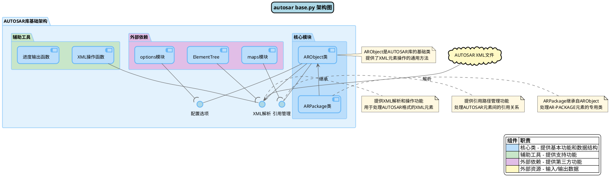

### 架构解释

`base.py` 模块的架构设计采用了面向对象的方式，将 AUTOSAR 元素抽象为类层次结构，并通过清晰的接口与外部系统交互。核心架构组件包括：

1. **核心模块**：

   - `ARObject` 类是整个库的基础，封装了对 AUTOSAR XML 元素的基本操作
   - `ARPackage` 类继承自 `ARObject`，专门处理 AUTOSAR 包元素（AR-PACKAGE）
2. **辅助工具**：

   - XML 操作函数：提供各种 XML 处理工具，如获取元素短名称、添加模式前缀等
   - 进度输出函数：提供操作进度的反馈机制
3. **外部依赖**：

   - ElementTree：Python 标准库，用于 XML 解析和处理
   - maps 模块：管理 AUTOSAR 元素间的引用关系
   - options 模块：提供全局配置选项
4. **接口层**：

   - XML 解析接口：提供 XML 文档解析功能
   - 引用管理接口：处理元素间的引用关系
   - 配置选项接口：处理全局配置

这种架构设计使得 `base.py` 能够灵活地处理 AUTOSAR XML 元素，并为上层模块提供稳定的基础功能。它实现了关注点分离，将 XML 解析、引用管理和配置处理等功能通过清晰的接口进行隔离，提高了代码的可维护性和可扩展性。

### 架构示例代码

以下是 `base.py` 模块架构的基本使用示例：

```python
# 导入必要的模块
from xml.etree import ElementTree as ET
from autosar import base

# 创建一个 AUTOSAR 元素
element = ET.Element('{http://autosar.org/schema/r4.0}AR-PACKAGE')
short_name = ET.SubElement(element, '{http://autosar.org/schema/r4.0}SHORT-NAME')
short_name.text = "MyPackage"

# 使用 ARObject 类表示 AUTOSAR 元素
ar_object = base.ARObject(element)
print(f"Element shortname: {ar_object.shortname}")  # 输出: Element shortname: MyPackage

# 创建新的 AUTOSAR 元素
new_element = base.create_element('CATEGORY', 'STANDARD')
print(f"New element tag: {new_element.refstr()}")  # 输出: New element tag: CATEGORY

# 使用 ARPackage 类管理包结构
ar_package = base.ARPackage(element)
sub_package = ar_package.addNewPackage("SubPackage")
print(f"Sub-package path: {sub_package.path}")  # 输出: Sub-package path: MyPackage/SubPackage

# 使用辅助函数
element_name = base.GetShortName(element)
print(f"Element name: {element_name}")  # 输出: Element name: MyPackage
```

这个示例展示了如何创建和操作 AUTOSAR 元素，使用核心类 `ARObject` 和 `ARPackage`，以及如何使用辅助函数。这反映了架构图中描述的组件如何协同工作，处理 AUTOSAR XML 元素。

## 模块导入关系

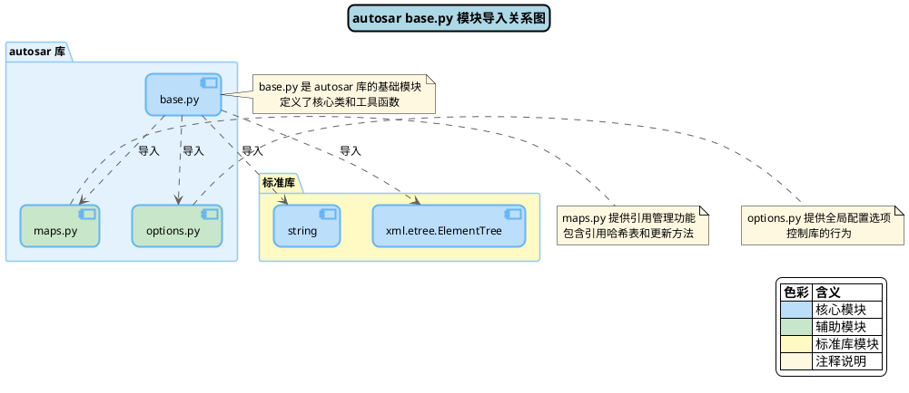

### 模块导入关系解释

`base.py` 模块的导入关系相对简单，主要依赖以下几个模块：

1. **内部依赖**：

   - `maps.py`：提供引用管理功能，维护 AUTOSAR 元素之间的引用关系
   - `options.py`：提供全局配置选项，控制库的日志输出、合并行为等
2. **标准库依赖**：

   - `string`：Python 标准库，用于字符串处理
   - `xml.etree.ElementTree`：Python 标准库，提供 XML 解析和处理功能

这种依赖结构使 `base.py` 能够专注于其核心功能——提供 AUTOSAR 元素的基础表示和操作，同时依赖其他模块提供辅助功能。这反映了良好的模块化设计原则，每个模块负责特定的功能，通过清晰的接口相互协作。

特别值得注意的是，`base.py` 依赖 `maps.py` 来处理引用关系，这是 AUTOSAR 规范中的重要特性，而依赖 `options.py` 则允许用户控制库的行为，提高了灵活性。

### 模块导入示例代码

以下示例展示了 `base.py` 模块导入关系的实际应用：

```python
import string
from xml.etree import ElementTree as ET
from autosar import maps, options
from autosar.base import ARObject, ARPackage, GetShortName, create_element

# 配置选项
options.verbose = True  # 启用详细输出
options.debug = False   # 禁用调试输出

# 创建 XML 元素
root = ET.Element('{http://autosar.org/schema/r4.0}AR-PACKAGE')
name = ET.SubElement(root, '{http://autosar.org/schema/r4.0}SHORT-NAME')
name.text = 'RootPackage'

# 使用 string 模块处理标识符
valid_chars = string.ascii_letters + string.digits + '_'
package_name = ''.join(c for c in 'My-Package+123' if c in valid_chars)
print(f"Sanitized package name: {package_name}")  # 输出: MyPackage123

# 创建包结构
package = ARPackage(root)
sub_package = package.addNewPackage(package_name)

# 使用引用管理
ref_elem = ET.Element('REFERENCE')
ref_elem.text = f"{package.path}/{package_name}"
maps.addReference(ref_elem.text, ref_elem)

# 移动包
old_path = sub_package.path
new_path = f"{package.path}/Renamed{package_name}"
maps.updateReference(old_path, new_path)

# 检查引用更新
print(f"Updated reference: {ref_elem.text}")  # 输出: Updated reference: RootPackage/RenamedMyPackage123

# 创建新元素
category = create_element('CATEGORY', 'STANDARD')
sub_package.addElement(category)

# 获取元素短名称
elem_name = GetShortName(root)
print(f"Root package name: {elem_name}")  # 输出: Root package name: RootPackage
```

这个示例展示了：

- 如何使用标准库 `string` 和 `ElementTree`
- 如何使用 `options` 模块配置库行为
- 如何使用 `maps` 模块管理引用关系
- 如何使用 `base.py` 提供的类和函数处理 AUTOSAR 元素

通过这些导入关系，`base.py` 能够提供完整的 AUTOSAR 元素处理功能，同时保持代码的模块化和可维护性。

## 函数调用关系

```plantuml
@startuml
!pragma encoding utf8

' 图表标题和描述
skinparam backgroundColor white
skinparam defaultFontName Microsoft YaHei
skinparam titleBorderRoundCorner 15
skinparam titleBorderThickness 2
skinparam titleBorderColor black
skinparam titleBackgroundColor LightBlue
skinparam arrowColor #4D4D4D

' 中文字体支持配置
skinparam defaultFontName Microsoft YaHei
skinparam defaultFontSize 12
skinparam ArrowFontName Microsoft YaHei
skinparam StateFontName Microsoft YaHei
skinparam NoteFontName Microsoft YaHei
skinparam TitleFontName Microsoft YaHei
skinparam defaultTextAlignment center
skinparam ParticipantFontName Microsoft YaHei
skinparam ActorFontName Microsoft YaHei
skinparam ComponentFontName Microsoft YaHei
skinparam InterfaceFontName Microsoft YaHei
skinparam ObjectFontName Microsoft YaHei
skinparam ActivityFontName Microsoft YaHei
skinparam LegendFontName Microsoft YaHei
skinparam PackageFontName Microsoft YaHei
skinparam SequenceGroupFontName Microsoft YaHei
skinparam BoxFontName Microsoft YaHei

' 颜色优化标准
skinparam {
  ArrowColor #616161
  ActivityBorderColor #64B5F6
  ActivityBackgroundColor #BBDEFB
  PackageBorderColor #90CAF9
  PackageBackgroundColor #E3F2FD
}

title autosar base.py 函数调用关系图

package "辅助函数" #C8E6C9 {
  usecase "GetShortName(element)" as GetShortName
  usecase "getiterator(element, tag)" as getiterator
  usecase "add_schema(xp)" as add_schema
  usecase "create_element(element, value, attrib)" as create_element
  usecase "printProgress(message)" as printProgress
  usecase "printProgressDone()" as printProgressDone
}

package "ARObject类方法" #BBDEFB {
  usecase "ARObject.__init__(element, path, fileref)" as ARObject_init
  usecase "ARObject.append(element)" as ARObject_append
  usecase "ARObject.insert(index, element)" as ARObject_insert
  usecase "ARObject.refstr()" as ARObject_refstr
  usecase "ARObject.setShortname(shortname)" as ARObject_setShortname
  usecase "ARObject.getSubElem(xp)" as ARObject_getSubElem
  usecase "ARObject.getSubElem2(xp)" as ARObject_getSubElem2
  usecase "ARObject.getAllSubElems(xp)" as ARObject_getAllSubElems
  usecase "ARObject.getAllSubElems2(xp)" as ARObject_getAllSubElems2
  usecase "ARObject.removeElement(element)" as ARObject_removeElement
  usecase "ARObject.addElement(element, UpdateReferences, replaceElement)" as ARObject_addElement
  usecase "ARObject.addPropertyElement(element, position)" as ARObject_addPropertyElement
}

package "ARPackage类方法" #B3E5FC {
  usecase "ARPackage.__repr__()" as ARPackage_repr
  usecase "ARPackage.addNewPackage(package_name)" as ARPackage_addNewPackage
  usecase "ARPackage.addPackage(ar_package, merge)" as ARPackage_addPackage
  usecase "ARPackage.getElements()" as ARPackage_getElements
  usecase "ARPackage.mergePackage(package)" as ARPackage_mergePackage
}

package "外部模块函数" #E1BEE7 {
  usecase "maps.updateReference(oldref, newref)" as maps_updateReference
  usecase "maps.addReference(ref, obj)" as maps_addReference
}

' 函数调用关系
ARObject_init --> GetShortName : 调用
ARObject_setShortname --> add_schema : 调用
ARObject_getSubElem --> add_schema : 调用
ARObject_getSubElem2 --> add_schema : 调用
ARObject_getAllSubElems --> add_schema : 调用
ARObject_getAllSubElems2 --> add_schema : 调用
ARObject_removeElement --> maps_updateReference : 调用
ARObject_addElement --> create_element : 调用
ARObject_addElement --> maps_updateReference : 调用
ARPackage_addNewPackage --> add_schema : 调用
ARPackage_addPackage --> add_schema : 调用
ARPackage_getElements --> add_schema : 调用
ARPackage_mergePackage --> add_schema : 调用
ARPackage_mergePackage --> GetShortName : 调用
ARPackage_mergePackage --> maps_updateReference : 调用
create_element --> ARObject_init : 创建并返回

note bottom of GetShortName #FFF8E1
  从XML元素中提取SHORT-NAME节点值
end note

note bottom of add_schema #FFF8E1
  为XPath表达式添加AUTOSAR模式前缀
end note

note bottom of ARObject_addElement #FFF8E1
  核心方法，用于向AUTOSAR元素添加子元素
  处理引用更新和路径管理
end note

legend right
  |= 色彩 |= 含义 |
  |<#C8E6C9>| 辅助函数 |
  |<#BBDEFB>| ARObject类方法 |
  |<#B3E5FC>| ARPackage类方法 |
  |<#E1BEE7>| 外部模块函数 |
  |<#FFF8E1>| 注释说明 |
endlegend

@enduml
```

### 函数调用关系解释

`base.py` 模块中的函数调用关系展示了模块内部的工作流程和组件间的交互。通过分析调用关系，可以看出以下关键点：

1. **辅助函数的基础作用**：

   - `GetShortName` 是一个基础函数，被 `ARObject.__init__` 和 `ARPackage.mergePackage` 等方法调用，用于获取元素短名称
   - `add_schema` 是另一个核心辅助函数，被众多方法调用，用于处理 AUTOSAR 命名空间
   - `create_element` 是创建新元素的工厂函数，返回 `ARObject` 实例
2. **ARObject 类的中心地位**：

   - `ARObject` 类是整个模块的核心，其方法广泛调用辅助函数
   - `ARObject.addElement` 是一个关键方法，负责添加子元素，并且调用 `create_element` 和 `maps.updateReference`
3. **ARPackage 类的依赖关系**：

   - `ARPackage` 类方法依赖于辅助函数 `add_schema` 和 `GetShortName`
   - `ARPackage.mergePackage` 是一个复杂方法，调用多个函数和方法
4. **外部模块的调用**：

   - `maps.updateReference` 被多个方法调用，处理元素引用关系的更新
   - 这表明引用管理是 AUTOSAR 库的核心功能之一

这种函数调用结构反映了良好的层次化设计：底层辅助函数提供基础功能，类方法集成这些功能提供更高层次的抽象，而外部模块则提供特定领域的功能支持。

### 函数调用示例代码

以下是一个完整的示例，展示 `base.py` 中的函数调用关系：

```python
from xml.etree import ElementTree as ET
from autosar import base, maps, options

# 启用详细输出，便于观察函数调用
options.verbose = True

# 1. 演示辅助函数的使用和调用关系
# 创建基本的 AUTOSAR 元素
root = ET.Element('{http://autosar.org/schema/r4.0}AR-PACKAGE')
name = ET.SubElement(root, '{http://autosar.org/schema/r4.0}SHORT-NAME')
name.text = 'RootPackage'

# 使用 GetShortName 获取元素短名称
package_name = base.GetShortName(root)
print(f"Package name: {package_name}")  # 输出: Package name: RootPackage

# 使用 add_schema 处理 XPath
xpath = "ELEMENTS/SHORT-NAME"
full_xpath = base.add_schema(xpath)
print(f"Full XPath: {full_xpath}")  # 输出带命名空间的 XPath

# 使用 create_element 创建新元素（内部调用 ARObject.__init__）
category = base.create_element('CATEGORY', 'STANDARD')
print(f"Created element: {category.refstr()}")  # 输出: Created element: CATEGORY

# 2. 演示 ARObject 方法的调用关系
# 创建 ARObject 实例（内部调用 GetShortName）
ar_object = base.ARObject(root)
print(f"ARObject shortname: {ar_object.shortname}")  # 输出: ARObject shortname: RootPackage

# 使用 getSubElem 获取子元素（内部调用 add_schema）
short_name_elem = ar_object.getSubElem('SHORT-NAME')
print(f"Found child element: {short_name_elem.text if short_name_elem is not None else 'None'}")

# 添加元素（内部调用 create_element 和间接调用 ARObject.__init__）
child = base.create_element('ADMIN-DATA')
ar_object.addElement(child)  # 内部可能调用 maps.updateReference

# 3. 演示 ARPackage 方法的调用关系
# 创建 ARPackage 实例
ar_package = base.ARPackage(root)

# 添加新包（内部调用 add_schema）
sub_package = ar_package.addNewPackage("SubPackage")
print(f"Created subpackage: {sub_package.path}")  # 输出: Created subpackage: RootPackage/SubPackage

# 创建另一个包并添加子元素
another_package = base.ARPackage(ET.Element('{http://autosar.org/schema/r4.0}AR-PACKAGE'))
name_elem = ET.SubElement(another_package.xmlref, '{http://autosar.org/schema/r4.0}SHORT-NAME')
name_elem.text = "AnotherPackage"
sub_sub = another_package.addNewPackage("NestedPackage")

# 合并包（内部调用 GetShortName 和 maps.updateReference）
ar_package.mergePackage(another_package)

# 获取元素（内部调用 add_schema）
elements = ar_package.getElements()
print(f"Package elements count: {len(list(elements))}")

# 4. 演示外部模块函数的调用
# 注册引用（供 maps.updateReference 使用）
ref_path = "RootPackage/SubPackage"
ref_elem = ET.Element('REFERENCE')
ref_elem.text = ref_path
maps.addReference(ref_path, ref_elem)

# 当调用 removeElement 时内部会调用 maps.updateReference
ar_package.removeElement(sub_package)
print(f"Reference after removal: {ref_elem.text}")  # 引用应该已被更新
```

这个示例展示了：

- 辅助函数如 `GetShortName`、`add_schema` 和 `create_element` 的基本使用
- `ARObject` 方法如何调用辅助函数和外部模块函数
- `ARPackage` 方法如何构建在 `ARObject` 基础上，并调用辅助函数
- 外部模块函数 `maps.updateReference` 如何被集成到整体调用流程中

通过这个示例，可以清楚地看到 `base.py` 模块内部的函数调用结构，以及各个组件如何协同工作以提供完整的 AUTOSAR 元素处理功能。

## 关系图

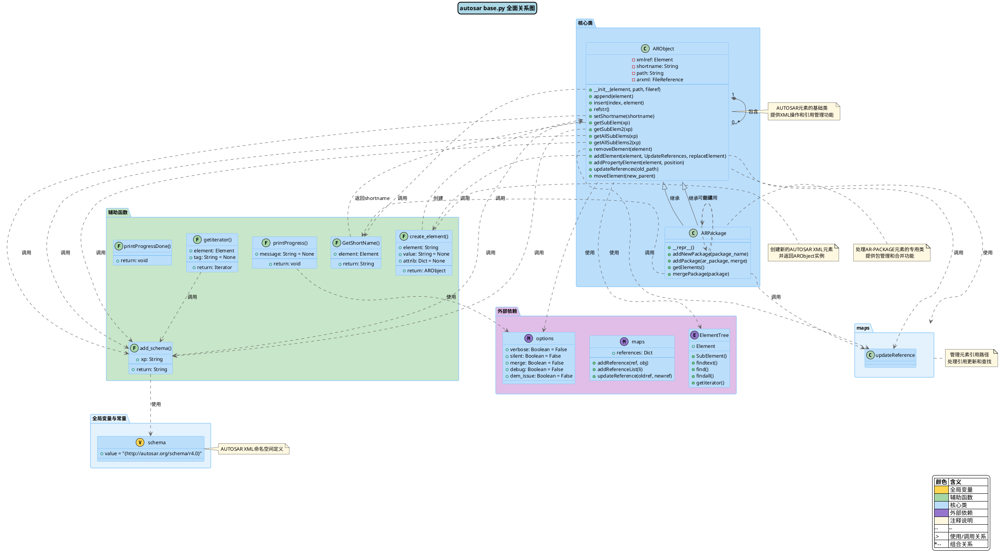

### 关系图解释

全面关系图提供了 `base.py` 模块中所有代码元素及它们之间关系的综合视图。这个图详细展示了：

1. **全局变量与常量**：

   - `schema` 定义了 AUTOSAR XML 的命名空间，是处理 XML 元素的基础
2. **辅助函数**：

   - 多个辅助函数提供了基础功能，如 `GetShortName`、`add_schema` 和 `create_element`
   - 这些函数相互调用，共同提供 XML 处理功能
3. **核心类**：

   - `ARObject` 是基础类，提供了 AUTOSAR 元素的表示和操作
   - `ARPackage` 类专门处理 AR-PACKAGE 元素
4. **外部依赖**：

   - `ElementTree` 提供 XML 解析功能
   - `maps` 提供引用管理
   - `options` 提供配置选项
5. **关系类型**：

   - **继承关系**：`ARPackage` 继承自 `ARObject`
   - **组合关系**：`ARObject` 可以包含其他 `ARObject` 实例
   - **使用关系**：函数和方法之间的调用关系
   - **依赖关系**：模块间的导入依赖

这个关系图清晰地展示了 `base.py` 模块的内部结构和外部依赖，帮助理解代码的组织方式和工作流程。它揭示了模块的核心是 `ARObject` 类及其派生类，以及围绕这些类的辅助函数和外部依赖。

### 关系示例代码

以下是一个综合示例，展示 `base.py` 模块中各种元素之间的关系：

```python
from xml.etree import ElementTree as ET
from autosar import base, maps, options

# 设置全局选项
options.verbose = True

# 1. 使用全局变量
print(f"AUTOSAR schema: {base.schema}")  # 输出 AUTOSAR 命名空间

# 2. 创建基本的 AUTOSAR 结构
# 创建根包
root_package_elem = ET.Element(f'{base.schema}AR-PACKAGE')
short_name = ET.SubElement(root_package_elem, f'{base.schema}SHORT-NAME')
short_name.text = 'RootPackage'

# 使用 ARObject 和辅助函数
root_package = base.ARObject(root_package_elem)
name = base.GetShortName(root_package_elem)
print(f"Package name: {name}")  # 输出: Package name: RootPackage

# 创建元素（展示 create_element 和 ARObject 的关系）
category = base.create_element('CATEGORY', 'STANDARD')
print(f"Element type: {category.refstr()}")  # 输出: Element type: CATEGORY

# 3. 使用 ARPackage 和继承关系
# 创建 ARPackage（继承自 ARObject）
package = base.ARPackage(root_package_elem)

# 添加子包（展示 ARPackage 特有功能）
sub_package = package.addNewPackage("SubPackage")
print(f"Sub-package path: {sub_package.path}")  # 输出: Sub-package path: RootPackage/SubPackage

# 使用继承的方法（来自 ARObject）
sub_package.setShortname("RenamedSubPackage")
print(f"New name: {sub_package.shortname}")  # 输出: New name: RenamedSubPackage

# 4. 展示组合关系（ARObject 包含其他 ARObject）
# 添加元素到包中
element = base.create_element('ADMIN-DATA')
sub_package.addElement(element)

# 5. 展示引用管理（与 maps 模块的交互）
# 创建引用
ref_path = sub_package.path
ref_elem = ET.Element('REFERENCE')
ref_elem.text = ref_path
maps.addReference(ref_path, ref_elem)

# 移除元素（触发引用更新）
package.removeElement(sub_package)
print(f"Reference after removal: {ref_elem.text}")  # 引用应该已被更新

# 6. 使用 XPath 和 add_schema
# 准备新的测试元素
test_elem = ET.Element(f'{base.schema}TEST-ELEMENT')
sub_elem = ET.SubElement(test_elem, f'{base.schema}SUB-ELEMENT')
sub_elem.text = "Test Value"

# 使用 add_schema 处理 XPath
xpath = "SUB-ELEMENT"
full_xpath = base.add_schema(xpath)
print(f"Full XPath: {full_xpath}")

# 使用处理后的 XPath 查找元素
found = test_elem.find(full_xpath)
print(f"Found element value: {found.text if found is not None else 'None'}")  # 输出: Found element value: Test Value

# 7. 创建复杂的包结构
# 创建多层包结构
comp_package = base.ARPackage(ET.Element(f'{base.schema}AR-PACKAGE'))
name_elem = ET.SubElement(comp_package.xmlref, f'{base.schema}SHORT-NAME')
name_elem.text = "Components"

# 添加子包
sw_package = comp_package.addNewPackage("Software")
hw_package = comp_package.addNewPackage("Hardware")

# 添加更深层次的包
app_package = sw_package.addNewPackage("Applications")
lib_package = sw_package.addNewPackage("Libraries")

# 打印包层次结构
print(f"Root: {comp_package.path}")
print(f"Software: {sw_package.path}")
print(f"Applications: {app_package.path}")
print(f"Libraries: {lib_package.path}")
print(f"Hardware: {hw_package.path}")
```

这个示例展示了 `base.py` 模块中各种元素之间的复杂关系：

- 全局变量 `schema` 的使用
- 辅助函数如 `GetShortName`、`add_schema` 和 `create_element` 的调用
- `ARObject` 和 `ARPackage` 类的继承关系
- 元素之间的组合关系（包含关系）
- 与外部模块 `maps` 和 `options` 的交互
- XPath 处理和 XML 操作

通过这个示例，可以理解 `base.py` 模块中各组件如何协同工作，处理 AUTOSAR XML 元素的创建、查询、修改和引用管理等任务。

## 总结与最佳实践

`base.py` 是 AUTOSAR 库的基础模块，提供了处理 AUTOSAR XML 元素的核心功能。通过本文的分析和示例，我们可以总结出以下关键点：

### 关键概念

1. **AUTOSAR 元素表示**：

   - `ARObject` 类是所有 AUTOSAR 元素的基础表示
   - `ARPackage` 类专门处理 AR-PACKAGE 元素
   - 元素通过 `shortname` 和 `path` 属性进行标识
2. **XML 处理机制**：

   - 利用 Python 标准库 `ElementTree` 进行 XML 解析和处理
   - 使用命名空间 `schema` 处理 AUTOSAR XML 的特殊格式
   - 提供辅助函数简化 XML 操作
3. **引用管理**：

   - 使用 `maps` 模块维护元素间的引用关系
   - 在元素移动或删除时自动更新引用
   - 支持引用路径的更新和管理
4. **包结构管理**：

   - 提供包的创建、添加、合并等功能
   - 支持多层次包结构的构建和管理
   - 处理包之间的关系和引用

### 最佳实践

在使用 `base.py` 模块时，以下是一些推荐的最佳实践：

1. **初始化和路径管理**：

   ```python
   # 正确的初始化方式
   element = ET.Element(f'{base.schema}AR-PACKAGE')
   name = ET.SubElement(element, f'{base.schema}SHORT-NAME')
   name.text = 'MyPackage'

   # 提供完整路径以便正确处理引用
   ar_obj = base.ARObject(element, 'MyPackage')
   ```
2. **引用处理**：

   ```python
   # 在修改元素路径前注册引用
   ref_path = ar_obj.path
   ref_elem = ET.Element('REFERENCE')
   ref_elem.text = ref_path
   maps.addReference(ref_path, ref_elem)

   # 使用 removeElement 或 addElement 会自动更新引用
   parent.removeElement(ar_obj)  # 引用会自动更新
   ```
3. **包管理**：

   ```python
   # 创建多层包结构
   root = base.ARPackage(root_elem)

   # 使用字符串方式添加新包
   # 如果包已存在，会返回现有包
   sw_package = root.addPackage("Software")

   # 使用 merge 参数合并同名包
   existing_package = base.ARPackage(existing_elem)
   merged = root.addPackage(existing_package, merge=True)
   ```
4. **XPath 查询**：

   ```python
   # 总是使用 add_schema 处理 XPath
   xpath = "ELEMENTS/SHORT-NAME"
   full_xpath = base.add_schema(xpath)

   # 使用 getSubElem 和 getAllSubElems 而不是直接使用 find/findall
   elem = ar_obj.getSubElem('SHORT-NAME')
   all_elems = ar_obj.getAllSubElems('ELEMENTS/*')
   ```
5. **配置选项**：

   ```python
   # 设置适当的选项以控制库行为
   options.verbose = True  # 启用详细输出
   options.debug = False   # 禁用调试输出
   options.silent = False  # 允许进度显示
   ```
6. **元素创建**：

   ```python
   # 使用 create_element 而不是直接创建 ET.Element
   element = base.create_element('CATEGORY', 'STANDARD')

   # 添加属性
   element_with_attrs = base.create_element('PARAMETER-VALUES', attrib={'S': 'SomeValue'})
   ```

通过遵循这些最佳实践，可以更有效地使用 `base.py` 模块处理 AUTOSAR XML 元素，构建复杂的 AUTOSAR 数据结构，并确保引用关系的正确管理。`base.py` 提供了坚实的基础，使得 AUTOSAR 库能够处理复杂的 AUTOSAR XML 文件，支持自动驾驶和汽车电子系统的开发。

---

# components.md

# components.py 文件解析

## 简介

`components.py` 是AUTOSAR库中的核心模块，主要负责定义和处理与AUTOSAR软件组件（Software Components，简称SWC）相关的对象和功能。该模块实现了AUTOSAR标准中软件组件模型的各种元素，包括组合软件组件（Composition）、原子软件组件（Atomic SWC）、端口（Ports）、接口（Interfaces）以及连接器（Connectors）等。通过这些类和功能，用户可以创建、修改和管理AUTOSAR软件架构中的组件定义。

该模块是整个AUTOSAR库的重要组成部分，与其他模块（如`base.py`、`arxml.py`、`utils.py`等）紧密协作，共同提供完整的AUTOSAR元模型支持和XML处理能力。`components.py`模块主要专注于软件组件架构的表示和操作，是进行AUTOSAR软件架构设计的基础。

## 架构概览

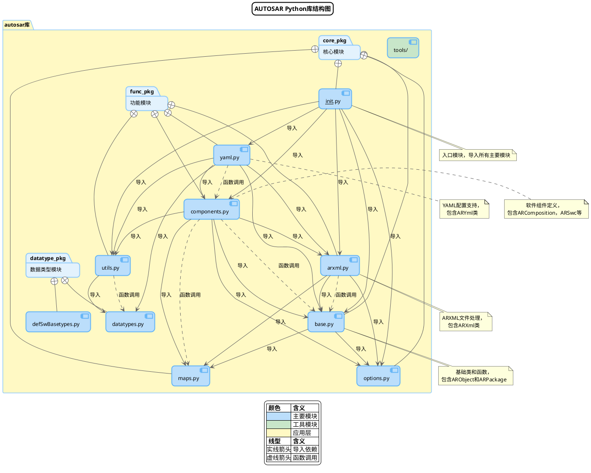

### 架构解释

上图展示了AUTOSAR Python库的整体结构，其中`components.py`作为功能模块的核心组件之一，负责定义软件组件相关的类和功能。从架构图中可以看出：

1. **模块依赖关系**：

   - `components.py`直接依赖于多个核心模块：`base.py`（提供基础类）、`maps.py`（管理引用映射）、`options.py`（配置选项）、`arxml.py`（XML处理）和`utils.py`（实用工具函数）。
   - 其他模块如`yaml.py`反过来依赖`components.py`，用于将YAML配置转换为AUTOSAR组件。
2. **模块分组**：

   - `components.py`属于功能模块组，与`arxml.py`、`yaml.py`和`utils.py`共同提供AUTOSAR库的主要功能。
   - 它依赖的`base.py`、`maps.py`和`options.py`则属于核心模块组，为整个库提供基础设施。
3. **功能职责**：

   - `components.py`主要负责定义软件组件，包括但不限于`ARComposition`和`ARSwc`等类。
   - 它通过调用`base.py`和`maps.py`中的函数来实现复杂的组件处理逻辑。

### 架构示例代码

以下是一个使用`components.py`模块创建和操作AUTOSAR软件组件的简单示例：

```python
# 导入必要的模块
from autosar import components
import xml.etree.ElementTree as ET

# 创建一个组合软件组件
composition = components.ARComposition.create("MyComposition")

# 向组合中添加软件组件原型
composition.addSWC("SensorSWC", "/AUTOSAR/SensorType")
composition.addSWC("ControllerSWC", "/AUTOSAR/ControllerType")

# 创建组件之间的装配连接
composition.addAssemblyConnection(
    "SensorToController",  # 连接名称
    "SensorSWC",           # 请求方组件
    "SensorOutput",        # 请求方端口
    "ControllerSWC",       # 提供方组件
    "SensorInput"          # 提供方端口
)

# 创建一个原子软件组件
swc = components.ARSwc.create("MySensor", "/MySensor", None)

# 添加一个端口
swc.addPort(
    "SensorOutput",                       # 端口名称
    "/PortInterfaces/SensorInterface",    # 端口接口引用
    "PPORT",                              # 方向（提供端口）
    "SENDER-RECEIVER-INTERFACE",          # 接口类型
    None,                                 # 模式组
    None,                                 # 非易失性数据类型
    [],                                   # 启用更新元素
    [],                                   # 端到端元素
    {},                                   # 初始值
    {}                                    # 队列长度
)

# 添加运行单元
swc.addRunnable(
    "SensorRunnable",                     # 运行单元名称
    "Sensor_Run",                         # 函数名称
    "CATEGORY_1",                         # 运行单元类型
    ["SensorOutput"],                     # 访问的端口
    {},                                   # 访问的模式
    "false",                              # 并发执行
    None,                                 # 软件地址方法路径
    None,                                 # 软件地址方法列表
    False                                 # 诊断相关
)

# 添加周期性事件触发运行单元
swc.addTimingEvent(
    "SensorCyclicEvent",                  # 事件名称
    "SensorRunnable",                     # 运行单元名称
    "0.01",                               # 周期（10ms）
    {},                                   # 模式
    False                                 # 模式抑制
)

print(f"Created composition with {len(composition.swcs)} SWCs")
print(f"Created SWC '{swc.shortname}' with {len(swc.ports)} ports")
```

这个示例展示了如何使用`components.py`模块创建一个组合软件组件和一个原子软件组件，包括添加端口、定义运行单元和事件触发。这些操作代表了AUTOSAR软件组件设计中的基本任务，`components.py`模块提供了直观的API来完成这些任务。

## 功能流程

```plantuml
@startuml
!pragma encoding utf8

' 图表标题和描述
skinparam backgroundColor white
skinparam defaultFontName Microsoft YaHei
skinparam titleBorderRoundCorner 15
skinparam titleBorderThickness 2
skinparam titleBorderColor black
skinparam titleBackgroundColor LightBlue
skinparam arrowColor #4D4D4D

' 中文字体支持配置
skinparam defaultFontName Microsoft YaHei
skinparam defaultFontSize 12
skinparam ArrowFontName Microsoft YaHei
skinparam StateFontName Microsoft YaHei
skinparam NoteFontName Microsoft YaHei
skinparam TitleFontName Microsoft YaHei
skinparam defaultTextAlignment center
skinparam ParticipantFontName Microsoft YaHei
skinparam ActorFontName Microsoft YaHei
skinparam ComponentFontName Microsoft YaHei
skinparam InterfaceFontName Microsoft YaHei
skinparam ObjectFontName Microsoft YaHei
skinparam ActivityFontName Microsoft YaHei
skinparam LegendFontName Microsoft YaHei
skinparam PackageFontName Microsoft YaHei
skinparam SequenceGroupFontName Microsoft YaHei
skinparam BoxFontName Microsoft YaHei

' 颜色优化标准
skinparam {
  ArrowColor #616161
  ActivityBackgroundColor #BBDEFB
  ActivityBorderColor #64B5F6
  ActivityDiamondBackgroundColor #E3F2FD
  ActivityDiamondBorderColor #90CAF9
  BackgroundColor white
}

title autosar.components 函数调用关系图

' ARComposition类的主要方法调用流程
partition "ARComposition" {
  (*) --> "ARComposition.__init__()"
  
  "ARComposition.__init__()" --> "ARComposition.__loadSWCs()"
  "ARComposition.__init__()" --> "ARComposition.__loadPorts()"
  "ARComposition.__init__()" --> "ARComposition.__loadDelegations()"
  "ARComposition.__init__()" --> "ARComposition.__loadAssemblys()"
  "ARComposition.__init__()" --> "ARComposition.__loadPortGroups()"

  "ARComposition.__loadSWCs()" --> "base.GetShortName()"
  "ARComposition.__loadPorts()" --> "AR_RPort()"
  "ARComposition.__loadPorts()" --> "AR_PPort()"
  "ARComposition.__loadPorts()" --> "maps.addReference()"

  ' addSWC方法流程
  note right
   在组合中添加软件组件原型
  end note
  "ARComposition.addSWC()" --> "ARComposition.getSubElem()"
  "ARComposition.addSWC()" --> "base.create_element()"
  "ARComposition.addSWC()" -right-> "maps.addReference()"

  ' 连接器方法
  "ARComposition.addAssemblyConnection()" --> "ARComposition.getSubElem()"
  "ARComposition.addAssemblyConnection()" --> "base.create_element()"

  "ARComposition.addDelegationConnection()" --> "ARComposition.getSubElem()"
  "ARComposition.addDelegationConnection()" --> "base.create_element()"

  "ARComposition.copyPort()" --> "ARComposition.getSubElem()"
  "ARComposition.copyPort()" --> "base.create_element()"
  "ARComposition.copyPort()" --> "maps.addReference()"

  "ARComposition.updateReferences()" --> "ARComposition.__updateReferences()"
  "ARComposition.__updateReferences()" --> "maps.updateReference()"
}

' ARSwc类的主要方法调用流程
partition "ARSwc" {
  (*) --> "ARSwc.__init__()"
  
  "ARSwc.__init__()" --> "ARSwc.__loadBehavior()"
  "ARSwc.__loadBehavior()" --> "ARSwc.__loadInterRunnableVariables()"
  "ARSwc.__loadBehavior()" --> "ARSwc.__loadDataTypeMappings()"
  "ARSwc.__loadBehavior()" --> "ARSwc.__loadEvents()"
  "ARSwc.__loadBehavior()" --> "ARSwc.__loadRunnables()"
  "ARSwc.__loadBehavior()" --> "ARSwc.__loadParameters()"
  "ARSwc.__loadBehavior()" --> "ARSwc.__loadExclusiveAreas()"
  "ARSwc.__loadBehavior()" --> "ARSwc.__loadServiceDependencys()"
  "ARSwc.__init__()" --> "ARSwc.__loadPorts()"

  ' 运行单元相关方法
  "ARSwc.addRunnable()" --> "base.create_element()"
  "ARSwc.addParameterAccess()" -left-> "ARSwc.getEventsForRunnable()"
  "ARSwc.addLocalVariableAccess()" --> "base.create_element()"
  "ARSwc.addExclusiveAreaRefs()" --> "base.create_element()"

  ' 事件相关方法
  "ARSwc.addInitEvent()" --> "base.create_element()"
  "ARSwc.addTimingEvent()" --> "base.create_element()"
  "ARSwc.addModeSwitchEvent()" --> "base.create_element()"

  ' 端口相关方法
  "ARSwc.addPort()" --> "ARSwc.getSubElem()"
  "ARSwc.addPort()" --> "base.create_element()"
  "ARSwc.copyPort()" --> "ARSwc.getSubElem()"

  "ARSwc.updateReferences()" --> "ARSwc.__updateReferences()"
  "ARSwc.__updateReferences()" --> "maps.updateReference()"
}

' 端口类的方法调用
partition "AR_Port和子类" {
  (*) --> "AR_Port.__init__()"
  "AR_Port.__init__()" --> "base.GetShortName()"
  
  "AR_RPort.__init__()" --> "AR_Port.__init__()"
  "AR_PPort.__init__()" --> "AR_Port.__init__()"
  
  "AR_Port.getEnableUpdateElems()" ..> "AR_Port.getDictInitValues()"
  "AR_Port.getEndToEndElems()" ..> "AR_Port.getDictInitValues()"
  "AR_Port.getPortInitValues()" ..> "AR_Port.getDictInitValues()"
}

' 接口类的方法调用
partition "ARPortInterface和子类" {
  (*) --> "ARPortInterface.__init__()"
  
  "ARSenderReceiverInterface.__init__()" --> "ARPortInterface.__init__()"
  "ARClientServerInterface.__init__()" --> "ARPortInterface.__init__()"
  
  "ARSenderReceiverInterface.create()" --> "ARSenderReceiverInterface()"
  "ARClientServerInterface.create()" --> "ARClientServerInterface()"
  
  "ARSenderReceiverInterface.merge()" ..> "ARSenderReceiverInterface.__contains__()"
  "ARClientServerInterface.merge()" ..> "ARClientServerInterface.getErrStr()"
}

legend
  |= 颜色 |= 含义 |
  |<#BBDEFB>| 活动节点 |
  |<#E3F2FD>| 决策节点 |
endlegend

@enduml
```

### 功能流程解释

上图展示了`components.py`模块中主要类的函数调用关系，可以清晰地看到各个类的方法如何相互交互以及它们如何调用外部模块的函数。以下是对主要功能流程的解释：

#### ARComposition 类流程

1. **初始化流程**：

   - `ARComposition.__init__()` 初始化组合软件组件对象，并依次调用多个加载方法。
   - 各个加载方法（`__loadSWCs()`、`__loadPorts()`等）从XML中提取相应的元素并创建相应的对象。
   - 在加载过程中调用`base.GetShortName()`获取元素名称，并使用`maps.addReference()`记录引用关系。
2. **添加软件组件流程**：

   - `addSWC()` 方法首先检查组件是否已存在，然后获取或创建COMPONENTS元素。
   - 使用`base.create_element()`创建新的组件原型元素。
   - 调用`maps.addReference()`注册引用关系。
3. **添加连接器流程**：

   - `addAssemblyConnection()` 和 `addDelegationConnection()` 方法创建装配连接器和委托连接器。
   - 都需要先获取或创建CONNECTORS元素，然后创建相应的连接器元素及其子元素。
4. **更新引用流程**：

   - `updateReferences()` 在组合被移动时调用，用于更新所有引用。
   - 调用私有方法 `__updateReferences()` 处理具体的引用更新，后者调用 `maps.updateReference()`。

#### ARSwc 类流程

1. **初始化流程**：

   - `ARSwc.__init__()` 初始化软件组件对象，调用 `__loadBehavior()` 和 `__loadPorts()` 等方法。
   - `__loadBehavior()` 加载组件行为，并调用多个子方法加载行为的各个方面（运行单元、事件等）。
2. **添加运行单元和事件**：

   - `addRunnable()` 创建新的运行单元。
   - `addInitEvent()`、`addTimingEvent()` 和 `addModeSwitchEvent()` 创建不同类型的事件触发。
   - 所有这些方法都依赖 `base.create_element()` 创建XML元素。
3. **端口管理**：

   - `addPort()` 创建一个新的端口，包括设置必要的属性和引用。
   - `copyPort()` 从现有端口创建副本。

#### 端口和接口类流程

1. **端口初始化**：

   - `AR_Port.__init__()` 初始化基本端口属性。
   - `AR_RPort` 和 `AR_PPort` 类扩展了基本端口功能。
2. **接口创建和管理**：

   - 接口类有静态 `create()` 方法，用于创建新的接口实例。
   - `merge()` 方法用于合并两个接口的功能。

### 功能流程示例代码

以下是一个详细的示例，演示了`components.py`模块中主要类的功能流程：

```python
from autosar import components, arxml
import xml.etree.ElementTree as ET
import os

# 创建一个新的ARXML文件
arxml_file = arxml.ARXml("vehicle_system.arxml", True)

# 步骤1: 创建接口
# ------------------------------
print("创建接口...")
# 创建发送接收接口
speed_interface = components.ARSenderReceiverInterface.create("VehicleSpeedInterface", 
    {"Speed": {"type": "float32"}}, "non-service")
# 将接口添加到ARXML文件
port_interface_pkg = arxml_file.createPackage("PortInterfaces")
port_interface_pkg.addElement(speed_interface)

# 步骤2: 创建软件组件
# ------------------------------
print("创建软件组件...")
# 创建速度传感器组件
speed_sensor = components.ARSwc.create("SpeedSensor", "/SpeedSensor", arxml_file)
# 添加提供端口
speed_sensor.addPort("SpeedOut", speed_interface.path, "PPORT", 
                    "SENDER-RECEIVER-INTERFACE", None, None, [], [], {}, {})
# 添加运行单元
speed_sensor.addRunnable("SpeedSensorRunnable", "SpeedSensor_Run", "CATEGORY_1", 
                        ["SpeedOut"], {}, "false", None, None, False)
# 添加周期性事件
speed_sensor.addTimingEvent("SpeedSensorCyclic", "SpeedSensorRunnable", "0.01", {}, False)

# 创建速度控制器组件
speed_controller = components.ARSwc.create("SpeedController", "/SpeedController", arxml_file)
# 添加接收端口
speed_controller.addPort("SpeedIn", speed_interface.path, "RPORT", 
                        "SENDER-RECEIVER-INTERFACE", None, None, [], [], {}, {})
# 添加运行单元
speed_controller.addRunnable("SpeedControllerRunnable", "SpeedController_Run", "CATEGORY_1", 
                           ["SpeedIn"], {}, "false", None, None, False)
# 添加周期性事件
speed_controller.addTimingEvent("SpeedControllerCyclic", "SpeedControllerRunnable", "0.02", {}, False)

# 步骤3: 创建组合
# ------------------------------
print("创建组合...")
# 创建组合组件
vehicle_system = components.ARComposition.create("VehicleSystem")
# 添加软件组件到组合中
vehicle_system.addSWC("Sensor", speed_sensor.path, speed_sensor)
vehicle_system.addSWC("Controller", speed_controller.path, speed_controller)
# 创建组件间的连接
vehicle_system.addAssemblyConnection("SensorToController", 
                                   "Sensor", "SpeedOut", 
                                   "Controller", "SpeedIn")

# 步骤4: 将组件添加到ARXML文件
# ------------------------------
print("添加组件到ARXML文件...")
# 创建组件包
components_pkg = arxml_file.createPackage("ComponentTypes")
# 添加软件组件
components_pkg.addElement(speed_sensor)
components_pkg.addElement(speed_controller)
components_pkg.addElement(vehicle_system)

# 步骤5: 保存ARXML文件
# ------------------------------
print("保存ARXML文件...")
arxml_file.save()
print(f"ARXML文件已保存为 'vehicle_system.arxml'")
print(f"组件结构: {vehicle_system.shortname} 包含 {len(vehicle_system.swcs)} 个软件组件")
for swc_name in vehicle_system.swcs:
    print(f"  - {swc_name}")
print(f"连接: {list(vehicle_system.assemblys.keys())}")
```

这个例子演示了完整的工作流程，从创建接口到定义软件组件，再到建立组合和连接，最后将整个结构保存到ARXML文件中。这种流程在AUTOSAR工具链中非常常见，用于设计和配置复杂的汽车电子系统。

## 模块导入关系

```plantuml
@startuml
!pragma encoding utf8

' 图表标题和描述
skinparam backgroundColor white
skinparam defaultFontName Microsoft YaHei
skinparam titleBorderRoundCorner 15
skinparam titleBorderThickness 2
skinparam titleBorderColor black
skinparam titleBackgroundColor LightBlue
skinparam arrowColor #4D4D4D

' 中文字体支持配置
skinparam defaultFontName Microsoft YaHei
skinparam defaultFontSize 12
skinparam ArrowFontName Microsoft YaHei
skinparam StateFontName Microsoft YaHei
skinparam NoteFontName Microsoft YaHei
skinparam TitleFontName Microsoft YaHei
skinparam defaultTextAlignment center
skinparam ParticipantFontName Microsoft YaHei
skinparam ActorFontName Microsoft YaHei
skinparam ComponentFontName Microsoft YaHei
skinparam InterfaceFontName Microsoft YaHei
skinparam ObjectFontName Microsoft YaHei
skinparam ActivityFontName Microsoft YaHei
skinparam LegendFontName Microsoft YaHei
skinparam PackageFontName Microsoft YaHei
skinparam SequenceGroupFontName Microsoft YaHei
skinparam BoxFontName Microsoft YaHei

' 颜色优化标准
skinparam {
  ArrowColor #616161
  PackageBackgroundColor #E3F2FD
  PackageBorderColor #90CAF9
  BackgroundColor white
}

title autosar库模块导入关系图

' 使用包来表示模块
package "autosar" as autosar #FFF9C4 {
  ' 基础模块
  package "base" as base #C8E6C9 {
    class "ARObject" as base_ARObject
    class "ARPackage" as base_ARPackage
    class "辅助函数" as base_utils
  }
  
  package "maps" as maps #C8E6C9 {
    class "references" as maps_references
    class "addReference()" as maps_addReference
    class "updateReference()" as maps_updateReference
  }
  
  package "options" as options #C8E6C9 {
    class "verbose" as options_verbose
    class "silent" as options_silent
  }
  
  package "arxml" as arxml #C8E6C9 {
    class "ARXml" as arxml_ARXml
    class "create()" as arxml_create
    class "load()" as arxml_load
  }
  
  package "utils" as utils #C8E6C9 {
    class "getBaseDatatypeFromSoftwareRecordLayout()" as utils_getBaseDatatypeFromSoftwareRecordLayout
  }
  
  ' components模块是主题
  package "components" as components #BBDEFB {
    class "ARComposition" as components_ARComposition
    class "ARSwc" as components_ARSwc
    class "ARPortInterface" as components_ARPortInterface
    class "AR_Port" as components_AR_Port
    class "AR_RPort" as components_AR_RPort
    class "AR_PPort" as components_AR_PPort
    class "ARVariableDataPrototype" as components_ARVariableDataPrototype
    class "ARParameterDataPrototype" as components_ARParameterDataPrototype
  }
  
  ' yaml模块
  package "yaml" as yaml #E1BEE7 {
    class "ARYml" as yaml_ARYml
  }
  
  ' datatypes模块
  package "datatypes" as datatypes #C8E6C9 {
    class "getTypeReferenceString()" as datatypes_getTypeReferenceString
  }
}

' 外部库依赖
package "xml.etree.ElementTree" as ET #E1BEE7 {
  class "Element" as ET_Element
  class "fromstring()" as ET_fromstring
}

' 导入关系
components --> base : from . import base
components --> maps : from . import maps
components --> options : from . import options
components --> arxml : from . import arxml
components --> utils : from .utils import getBaseDatatypeFromSoftwareRecordLayout
components --> ET : from xml.etree import ElementTree

' components模块内类的继承关系
base_ARObject <|-- components_ARComposition
base_ARObject <|-- components_ARSwc
base_ARObject <|-- components_ARPortInterface
base_ARObject <|-- components_AR_Port
components_AR_Port <|-- components_AR_RPort
components_AR_Port <|-- components_AR_PPort
base_ARObject <|-- components_ARVariableDataPrototype
base_ARObject <|-- components_ARParameterDataPrototype

' yaml模块对components模块的依赖
yaml --> components : from autosar.components import ...

' 交叉模块函数调用
components_ARComposition ..> base_utils : 使用辅助函数
components_ARSwc ..> base_utils : 使用辅助函数
components_ARComposition ..> maps_addReference : 引用映射管理
components_ARComposition ..> options_verbose : 条件输出
components_ARComposition ..> ET_Element : XML处理
components_ARSwc ..> ET_Element : XML处理

' 模块说明
note bottom of base
  基础模块，提供核心类和工具函数
end note

note bottom of components
  AUTOSAR组件模块，定义软件组件和端口类
end note

note bottom of maps
  引用映射模块，管理元素间的引用关系
end note

note right of arxml
  ARXML文件操作模块
end note

note bottom of utils
  实用工具函数模块
end note

legend
  |= 颜色 |= 含义 |
  |<#BBDEFB>| 主要模块(components) |
  |<#C8E6C9>| 内部依赖模块 |
  |<#E1BEE7>| 外部依赖库 |
  |<#FFF9C4>| autosar库命名空间 |
endlegend

@enduml
```

### 模块导入关系解释

上图详细展示了`components.py`模块与其他模块之间的导入和依赖关系。从图中可以看出：

1. **导入依赖**：

   - `components.py`直接导入了五个模块：`base`、`maps`、`options`、`arxml`和`utils`（从中特别导入了`getBaseDatatypeFromSoftwareRecordLayout`函数）。
   - 此外，它还导入了外部库`xml.etree.ElementTree`，用于XML处理。
2. **被导入情况**：

   - `yaml`模块依赖于`components`模块，导入了其中的类和函数。
   - 这说明`components`模块不仅是一个消费者，也是一个提供者，为其他模块提供AUTOSAR组件的处理能力。
3. **类的继承关系**：

   - 所有主要的组件类（`ARComposition`、`ARSwc`等）都继承自`base.ARObject`。
   - 端口类有自己的继承层次：`base.ARObject` -> `AR_Port` -> `AR_RPort`/`AR_PPort`。
4. **函数调用关系**：

   - `components`模块中的类使用`base`模块的辅助函数。
   - 它们还与`maps`模块交互，特别是使用`addReference`和`updateReference`功能来管理引用。
   - 对`options.verbose`的检查用于条件输出。
   - XML处理依赖于`ElementTree`库的功能。

这种导入和依赖关系表明`components.py`是一个集成了多个功能模块的中心模块，它将基础设施（如XML处理、引用管理）与领域特定的AUTOSAR组件模型结合起来。

### 模块导入示例代码

以下是一个简化的示例，展示了如何在实际代码中使用这些导入关系：

```python
# 导入所需的模块
from autosar import base, maps, options, arxml
from autosar.utils import getBaseDatatypeFromSoftwareRecordLayout
from xml.etree import ElementTree as ET

# 设置可选参数
options.verbose = True  # 启用详细输出

# 创建一个基本的XML元素
element = ET.Element('{http://autosar.org/schema/r4.0}COMPOSITION-SW-COMPONENT-TYPE')
shortname = ET.SubElement(element, '{http://autosar.org/schema/r4.0}SHORT-NAME')
shortname.text = 'MyComposition'

# 使用基础类处理XML
obj = base.ARObject(element, '/MyComposition', None)
print(f"Created object with shortname: {obj.shortname}")

# 使用create_element辅助函数
components_elem = base.create_element('COMPONENTS')
ports_elem = base.create_element('PORTS')
element.append(components_elem.xmlref)
element.append(ports_elem.xmlref)

# 添加引用映射
type_ref_elem = ET.SubElement(element, '{http://autosar.org/schema/r4.0}TYPE-TREF')
type_ref_elem.text = '/SWCs/SensorType'
maps.addReference(type_ref_elem.text, type_ref_elem)

# 查找引用
if '/SWCs/SensorType' in maps.references:
    print(f"Reference found with {len(maps.references['/SWCs/SensorType'])} elements")

# 创建组合软件组件
from autosar import components
composition = components.ARComposition(element, '/MyComposition', None)

# 添加软件组件原型
composition.addSWC('Sensor', '/SWCs/SensorType')
print(f"Added SWC prototype to composition: {composition.swcs}")

# 使用工具函数
if hasattr(composition, 'ports'):
    for port_name, port in composition.ports.items():
        layout = getBaseDatatypeFromSoftwareRecordLayout(port.xmlref)
        if layout:
            print(f"Found software record layout for port {port_name}")
```

这个例子展示了`components.py`如何与其他模块协同工作，特别是：

- 如何使用`base`模块中的类和函数创建和操作XML元素
- 如何使用`maps`模块管理引用关系
- 如何使用`options`模块控制行为
- 如何使用`components`模块创建和操作AUTOSAR组件
- 如何使用`utils`模块中的特定函数进行辅助操作

这种模块化的设计使得代码更易于维护和扩展，每个模块都专注于特定的功能领域。

## 模块层次结构

```plantuml
@startuml
!pragma encoding utf8
scale max 4600 width
' 图表标题和描述
skinparam backgroundColor white
skinparam defaultFontName Microsoft YaHei
skinparam titleBorderRoundCorner 15
skinparam titleBorderThickness 2
skinparam titleBorderColor black
skinparam titleBackgroundColor LightBlue
skinparam arrowColor #4D4D4D

' 中文字体支持配置
skinparam defaultFontName Microsoft YaHei
skinparam defaultFontSize 12
skinparam ArrowFontName Microsoft YaHei
skinparam StateFontName Microsoft YaHei
skinparam NoteFontName Microsoft YaHei
skinparam TitleFontName Microsoft YaHei
skinparam defaultTextAlignment center
skinparam ParticipantFontName Microsoft YaHei
skinparam ActorFontName Microsoft YaHei
skinparam ComponentFontName Microsoft YaHei
skinparam InterfaceFontName Microsoft YaHei
skinparam ObjectFontName Microsoft YaHei
skinparam ActivityFontName Microsoft YaHei
skinparam LegendFontName Microsoft YaHei
skinparam PackageFontName Microsoft YaHei
skinparam SequenceGroupFontName Microsoft YaHei
skinparam BoxFontName Microsoft YaHei

' 颜色优化标准
skinparam {
  ArrowColor #616161
  ComponentBackgroundColor #BBDEFB
  ComponentBorderColor #64B5F6
  PackageBackgroundColor #E3F2FD
  PackageBorderColor #90CAF9
  BackgroundColor white
}

title autosar.components 模块层次结构图

package "autosar" #FFF9C4 {
  component "base" as base #C8E6C9 {
    [ARObject]
    [ARPackage]
    [GetShortName()]
    [add_schema()]
    [create_element()]
    [printProgress()]
  }
  
  component "maps" as maps #C8E6C9 {
    [addReference()]
    [updateReference()]
  }
  
  component "options" as options #C8E6C9 {
    [verbose]
    [silent]
  }
  
  component "arxml" as arxml #C8E6C9 {
    [ARXml]
    [create()]
    [load()]
  }
  
  component "utils" as utils #C8E6C9 {
    [getBaseDatatypeFromSoftwareRecordLayout()]
  }
  
  component "components" as components #BBDEFB {
    ' 组合区域
    package "组合相关" as composition_pkg #E3F2FD {
      [ARComposition]
      [ARDelegationConnector]
      [ARAssemblyConnector]
    }
  
    ' 软件组件区域
    package "软件组件相关" as swc_pkg #E3F2FD {
      [ARSwc]
      [ARExclusiveArea]
      [ARAccessPoint]
    }
  
    ' 端口区域
    package "端口相关" as port_pkg #E3F2FD {
      [AR_Port]
      [AR_RPort]
      [AR_PPort]
    }
  
    ' 接口区域
    package "接口相关" as interface_pkg #E3F2FD {
      [ARPortInterface]
      [ARSenderReceiverInterface]
      [ARClientServerInterface]
      [ARServiceInterface]
      [ARNvDataInterface]
      [ARModeSwitchInterface]
    }
  
    ' 数据类型区域
    package "数据类型相关" as datatype_pkg #E3F2FD {
      [ARVariableDataPrototype]
      [ARParameterDataPrototype]
      [ARArrayDatatype]
      [ARRecordDatatype]
      [ARImplDatatype]
      [ARCompuMethod]
      [ARDataConstraint]
      [ARSWRecordLayout]
    }
  
    ' 物理量区域
    package "物理量相关" as units_pkg #E3F2FD {
      [ARUnit]
      [ARPhysDimension]
    }
  
    ' 数据曲线相关
    package "数据曲线相关" as curve_pkg #E3F2FD {
      [ARComAxisDataType]
      [ARCurveDataType]
      [ARMapDataType]
    }
  }
}

' 组件间依赖关系
components --> base : 导入
components --> maps : 导入
components --> options : 导入
components --> arxml : 导入
components --> utils : 导入

' 组件内部依赖关系
composition_pkg ..> swc_pkg : 使用
composition_pkg ..> port_pkg : 使用
swc_pkg ..> port_pkg : 使用
swc_pkg ..> interface_pkg : 使用
swc_pkg ..> datatype_pkg : 使用
port_pkg ..> interface_pkg : 引用
interface_pkg ..> datatype_pkg : 使用

' 组件内主要类之间的继承关系
base.ARObject <|-- composition_pkg.ARComposition : 继承
base.ARObject <|-- swc_pkg.ARSwc : 继承
base.ARObject <|-- port_pkg.AR_Port : 继承
base.ARObject <|-- interface_pkg.ARPortInterface : 继承
base.ARObject <|-- datatype_pkg.ARVariableDataPrototype : 继承
base.ARObject <|-- datatype_pkg.ARParameterDataPrototype : 继承
base.ARObject <|-- datatype_pkg.ARDatatype : 继承
base.ARObject <|-- datatype_pkg.ARCompuMethod : 继承
base.ARObject <|-- datatype_pkg.ARDataConstraint : 继承
base.ARObject <|-- units_pkg.ARUnit : 继承
base.ARObject <|-- units_pkg.ARPhysDimension : 继承
base.ARObject <|-- swc_pkg.ARSwcImplementation : 继承
base.ARObject <|-- swc_pkg.ARExclusiveArea : 继承
base.ARObject <|-- swc_pkg.ARServiceDependency : 继承

port_pkg.AR_Port <|-- port_pkg.AR_RPort : 继承
port_pkg.AR_Port <|-- port_pkg.AR_PPort : 继承

interface_pkg.ARPortInterface <|-- interface_pkg.ARSenderReceiverInterface : 继承
interface_pkg.ARPortInterface <|-- interface_pkg.ARClientServerInterface : 继承
interface_pkg.ARPortInterface <|-- interface_pkg.ARModeSwitchInterface : 继承
interface_pkg.ARPortInterface <|-- interface_pkg.ARNvDataInterface : 继承

datatype_pkg.ARDatatype <|-- datatype_pkg.ARArrayDatatype : 继承
datatype_pkg.ARDatatype <|-- datatype_pkg.ARRecordDatatype : 继承
datatype_pkg.ARDatatype <|-- datatype_pkg.ARImplDatatype : 继承

curve_pkg.ARDatatype <|-- curve_pkg.ARComAxisDataType : 继承
curve_pkg.ARDatatype <|-- curve_pkg.ARCurveDataType : 继承
curve_pkg.ARDatatype <|-- curve_pkg.ARMapDataType : 继承

legend
  |= 颜色 |= 含义 |
  |<#BBDEFB>| 主要组件 |
  |<#C8E6C9>| 基础/工具组件 |
  |<#E3F2FD>| 子包 |
  |<#FFF9C4>| 应用层 |
endlegend

@enduml
```

### 模块层次结构解释

上图展示了`components.py`模块的内部层次结构及其与外部模块的关系。从这个层次结构中，我们可以看到：

1. **组件内部分组**：

   - `components`模块内部按功能领域划分为多个逻辑分组：
     - **组合相关**：包含`ARComposition`、`ARDelegationConnector`和`ARAssemblyConnector`等处理软件组件组合的类
     - **软件组件相关**：包含`ARSwc`和`ARExclusiveArea`等处理原子软件组件的类
     - **端口相关**：包含`AR_Port`及其子类，负责处理组件的接口点
     - **接口相关**：包含`ARPortInterface`及其各种子类，定义不同类型的接口
     - **数据类型相关**：包含各种数据类型定义类
     - **物理量相关**：处理单位和物理维度
     - **数据曲线相关**：处理曲线和映射数据类型
2. **依赖关系**：

   - `components`模块依赖于多个基础/工具模块：`base`、`maps`、`options`、`arxml`和`utils`
   - 在内部，不同分组间也存在依赖关系，例如：
     - 组合相关类使用软件组件和端口相关类
     - 软件组件类使用端口、接口和数据类型相关类
     - 端口类引用接口类
     - 接口类使用数据类型相关类
3. **继承关系**：

   - 从`base.ARObject`派生出各种主要类
   - 在内部有更细致的继承层次，如从`AR_Port`派生出`AR_RPort`和`AR_PPort`，从`ARPortInterface`派生出各种特定接口类

这种层次化的结构使`components.py`能够有效地组织和管理复杂的AUTOSAR软件组件模型，同时保持了代码的模块化和可扩展性。

### 模块层次结构示例代码

以下是一个展示`components.py`模块层次结构的完整工作示例，包括创建不同类型的组件、接口和连接：

```python
from autosar import components, arxml
import os

# 创建一个ARXML文件
arxml_file = arxml.ARXml("complex_system.arxml", True)

# 创建包结构
interfaces_pkg = arxml_file.createPackage("PortInterfaces")
datatypes_pkg = arxml_file.createPackage("DataTypes")
components_pkg = arxml_file.createPackage("Components")

# 创建数据约束（数据类型相关）
speed_constr = components.ARDataConstraint.create(
    "SpeedConstraint", 
    {"lowerLimit": "0", "upperLimit": "300"}
)
datatypes_pkg.addElement(speed_constr)

# 创建物理量（物理量相关）
speed_unit = components.ARUnit.create("kph", "km/h")
speed_phys = components.ARPhysDimension.create("speed", "Speed", [{"L": 1}, {"T": -1}])
datatypes_pkg.addElement(speed_unit)
datatypes_pkg.addElement(speed_phys)

# 创建接口（接口相关）
# 发送接收接口
speed_interface = components.ARSenderReceiverInterface.create(
    "SpeedInterface", 
    {
        "CurrentSpeed": {
            "type": "float32",
            "unit": speed_unit.path,
            "constraint": speed_constr.path
        }
    }, 
    "non-service"
)
interfaces_pkg.addElement(speed_interface)

# 客户端服务器接口
control_interface = components.ARClientServerInterface.create(
    "SpeedControlInterface", 
    {
        "SetTargetSpeed": {
            "arguments": {
                "speed": {
                    "type": "float32",
                    "direction": "IN"
                }
            }
        }
    }, 
    "non-service"
)
interfaces_pkg.addElement(control_interface)

# 创建软件组件（软件组件相关）
# 速度传感器组件
speed_sensor = components.ARSwc.create("SpeedSensor", "/Components/SpeedSensor", arxml_file)
# 添加端口（端口相关）
speed_sensor.addPort(
    "SpeedOut",         # 端口名称
    speed_interface.path,  # 接口引用
    "PPORT",            # 方向（提供端口）
    "SENDER-RECEIVER-INTERFACE",  # 接口类型
    None, None, [], [], {}, {}   # 其他参数
)
# 添加独占区域（软件组件相关）
speed_sensor.addExclusiveArea("SpeedCalculation", "Speed calculation critical section")
# 添加运行单元
speed_sensor.addRunnable(
    "SensorRunnable",   # 运行单元名称
    "Sensor_Run",       # 函数名称
    "CATEGORY_1",       # 类别
    ["SpeedOut"],       # 访问的端口
    {},                 # 模式
    "false",            # 并发执行
    None, None, False   # 其他参数
)
# 添加独占区域引用
speed_sensor.addExclusiveAreaRefs("RUNS_INSIDE", "SensorRunnable", ["SpeedCalculation"])
# 添加周期性事件
speed_sensor.addTimingEvent("SensorCyclicEvent", "SensorRunnable", "0.01", {}, False)
components_pkg.addElement(speed_sensor)

# 速度控制器组件
speed_controller = components.ARSwc.create("SpeedController", "/Components/SpeedController", arxml_file)
# 添加接收端口
speed_controller.addPort(
    "SpeedIn",           # 端口名称
    speed_interface.path,   # 接口引用
    "RPORT",             # 方向（接收端口）
    "SENDER-RECEIVER-INTERFACE",   # 接口类型
    None, None, [], [], {}, {}    # 其他参数
)
# 添加提供服务端口
speed_controller.addPort(
    "ControlService",     # 端口名称
    control_interface.path, # 接口引用
    "PPORT",             # 方向（提供端口）
    "CLIENT-SERVER-INTERFACE",  # 接口类型
    None, None, [], [], {}, {}   # 其他参数
)
# 添加运行单元
speed_controller.addRunnable(
    "ControllerRunnable",   # 运行单元名称
    "Controller_Run",       # 函数名称
    "CATEGORY_1",          # 类别
    ["SpeedIn", "ControlService"],  # 访问的端口
    {},                    # 模式
    "false",               # 并发执行
    None, None, False      # 其他参数
)
speed_controller.addTimingEvent("ControllerCyclicEvent", "ControllerRunnable", "0.02", {}, False)
components_pkg.addElement(speed_controller)

# 创建应用组件
vehicle_app = components.ARSwc.create("VehicleApp", "/Components/VehicleApp", arxml_file)
# 添加请求服务端口
vehicle_app.addPort(
    "ControlRequest",     # 端口名称
    control_interface.path, # 接口引用
    "RPORT",             # 方向（接收端口）
    "CLIENT-SERVER-INTERFACE",  # 接口类型
    None, None, [], [], {}, {}   # 其他参数
)
vehicle_app.addRunnable(
    "AppRunnable",        # 运行单元名称
    "App_Run",            # 函数名称
    "CATEGORY_1",         # 类别
    ["ControlRequest"],   # 访问的端口
    {},                   # 模式
    "false",              # 并发执行
    None, None, False     # 其他参数
)
vehicle_app.addTimingEvent("AppCyclicEvent", "AppRunnable", "0.1", {}, False)
components_pkg.addElement(vehicle_app)

# 创建组合（组合相关）
vehicle_system = components.ARComposition.create("VehicleSystem")
# 添加软件组件
vehicle_system.addSWC("Sensor", speed_sensor.path, speed_sensor)
vehicle_system.addSWC("Controller", speed_controller.path, speed_controller)
vehicle_system.addSWC("Application", vehicle_app.path, vehicle_app)
# 添加组件间的连接（装配连接器）
vehicle_system.addAssemblyConnection(
    "SensorToController",  # 连接名称
    "Sensor",             # 提供方组件
    "SpeedOut",           # 提供方端口
    "Controller",         # 请求方组件
    "SpeedIn"             # 请求方端口
)
vehicle_system.addAssemblyConnection(
    "AppToController",    # 连接名称
    "Controller",         # 提供方组件
    "ControlService",     # 提供方端口
    "Application",        # 请求方组件
    "ControlRequest"      # 请求方端口
)
components_pkg.addElement(vehicle_system)

# 保存ARXML文件
arxml_file.save()
print(f"创建了包含 {len(vehicle_system.swcs)} 个软件组件的系统：{vehicle_system.shortname}")
for swc_name in vehicle_system.swcs:
    print(f"  - {swc_name}")
print(f"系统内部连接：")
for conn_name in vehicle_system.assemblys:
    print(f"  - {conn_name}")
```

这个示例完整地展示了`components.py`模块的各个层次，从物理量和数据类型定义，到接口和端口创建，再到软件组件定义和组合，最后将整个结构保存到ARXML文件中。这种层次化的结构使得代码既能表达复杂的AUTOSAR概念，又保持了良好的可读性和可维护性。

## 总结与最佳实践

`components.py`模块是AUTOSAR Python库中的一个关键组件，它提供了一套丰富的类和函数来创建、管理和操作AUTOSAR软件组件架构。通过本文的详细分析，我们可以得出以下关键点和最佳实践：

### 关键点总结

1. **模块架构**：

   - `components.py`模块是一个中心模块，它依赖于多个基础模块（`base`、`maps`、`options`等）。
   - 内部按功能领域划分为多个逻辑分组（组合相关、软件组件相关、端口相关等）。
   - 所有主要类都直接或间接继承自`base.ARObject`，提供通用的XML元素操作能力。
2. **主要类和功能**：

   - **ARComposition**：表示AUTOSAR组合软件组件，包含多个软件组件原型及其连接。
   - **ARSwc**：表示AUTOSAR原子软件组件，定义组件的行为、端口和内部元素。
   - **ARPortInterface及其子类**：定义不同类型的端口接口（SR、CS等）。
   - **AR_Port及其子类**：表示组件上的端口，包括提供端口和接收端口。
   - **连接器类**：定义组件间的连接关系，包括装配连接器和委托连接器。
3. **功能流程**：

   - 创建接口和数据类型
   - 定义软件组件及其端口
   - 添加运行单元和触发事件
   - 创建组件组合并定义连接
   - 与ARXML文件集成
4. **与其他模块的交互**：

   - 使用`base`模块创建和操作XML元素
   - 使用`maps`模块管理引用关系
   - 使用`options`模块控制行为
   - 使用`arxml`模块进行文件处理
   - 被`yaml`模块调用以支持YAML配置转换

### 最佳实践

在使用`components.py`模块开发AUTOSAR应用时，建议遵循以下最佳实践：

1. **模块化开发**：

   - 按照功能领域（接口、组件、组合等）组织代码，保持模块化。
   - 使用适当的类继承关系表达领域概念，避免代码重复。
2. **接口先行**：

   - 在创建组件之前，先定义和创建所有需要的接口和数据类型。
   - 确保接口定义清晰、完整，包括数据元素、操作参数等。
3. **引用管理**：

   - 正确使用路径和引用，确保组件之间的链接有效。
   - 在移动或重命名元素时，注意更新相关引用。
4. **组件组织**：

   - 使用组合来组织复杂的组件结构，避免过度复杂的单个组件。
   - 明确定义组件边界和职责，遵循单一职责原则。
5. **错误处理**：

   - 检查API返回值和异常，确保操作成功。
   - 使用条件检查避免无效操作，如添加已存在的元素。
6. **文档化**：

   - 为创建的组件、接口和连接添加适当的注释和文档。
   - 使用有意义的命名约定，提高代码可读性。
7. **验证与测试**：

   - 创建后验证组件结构的完整性和正确性。
   - 考虑使用自动化测试验证复杂的组件配置。
8. **性能考虑**：

   - 对于大型系统，注意内存使用和处理效率。
   - 批量处理相关操作，减少文件I/O和XML解析开销。

通过遵循这些最佳实践，开发者可以有效地利用`components.py`模块构建强大、可靠的AUTOSAR软件架构，同时保持代码的可维护性和可扩展性。`components.py`模块提供了丰富而灵活的API，使得AUTOSAR软件组件的开发变得更加直观和高效。

---

# utils.md

# AUTOSAR utils模块图表详细解释

## utils_CompleteDiagram

```plantuml
@startuml
!pragma encoding utf8
scale max 1800 width
' 图表标题和描述
skinparam backgroundColor white
skinparam defaultFontName Microsoft YaHei
skinparam titleBorderRoundCorner 15
skinparam titleBorderThickness 2
skinparam titleBorderColor black
skinparam titleBackgroundColor LightBlue
skinparam arrowColor #4D4D4D

title AUTOSAR utils模块完整代码元素关系图

' 颜色优化标准
skinparam {
  ArrowColor #616161
  ComponentBorderColor #64B5F6
  InterfaceBorderColor #64B5F6
  PackageBorderColor #90CAF9
  PackageBackgroundColor #E3F2FD
  BackgroundColor white
  ClassBackgroundColor #BBDEFB
  ComponentBackgroundColor #BBDEFB
}

' 主要模块
package "utils模块" as utils #E3F2FD {
  
  package "辅助函数" as helpers #FFF9C4 {
    [extendHash]
    [basename]
    [findallswcs]
    [getImplDataTypeFromMapping]
  }
  
  package "数据类型转换函数" as converters #C8E6C9 {
    [convertBoolean]
    [convertValue]
    [convertStructure]
    [convertArray]
    [convertMap]
    [getBaseType]
    [convertLinear]
    [convertTextable]
    [convertIdentical]
    [conversionError]
  }
  
  package "ARXML创建函数" as creators #B3E5FC {
    [create_arxml]
    [create_array_1d]
    [mergeSwBaseTypes]
    [createDataTypeMapping]
    [createModeReqMapping]
    [getBaseDatatypeFromSoftwareRecordLayout]
    [generate_implementation_datatypes]
  }
  
  package "工具类" as classes #E1BEE7 {
    [OverlappingTypeObject] #BBDEFB
    [CompositionMapper] #BBDEFB
  }
}

' 导入模块
package "外部模块" as imports #E1BEE7 {
  [arxml]
  [components]
  [options]
  [base]
  [defSwBasetypes]
  [sys]
  [os]
  [re]
  [ElementTree] as ET
}

' 导入关系
utils --> arxml : 导入
utils --> components : 导入
utils --> options : 导入
utils --> base : 导入
utils --> defSwBasetypes : 导入
utils --> sys : 导入
utils --> os : 导入
utils --> re : 导入
utils --> ET : 导入

' 函数调用关系
getImplDataTypeFromMapping --> arxml
findallswcs --> basename
findallswcs --> findallswcs
findallswcs --> arxml

convertValue --> convertLinear
convertValue --> convertTextable
convertValue --> convertIdentical

convertLinear --> getBaseType
convertTextable --> getBaseType
convertIdentical --> getBaseType

generate_implementation_datatypes --> mergeSwBaseTypes
generate_implementation_datatypes --> convertBoolean
generate_implementation_datatypes --> convertValue
generate_implementation_datatypes --> convertStructure
generate_implementation_datatypes --> convertArray
generate_implementation_datatypes --> convertMap
generate_implementation_datatypes --> create_arxml
generate_implementation_datatypes --> createDataTypeMapping

create_arxml --> create_array_1d
create_arxml --> ET

note right of getBaseType
  参数: lower, upper, signed
  返回: 基础数据类型名称
end note

note right of convertValue
  参数: datatype对象
  返回: (shortname, basetype, path)
end note

note right of generate_implementation_datatypes
  核心函数: 生成实现数据类型
end note

note bottom of OverlappingTypeObject
  工具类: 用于创建重叠数据类型和端口接口的映射对象
end note

note left of CompositionMapper
  组件映射工具类:
  管理端口关系和连接
end note

' 图例
legend right
  <b>AUTOSAR utils模块元素关系图例</b>
  <font color="#616161">——</font> 函数调用关系
  <font color="#FFF9C4">■</font> 辅助函数
  <font color="#C8E6C9">■</font> 数据类型转换函数
  <font color="#B3E5FC">■</font> ARXML创建函数
  <font color="#E1BEE7">■</font> 工具类与外部模块
endlegend

@enduml
```

这张完整的模块关系图展示了utils.py中所有组件及其相互关系。从图中可以看出：

1. **核心功能分组**：图中将utils模块分为三个主要功能区域：

   - 数据类型转换函数（左侧）
   - 辅助工具函数（中间）
   - ARXML创建函数（右侧）
2. **类和函数的组织关系**：

   - `OverlappingTypeObject`类位于图的上部，负责处理在多个文件中出现的重叠类型
   - `CompositionMapper`类位于右侧，负责处理组件连接关系
   - 各种数据类型转换函数如`getBaseType`位于左侧
3. **关键依赖关系**：

   ```python
   # getBaseType函数是其他许多函数的基础
   def getBaseType(lower, upper, signed=True):
       # 根据数值范围确定基本数据类型
       if signed:
           # 处理有符号类型...
       else:
           # 处理无符号类型...
   ```
4. **组件之间的交互**：

   - 从图中可以看出`generate_implementation_datatypes`函数依赖于`getBaseType`和`create_arxml`函数
   - `CompositionMapper`类与ARXML创建函数有紧密联系

## utils_ModuleImportDiagram

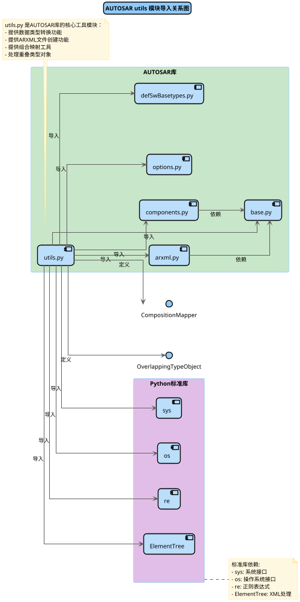

这张图展示了utils.py模块的外部依赖关系：

1. **标准库依赖**：

   ```python
   import os
   import re
   import xml.etree.ElementTree as ET
   import logging
   ```
2. **内部模块依赖**：

   ```python
   from autosar.arxml import ARXml
   from autosar.components import ComponentType
   ```
3. **依赖方向**：

   - utils模块主要依赖于`arxml`和`components`模块
   - 这些依赖关系在代码中体现为导入语句和函数调用
4. **关键接口点**：

   - 与`arxml`模块的接口主要用于XML元素的创建和处理
   - 与`components`模块的接口主要用于组件类型的处理和映射

## utils_ClassDiagram

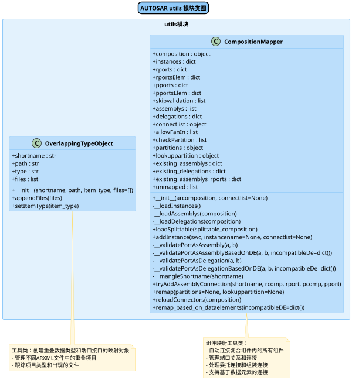

此图详细展示了utils.py中定义的类结构：

1. **OverlappingTypeObject类**：

   ```python
   class OverlappingTypeObject:
       def __init__(self, shortname, path, item_type, files):
           self.shortname = shortname  # 短名称
           self.path = path            # 路径
           self.type = item_type       # 类型
           self.files = files          # 文件列表

       def appendFiles(self, files):
           # 添加文件到列表

       def setItemType(self, item_type):
           # 设置项目类型
   ```

   - 用于处理在多个文件中出现的重叠类型
   - 包含文件列表管理和类型设置功能
2. **CompositionMapper类**：

   ```python
   class CompositionMapper:
       def __init__(self, composition):
           self.composition = composition
           self.instances = {}
           # 其他初始化...

       def addInstance(self, swc, name):
           # 添加组件实例

       def tryAddAssemblyConnection(self, shortname, rcomp, rport, pcomp, pport):
           # 尝试添加连接

       def remap(self):
           # 重新映射所有连接
   ```

   - 负责管理复合组件中组件实例之间的连接
   - 提供添加实例、添加连接和重映射功能
3. **类的方法和属性**：

   - 图中详细展示了每个类的属性和方法
   - 清晰展示了方法的参数和返回类型
4. **类之间的关系**：

   - 两个主要类之间没有直接的继承或组合关系
   - 它们分别服务于不同的功能领域

## utils_FunctionDiagram

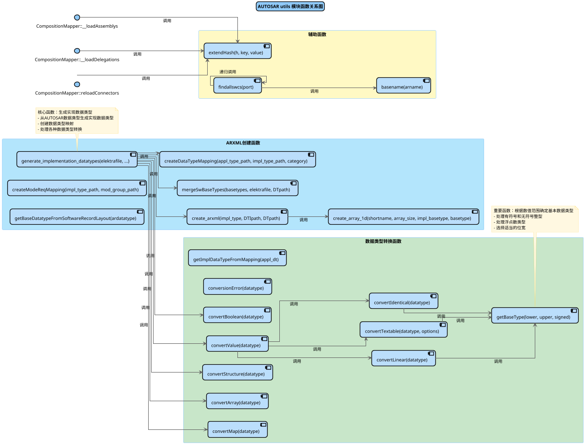

这张图展示了utils.py中函数之间的调用关系：

1. **核心数据类型转换函数**：

   ```python
   def getBaseType(lower, upper, signed=True):
       # 核心实现...
   ```

   - 这个函数是数据类型确定的基础，被多个其他函数调用
   - 根据上下界和是否有符号来确定最合适的基本数据类型
2. **实现数据类型生成函数**：

   ```python
   def generate_implementation_datatypes(elektrafile, DataTypeMappingSetName, DTIpath, DTMpath, DTpath):
       # 调用getBaseType确定类型
       # 调用create_arxml创建XML元素
       # 返回实现类型和基本类型列表
   ```

   - 负责生成AUTOSAR实现数据类型
   - 依赖于多个辅助函数完成工作
3. **ARXML创建函数群**：

   ```python
   def create_arxml(impl_type, DTIpath, DTpath):
       # 创建XML元素

   def create_array_1d(shortname, array_size, impl_basetype, basetype):
       # 创建一维数组类型

   def createDataTypeMapping(appl_type_path, impl_type_path, category):
       # 创建数据类型映射
   ```

   - 这些函数负责创建各种ARXML元素
   - 它们之间有明确的调用顺序和依赖关系
4. **函数调用路径**：

   - 图中的箭头清晰地展示了函数调用的方向和依赖关系
   - 可以看出`generate_implementation_datatypes`是一个高层函数，依赖于多个底层函数

通过这些图表和相关代码的对应解释，可以全面理解utils.py模块的内部结构、功能组织和各组件之间的交互关系。代码示例展示了关键功能的实现方式，有助于开发者理解并正确使用模块提供的功能。

---

# yaml.md

# yaml.py 文件解析

## 简介

yaml.py 是 autosar 库中的一个核心模块，主要功能是支持使用 YAML 配置文件创建和处理 AUTOSAR 软件组件（SWC）。该模块提供了一套完整的工具链，用于解析 YAML 配置，生成符合 AUTOSAR 标准的软件组件，并最终输出为 ARXML 文件。模块的核心是 ARYml 类，它集成了从配置加载、数据类型处理、组件生成到文件输出的全部功能。

作为 AUTOSAR 软件开发的重要工具，yaml.py 简化了 AUTOSAR 组件的创建过程，允许开发者使用更简洁、易读的 YAML 格式代替复杂的 ARXML 格式进行开发。此模块特别适合需要批量生成 AUTOSAR 组件或者简化 AUTOSAR 开发流程的场景。

## 架构概览

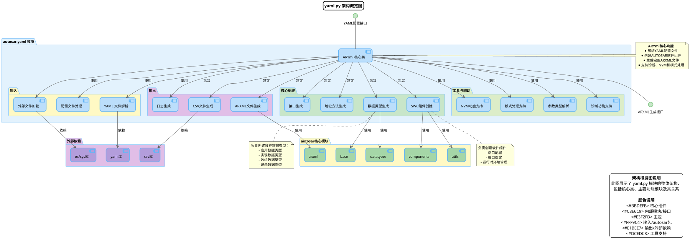

### 架构解释

yaml.py 模块的架构设计清晰，采用了模块化和层次化的结构，主要由以下几个部分组成：

1. **ARYml 核心类**：作为整个模块的中枢，负责协调各个功能模块的工作。它提供了一套完整的 API，用于从 YAML 配置创建 AUTOSAR 组件。
2. **输入处理**：

   - YAML 文件解析器：负责读取和解析 YAML 配置文件
   - 外部文件加载器：处理外部依赖文件的导入
   - 配置文件处理器：加载各种配置项，如包路径、诊断配置等
3. **核心处理**：

   - 数据类型生成器：创建各种 AUTOSAR 数据类型
   - SWC 组件创建器：生成软件组件及其内部结构
   - 接口生成器：创建端口接口
   - 地址方法生成器：处理软件地址方法
4. **输出处理**：

   - ARXML 文件生成器：输出符合 AUTOSAR 标准的 ARXML 文件
   - CSV 文件生成器：创建白名单等辅助文件
   - 日志生成器：记录处理过程和结果
5. **工具与辅助**：提供各种辅助功能，如参数类型解析、诊断功能支持、NVM 功能支持和模式处理支持等。
6. **外部依赖**：模块依赖于标准库中的 yaml、os/sys 和 csv 等组件。
7. **autosar 核心模块**：内部使用 autosar 库中的其他模块，如 components、arxml、base、datatypes 和 utils 等。

这种架构设计具有良好的模块化和可扩展性，使得功能区分明确，便于维护和扩展。

### 架构示例代码

```python
# 使用 yaml.py 创建 AUTOSAR 组件的示例代码

from autosar import yaml
import os

# 1. 初始化 ARYml 实例
yaml_file = 'swc_config.yaml'
output_file = 'generated_swc.arxml'
package_paths_file = 'package_paths.json'
diag_config_file = 'diag_config.json'

# 创建 ARYml 实例
arYml = yaml.ARYml(
    yamlfile=yaml_file,
    filepath=output_file,
    package_paths_file=package_paths_file,
    diag_config_file=diag_config_file
)

# 2. 生成所有内容
arxml = arYml.generate_all()

# 3. 创建辅助文件
arYml.create_whitelist_csv("whitelist", "MySWC", ["Port1", "Port2"])
arYml.create_log()

# 4. 保存 ARXML 文件
arxml.write()

print(f"成功生成 ARXML 文件：{output_file}")
```

## 类与模块结构

```plantuml
@startuml
!pragma encoding utf8
scale max 1800 width


' 图表标题和描述
skinparam backgroundColor white
skinparam defaultFontName Microsoft YaHei
skinparam titleBorderRoundCorner 15
skinparam titleBorderThickness 2
skinparam titleBorderColor black
skinparam titleBackgroundColor LightBlue
skinparam arrowColor #4D4D4D

' 中文字体支持配置
skinparam defaultFontName Microsoft YaHei
skinparam defaultFontSize 12
skinparam ArrowFontName Microsoft YaHei
skinparam StateFontName Microsoft YaHei
skinparam NoteFontName Microsoft YaHei
skinparam TitleFontName Microsoft YaHei
skinparam defaultTextAlignment center
skinparam ParticipantFontName Microsoft YaHei
skinparam ActorFontName Microsoft YaHei
skinparam ComponentFontName Microsoft YaHei
skinparam InterfaceFontName Microsoft YaHei
skinparam ObjectFontName Microsoft YaHei
skinparam ActivityFontName Microsoft YaHei
skinparam LegendFontName Microsoft YaHei
skinparam PackageFontName Microsoft YaHei
skinparam SequenceGroupFontName Microsoft YaHei
skinparam BoxFontName Microsoft YaHei

' 颜色优化标准
skinparam {
  ArrowColor #616161
  ClassBackgroundColor #BBDEFB
  ClassBorderColor #64B5F6
  PackageBorderColor #90CAF9
  PackageBackgroundColor #E3F2FD
  BackgroundColor white
}

title yaml.py 类图

package "autosar.yaml" #E3F2FD {
  class ARYml {
    + DEFAULT_PATHS: dict
    + DEFAULT_DIAG_CONFIG: dict
    + DEFAULT_SWADDRMETHOD: list
    + DEFAULT_NVM_CONFIG: dict
    + DEFAULT_MODE_PORT_CONFIG: dict
    + DEFAULT_SC_TIMEOUT: dict
    + DEFAULT_SUPERVISION: dict
  
    + __init__(yamlfile: str, filepath: str, package_paths_file: str, diag_config_file: str, nvm_config_file: str, mode_config_file: str, timeout_config_file: str, externalfiles_cmd: list, swaddrmethod_file: str, iohal_ecu_file: str, io_allowed_pin_file: str, supervision_config_file: str)
    + load_package_paths_from_json(configfile: str): void
    + load_diag_config_from_json(diagconfigfile: str): void
    + load_nvm_config_from_json(nvm_config_file: str): void
    + load_mode_config_from_json(modeconfigfile: str): void
    + load_timeout_from_json(timeout_config: str): void
    + load_supervision_from_json(supervision_config: str): void
    + load_swaddrmethod_from_csv(): void
    + load_external_files(external_files: list): void
    + load_iohal_config_from_json(iohal_ecu_file: str, io_allowed_pin_file: str): void
    + check_external_files_overlap(external_files: list): void
    + load_composition_from_yaml(composition: dict): void
    + create_stub_arxml(filepath: str): void
    + create_whitelist_csv(filepath: str, swcname: str, elems: list): void
    + create_log(): void
    + get_external_reference(reference: str): object
    + load_external(arxml: ARXml): void
    + copyDependencies(element: object): void
    + generate_all(): ARXml
    + generate_swc(swc: dict): ARSwc
    + createSWC(name: str, elem: dict): ARSwc
    + createSWAddrMethods(): void
    + createDatatype(name: str, yml_elem: dict): ARDatatype
    + getModeRequestTypeMaps(): dict
    + getPortInterfaceFromShortname(shortname: str): ARPortInterface
    + getDatatypeFromShortname(shortname: str): ARDatatype
    + getApplicationDatatypeFromShortname(shortname: str): ARDatatype
    + getImplDatatypeFromShortname(shortname: str): ARImplDatatype
    + getPortAPIOptions(api_options: dict): dict
    + getPortDefinedArguments(arg: dict, args: dict): dict
    + getClientServerOperations(if_path: str, op_shortname: str, argtype: str): list
    + getServiceDataType(dsize: int): ARDatatype
    + getServiceArgumentTypes(operation: str, datatype: str): dict
    + getRoutineArgumentTypes(operation: str, indata: str, userOutData: str, sw_label: str): dict
    + getRoutineDatatype(dsize: int, operation: str, outdata: bool): ARDatatype
    + createArrayDatatypeElementForDiag(dsize: int): ARArrayDatatype
    + createLenVarType(): ARDatatype
    + validate_rid_type(rid_type: str, operations: list): bool
    + getNvmOperations(nvm_type: str, service_needs: list, error_status: bool): list
    + getNameFromPattern(naming_pattern: str, *args): str
    + getModePortInfo(elem: dict, mode: str, template: bool): dict
    + getDisabledModes(mode_suppression: dict): list
    + getArgTypeForNvM(nv_if: str): ARParameterDataPrototype
    + getInitValueForIOhal(dataElement: dict, init_data_ref: str): str
  }
}

package "autosar" #FFF9C4 {
  package "components" #C8E6C9 {
    class ARComAxisDataType {
    }
    class ARCurveDataType {
    }
    class ARImplDatatype {
    }
    class ARMapDataType {
    }
    class ARSWRecordLayout {
    }
    class ARVariableDataPrototype {
    }
    class ARPortInterface {
    }
    class ARUnit {
    }
    class ARModeSwitchInterface {
    }
    class ARModeDeclarationGroup {
    }
    class ARConstant {
    }
    class AR_RPort {
    }
    class AR_PPort {
    }
    class ARArrayDatatype {
    }
    class ARClientServerInterface {
    }
    class ARCompuMethod {
    }
    class ARDataConstraint {
    }
    class ARDatatype {
    }
    class ARRecordDatatype {
    }
    class ARSenderReceiverInterface {
    }
    class ARSwc {
    }
    class ARPhysDimension {
    }
    class ARSwcImplementation {
    }
    class ARParameterDataPrototype {
    }
    class ARExclusiveArea {
    }
    class ARServiceDependency {
    }
    class ARNvDataInterface {
    }
  }
  
  package "arxml" #C8E6C9 {
    class ARXml {
    }
  }
  
  package "base" #C8E6C9 {
    class ARPackage {
    }
    class ARObject {
    }
  }
  
  package "datatypes" #C8E6C9 {
    class DataTypeNotDefinedException {
    }
  }
  
  package "utils" #C8E6C9 {
    class OverlappingTypeObject {
    }
  }
  
  package "options" #C8E6C9 {
  }
}

' 外部依赖关系
package "外部依赖" #E1BEE7 {
  class "yaml" #B39DDB {
    + load()
    + SafeLoader
  }
  class "os" #B39DDB
  class "re" #B39DDB
  class "sys" #B39DDB
  class "csv" #B39DDB
}

' 关系定义
ARYml --> "yaml"
ARYml --> "os"
ARYml --> "re"
ARYml --> "sys"
ARYml --> "csv"
ARYml --> ARXml: 使用
ARYml --> ARPackage: 使用
ARYml --> ARObject: 使用
ARYml --> ARSwc: 创建和管理
ARYml --> ARDatatype: 创建和管理
ARYml --> ARPortInterface: 创建和管理
ARYml --> ARParameterDataPrototype: 创建和管理
ARYml --> ARImplDatatype: 创建和管理
ARYml --> ARArrayDatatype: 创建和管理
ARYml --> DataTypeNotDefinedException: 处理
ARYml --> OverlappingTypeObject: 使用

' 图例说明
legend right
  <b>类图说明</b>
  此图展示了 yaml.py 模块中的 ARYml 类及其与其他类的关系
  
  <b>颜色说明</b>
  <#BBDEFB> 主要类
  <#C8E6C9> 内部模块类
  <#FFF9C4> 应用层
  <#E1BEE7> 外部依赖
end legend

@enduml 
```

### 类结构解释

yaml.py 模块的核心是 ARYml 类，它负责整个从 YAML 到 ARXML 的转换过程。从类图可以看出，ARYml 具有丰富的功能和复杂的依赖关系：

1. **静态配置项**：

   - DEFAULT_PATHS：定义了各种包的默认路径
   - DEFAULT_DIAG_CONFIG：提供了诊断功能的默认配置
   - DEFAULT_SWADDRMETHOD：定义了软件地址方法的默认设置
   - DEFAULT_NVM_CONFIG：提供了非易失性存储器的默认配置
   - DEFAULT_MODE_PORT_CONFIG：定义了模式端口的默认配置
   - DEFAULT_SC_TIMEOUT：设置了客户端服务器操作的默认超时
   - DEFAULT_SUPERVISION：提供了监督功能的默认配置
2. **主要功能分组**：

   - 初始化和配置加载功能：包括 __init__、load_package_paths_from_json 等方法
   - 外部文件处理功能：包括 load_external_files、check_external_files_overlap 等方法
   - 文件生成功能：包括 create_stub_arxml、create_whitelist_csv、create_log 等方法
   - 核心生成功能：包括 generate_all、generate_swc、createSWC 等方法
   - 数据类型处理功能：包括 createDatatype、createArrayDatatypeElementForDiag 等方法
   - 工具和辅助功能：包括各种 get* 方法，用于获取或构建特定的组件
3. **关键依赖关系**：

   - 外部库依赖：yaml、os、re、sys、csv 等标准库
   - autosar 模块依赖：ARXml、ARPackage、ARObject、ARSwc、ARDatatype 等 AUTOSAR 相关类
   - 异常处理依赖：DataTypeNotDefinedException、OverlappingTypeObject 等

ARYml 类采用了组合设计模式，将各种功能模块化，使得类结构清晰、功能分明，同时也便于维护和扩展。

### 类结构示例代码

```python
# ARYml 类使用示例
from autosar import yaml

# 创建 ARYml 实例并进行配置
aryml = yaml.ARYml(
    yamlfile='component_config.yaml',
    filepath='output.arxml',
    package_paths_file='package_paths.json',
    diag_config_file='diag_config.json',
    nvm_config_file='nvm_config.json',
    mode_config_file='mode_config.json'
)

# 加载额外的外部文件
aryml.load_external_files([
    'external_datatypes.arxml',
    'external_interfaces.arxml'
])

# 检查外部文件是否有重叠
aryml.check_external_files_overlap([
    'external_datatypes.arxml',
    'external_interfaces.arxml'
])

# 创建数据类型
array_datatype = aryml.createArrayDatatypeElementForDiag(dsize=8)
len_vartype = aryml.createLenVarType()

# 获取端口接口
port_interface = aryml.getPortInterfaceFromShortname('MyInterface')

# 获取数据类型
datatype = aryml.getDatatypeFromShortname('MyDataType')
app_datatype = aryml.getApplicationDatatypeFromShortname('MyAppDataType')
impl_datatype = aryml.getImplDatatypeFromShortname('MyImplDataType')

# 生成 SWC 组件
swc = aryml.generate_swc({'name': 'MySWC', 'ports': [...], 'runnables': [...]})

# 生成所有内容并输出
arxml = aryml.generate_all()
aryml.create_log()
arxml.write()
```

## 模块结构图

```plantuml
@startuml
!pragma encoding utf8
scale max 1800 width


' 图表标题和描述
skinparam backgroundColor white
skinparam defaultFontName Microsoft YaHei
skinparam titleBorderRoundCorner 15
skinparam titleBorderThickness 2
skinparam titleBorderColor black
skinparam titleBackgroundColor LightBlue
skinparam arrowColor #4D4D4D

' 中文字体支持配置
skinparam defaultFontName Microsoft YaHei
skinparam defaultFontSize 12
skinparam ArrowFontName Microsoft YaHei
skinparam StateFontName Microsoft YaHei
skinparam NoteFontName Microsoft YaHei
skinparam TitleFontName Microsoft YaHei
skinparam defaultTextAlignment center
skinparam PackageFontName Microsoft YaHei

' 颜色优化标准
skinparam {
  ArrowColor #616161
  PackageBorderColor #90CAF9
  PackageBackgroundColor #E3F2FD
  BackgroundColor white
  ComponentBackgroundColor #BBDEFB
  ComponentBorderColor #64B5F6
}

title yaml.py 模块结构图

' 定义外部模块
package "标准库" #E1BEE7 {
  [yaml] #B39DDB
  [os] #B39DDB
  [re] #B39DDB
  [sys] #B39DDB
  [csv] #B39DDB
}

' 定义内部autosar模块结构
package "autosar" #FFF9C4 {
  package "components" #C8E6C9 {
    [ARSwc] #A5D6A7
    [ARDatatype相关组件] #A5D6A7
    [ARPortInterface相关组件] #A5D6A7
    [其他组件类] #A5D6A7
  }
  
  package "arxml" #C8E6C9 {
    [ARXml] #A5D6A7
    [create方法] #A5D6A7
    [load方法] #A5D6A7
  }
  
  package "base" #C8E6C9 {
    [ARPackage] #A5D6A7
    [ARObject] #A5D6A7
    [add_schema方法] #A5D6A7
    [create_element方法] #A5D6A7
  }
  
  package "datatypes" #C8E6C9 {
    [getTypeReferenceString方法] #A5D6A7
    [DataTypeNotDefinedException] #A5D6A7
  }
  
  package "utils" #C8E6C9 {
    [generate_implementation_datatypes] #A5D6A7
    [createModeReqMapping] #A5D6A7
    [OverlappingTypeObject] #A5D6A7
  }
  
  package "options" #C8E6C9 {
    [AROptions] #A5D6A7
  }
  
  package "_version" #C8E6C9 {
    [__version__] #A5D6A7
  }
}

' 定义yaml.py模块
[autosar.yaml] #BBDEFB

' 导入关系
[autosar.yaml] ..> [yaml]
[autosar.yaml] ..> [os]
[autosar.yaml] ..> [re]
[autosar.yaml] ..> [sys]
[autosar.yaml] ..> [csv]

[autosar.yaml] ..> [ARDatatype相关组件]
[autosar.yaml] ..> [ARSwc]
[autosar.yaml] ..> [ARPortInterface相关组件]
[autosar.yaml] ..> [其他组件类]

[autosar.yaml] ..> [ARXml]
[autosar.yaml] ..> [create方法]
[autosar.yaml] ..> [load方法]

[autosar.yaml] ..> [ARPackage]
[autosar.yaml] ..> [ARObject]
[autosar.yaml] ..> [add_schema方法]
[autosar.yaml] ..> [create_element方法]

[autosar.yaml] ..> [getTypeReferenceString方法]
[autosar.yaml] ..> [DataTypeNotDefinedException]

[autosar.yaml] ..> [generate_implementation_datatypes]
[autosar.yaml] ..> [createModeReqMapping]
[autosar.yaml] ..> [OverlappingTypeObject]

[autosar.yaml] ..> [AROptions]
[autosar.yaml] ..> [__version__]

' 注释
note right of [autosar.yaml]
  <b>yaml.py 模块</b>
  主要功能：支持使用 YAML 文件
  创建和处理 SWC (软件组件)
end note

' 图例说明
legend right
  <b>模块结构图说明</b>
  此图展示了 yaml.py 模块的导入结构
  及与其他模块的依赖关系
  
  <b>颜色说明</b>
  <#BBDEFB> 主要模块
  <#C8E6C9> 内部模块
  <#A5D6A7> 内部组件
  <#FFF9C4> autosar 包
  <#E1BEE7> 外部标准库
  <#B39DDB> 外部依赖组件
end legend

@enduml 
```

### 模块结构解释

模块结构图清晰地展示了 yaml.py 模块与其他模块的依赖关系：

1. **标准库依赖**：

   - yaml：用于解析 YAML 配置文件
   - os/sys：用于文件系统操作和系统调用
   - re：用于正则表达式处理
   - csv：用于 CSV 文件的读写操作
2. **autosar 内部模块依赖**：

   - components：提供 AUTOSAR 组件定义，如 ARSwc、ARDatatype 等
   - arxml：处理 ARXML 文件的读写，包括 ARXml 类、create 和 load 方法
   - base：提供基础类和函数，如 ARPackage、ARObject 等
   - datatypes：处理数据类型相关的功能
   - utils：提供工具函数，如 generate_implementation_datatypes 等
   - options：提供全局选项配置
   - _version：提供版本信息

这种模块结构设计遵循了良好的软件工程实践：

- **关注点分离**：每个模块都有明确的职责，yaml.py 专注于 YAML 到 ARXML 的转换
- **依赖注入**：通过导入需要的模块和类，实现了松耦合的设计
- **层次化设计**：从底层的基础类到高层的应用功能，形成了清晰的层次结构

### 模块结构示例代码

```python
# yaml.py 的模块依赖示例

# 标准库导入
from yaml import load as yaml_load, SafeLoader
import os
import re
import sys
import csv

# autosar 内部模块导入
from autosar import datatypes
from autosar.components import (
    ARSwc, AR_RPort, AR_PPort, ARPortInterface,
    ARDatatype, ARArrayDatatype, ARImplDatatype
)
from autosar.arxml import ARXml, create as arxml_create, load as arxml_load
from autosar.base import ARPackage, add_schema, ARObject, create_element
from autosar.utils import generate_implementation_datatypes, createModeReqMapping
from autosar.utils import OverlappingTypeObject
import autosar.options as AROptions
from ._version import __version__

# 模块使用示例
def process_yaml_file(yaml_file_path, output_arxml_path):
    """处理 YAML 文件并生成 ARXML 文件"""
  
    # 使用标准库
    with open(yaml_file_path, 'r') as fh:
        yaml_content = yaml_load(fh, Loader=SafeLoader)
  
    # 创建 ARXml 实例
    arxml = arxml_create(output_arxml_path, True)
  
    # 创建软件组件
    swc = ARSwc(yaml_content['name'])
  
    # 添加端口
    for port_config in yaml_content.get('ports', []):
        port_interface = ARPortInterface(port_config['interface'])
        if port_config['direction'] == 'in':
            swc.add(AR_RPort(port_config['name'], port_interface))
        else:
            swc.add(AR_PPort(port_config['name'], port_interface))
  
    # 添加到 ARXML
    package = ARPackage('Components')
    package.add(swc)
    arxml.add(package)
  
    # 写入文件
    arxml.write()
  
    return arxml
```

## 功能流程

```plantuml
@startuml
!pragma encoding utf8
scale max 1800 width


' 图表标题和描述
skinparam backgroundColor white
skinparam defaultFontName Microsoft YaHei
skinparam titleBorderRoundCorner 15
skinparam titleBorderThickness 2
skinparam titleBorderColor black
skinparam titleBackgroundColor LightBlue
skinparam arrowColor #4D4D4D

' 中文字体支持配置
skinparam defaultFontName Microsoft YaHei
skinparam defaultFontSize 12
skinparam ArrowFontName Microsoft YaHei
skinparam StateFontName Microsoft YaHei
skinparam NoteFontName Microsoft YaHei
skinparam TitleFontName Microsoft YaHei
skinparam defaultTextAlignment center
skinparam ParticipantFontName Microsoft YaHei
skinparam ActorFontName Microsoft YaHei
skinparam SequenceLifeLineBorderColor #64B5F6
skinparam SequenceLifeLineBackgroundColor #BBDEFB
skinparam SequenceGroupBorderColor #81C784
skinparam SequenceGroupBackgroundColor #C8E6C9
skinparam SequenceBoxBackgroundColor #E3F2FD
skinparam SequenceBoxBorderColor #90CAF9

title yaml.py 时序图

' 参与者定义
actor "用户" as User #FFF9C4
participant "ARYml" as ARYml
participant "YAML加载器" as YamlLoader
participant "配置处理器" as ConfigProcessor
participant "数据类型生成器" as DatatypeGenerator
participant "SWC生成器" as SwcGenerator
participant "ARXML生成器" as ArxmlGenerator

' 时序流程
User -> ARYml: 初始化ARYml实例\n(__init__)
activate ARYml

ARYml -> YamlLoader: 加载YAML文件\n(yaml_load)
activate YamlLoader
YamlLoader --> ARYml: 返回YAML数据结构
deactivate YamlLoader

ARYml -> ConfigProcessor: 加载配置文件
activate ConfigProcessor
note right: 加载包路径、诊断配置、\nNVM配置、模式配置等

group 配置加载流程
    ARYml -> ConfigProcessor: load_package_paths_from_json
    ARYml -> ConfigProcessor: load_diag_config_from_json
    ARYml -> ConfigProcessor: load_nvm_config_from_json
    ARYml -> ConfigProcessor: load_mode_config_from_json
    ARYml -> ConfigProcessor: load_timeout_from_json
    ARYml -> ConfigProcessor: load_supervision_from_json
    ARYml -> ConfigProcessor: load_swaddrmethod_from_csv
    ARYml -> ConfigProcessor: load_external_files
    ARYml -> ConfigProcessor: load_iohal_config_from_json
end

ConfigProcessor --> ARYml: 所有配置加载完成
deactivate ConfigProcessor

User -> ARYml: 生成所有内容\n(generate_all)
activate ARYml

ARYml -> ARYml: 检查外部文件重叠\n(check_external_files_overlap)

group 内容生成流程
    ARYml -> DatatypeGenerator: 创建数据类型\n(createDatatype)
    activate DatatypeGenerator
  
    DatatypeGenerator -> DatatypeGenerator: 处理基本数据类型
    DatatypeGenerator -> DatatypeGenerator: 处理数组类型\n(createArrayDatatypeElementForDiag)
    DatatypeGenerator -> DatatypeGenerator: 处理长度变量类型\n(createLenVarType)
  
    DatatypeGenerator --> ARYml: 返回创建的数据类型
    deactivate DatatypeGenerator
  
    ARYml -> ARYml: 创建地址方法\n(createSWAddrMethods)
  
    ARYml -> SwcGenerator: 生成SWC组件\n(generate_swc)
    activate SwcGenerator
  
    SwcGenerator -> SwcGenerator: 创建SWC\n(createSWC)
  
    group SWC创建流程
        SwcGenerator -> SwcGenerator: 获取端口接口\n(getPortInterfaceFromShortname)
        SwcGenerator -> SwcGenerator: 获取数据类型\n(getDatatypeFromShortname)
        SwcGenerator -> SwcGenerator: 获取应用数据类型\n(getApplicationDatatypeFromShortname)
        SwcGenerator -> SwcGenerator: 获取实现数据类型\n(getImplDatatypeFromShortname)
        SwcGenerator -> SwcGenerator: 处理客户端-服务器操作\n(getClientServerOperations)
        SwcGenerator -> SwcGenerator: 处理诊断服务\n(getServiceDataType/getServiceArgumentTypes)
        SwcGenerator -> SwcGenerator: 处理NVM操作\n(getNvmOperations)
        SwcGenerator -> SwcGenerator: 处理模式端口\n(getModePortInfo)
    end
  
    SwcGenerator --> ARYml: 返回创建的SWC组件
    deactivate SwcGenerator
end

ARYml -> ArxmlGenerator: 生成ARXML文件
activate ArxmlGenerator
ArxmlGenerator --> ARYml: ARXML文件生成完成
deactivate ArxmlGenerator

ARYml -> ARYml: 创建存根ARXML\n(create_stub_arxml)
ARYml -> ARYml: 创建白名单CSV\n(create_whitelist_csv)
ARYml -> ARYml: 创建日志\n(create_log)

ARYml --> User: 返回生成的ARXml对象
deactivate ARYml

' 图例说明
legend right
  <b>时序图说明</b>
  此图展示了 yaml.py 模块的主要处理流程，
  从初始化到最终生成 ARXML 文件的完整时序
  
  <b>颜色说明</b>
  <#BBDEFB> 主要组件/对象
  <#C8E6C9> 分组流程
  <#E3F2FD> 序列框
  <#FFF9C4> 用户
end legend

@enduml 
```

### 功能流程解释

时序图展示了 ARYml 类从初始化到生成最终 ARXML 文件的完整流程，主要分为以下几个阶段：

1. **初始化阶段**：

   - 用户创建 ARYml 实例，调用 __init__ 方法
   - ARYml 加载 YAML 文件，解析成数据结构
   - 加载各种配置文件，包括包路径、诊断配置、NVM 配置等
2. **配置加载阶段**：

   - load_package_paths_from_json：加载包路径配置
   - load_diag_config_from_json：加载诊断配置
   - load_nvm_config_from_json：加载 NVM 配置
   - load_mode_config_from_json：加载模式配置
   - load_timeout_from_json：加载超时配置
   - load_supervision_from_json：加载监督配置
   - load_swaddrmethod_from_csv：加载软件地址方法配置
   - load_external_files：加载外部文件
   - load_iohal_config_from_json：加载 IO-HAL 配置
3. **内容生成阶段**：

   - 检查外部文件重叠：确保没有冲突的定义
   - 创建数据类型：处理基本数据类型、数组类型和长度变量类型
   - 创建地址方法：定义软件地址方法
   - 生成 SWC 组件：创建软件组件结构
4. **SWC 创建流程**：

   - 获取端口接口：解析端口接口定义
   - 获取数据类型：解析各种数据类型定义
   - 处理客户端-服务器操作：设置操作和参数
   - 处理诊断服务：添加诊断功能
   - 处理 NVM 操作：添加非易失性存储功能
   - 处理模式端口：设置模式切换功能
5. **输出阶段**：

   - 生成 ARXML 文件：将所有创建的组件写入 ARXML 文件
   - 创建存根 ARXML：生成简化版的 ARXML 文件
   - 创建白名单 CSV：生成辅助文件
   - 创建日志：记录处理结果

整个流程设计有条理、层次分明，每个阶段都有明确的职责，体现了良好的软件工程实践。

### 功能流程示例代码

```python
# ARYml 类的完整使用流程示例

from autosar import yaml
import os

def generate_arxml_from_yaml():
    # 1. 初始化 ARYml 实例
    arYml = yaml.ARYml(
        yamlfile='swc_definition.yaml',
        filepath='output/swc.arxml',
        package_paths_file='config/package_paths.json',
        diag_config_file='config/diag_config.json',
        nvm_config_file='config/nvm_config.json',
        mode_config_file='config/mode_config.json',
        timeout_config_file='config/timeout_config.json',
        supervision_config_file='config/supervision_config.json',
        externalfiles_cmd=['external/types.arxml', 'external/interfaces.arxml'],
        swaddrmethod_file='config/swaddrmethod.csv',
        iohal_ecu_file='config/iohal_ecu.json',
        io_allowed_pin_file='config/io_pins.json'
    )

    # 2. 检查外部文件是否有重叠
    arYml.check_external_files_overlap(['external/types.arxml', 'external/interfaces.arxml'])

    # 3. 生成所有内容
    print("生成 AUTOSAR 组件...")
    arxml = arYml.generate_all()

    # 4. 创建辅助文件
    print("创建辅助文件...")
    arYml.create_stub_arxml('output/stub.arxml')
    arYml.create_whitelist_csv('output/whitelist', 'MySWC', ['Port1', 'Port2'])
    arYml.create_log()

    # 5. 保存 ARXML 文件
    print("保存 ARXML 文件...")
    arxml.write()
    print("完成！")

    return arxml

# 执行生成流程
if __name__ == "__main__":
    generate_arxml_from_yaml()
```

## 状态与转换

```plantuml
@startuml
!pragma encoding utf8
scale max 1800 width


' 图表标题和描述
skinparam backgroundColor white
skinparam defaultFontName Microsoft YaHei
skinparam titleBorderRoundCorner 15
skinparam titleBorderThickness 2
skinparam titleBorderColor black
skinparam titleBackgroundColor LightBlue
skinparam arrowColor #4D4D4D

' 中文字体支持配置
skinparam defaultFontName Microsoft YaHei
skinparam defaultFontSize 12
skinparam ArrowFontName Microsoft YaHei
skinparam StateFontName Microsoft YaHei
skinparam NoteFontName Microsoft YaHei
skinparam TitleFontName Microsoft YaHei
skinparam defaultTextAlignment center

' 颜色优化标准
skinparam {
  ArrowColor #616161
  StateBackgroundColor #BBDEFB
  StateBorderColor #64B5F6
  NoteBackgroundColor #FFF8E1
  NoteBorderColor #FFD54F
  BackgroundColor white
}

title yaml.py 状态图

' 定义状态
[*] --> 未初始化

state 未初始化 {
  [*] --> 等待配置
}

state 初始化中 {
  state "加载YAML文件" as LoadYaml
  state "加载配置文件" as LoadConfig
  state "加载外部文件" as LoadExternal
  
  LoadYaml --> LoadConfig
  LoadConfig --> LoadExternal  
}

state 已配置 {
  state "检查配置完整性" as CheckConfig
  state "准备生成环境" as PrepareEnv
  
  CheckConfig --> PrepareEnv
}

state 生成处理中 {
  state "生成数据类型" as GenDatatype
  state "生成地址方法" as GenAddrMethods
  state "生成SWC组件" as GenSwc
  state "生成端口接口" as GenInterfaces
  state "处理依赖关系" as ProcessDeps
  
  GenDatatype --> GenAddrMethods
  GenAddrMethods --> GenSwc
  GenSwc --> GenInterfaces
  GenInterfaces --> ProcessDeps
}

state 输出处理中 {
  state "生成ARXML文件" as GenARXML
  state "生成CSV白名单" as GenCSV
  state "生成日志文件" as GenLog
  
  GenARXML --> GenCSV
  GenCSV --> GenLog
}

state 已完成

' 主要状态转换关系
未初始化 --> 初始化中 : __init__()
初始化中 --> 已配置 : 配置加载完成
已配置 --> 生成处理中 : generate_all()
生成处理中 --> 输出处理中 : 组件生成完成
输出处理中 --> 已完成 : 输出文件生成完成

' 异常处理状态
state 错误状态 {
  state "配置错误" as ConfigError
  state "依赖冲突" as DependencyConflict
  state "类型错误" as TypeError
  state "文件生成错误" as FileError
  
  ConfigError --> [*] : 抛出异常
  DependencyConflict --> [*] : 抛出异常
  TypeError --> [*] : 抛出异常
  FileError --> [*] : 抛出异常
}

' 错误状态转换
初始化中 --> 配置错误 : 配置文件不存在或格式错误
已配置 --> 配置错误 : 配置不完整
生成处理中 --> 依赖冲突 : 外部引用重叠
生成处理中 --> 类型错误 : 数据类型未定义
输出处理中 --> 文件生成错误 : 文件写入失败

' 附加说明
note right of 已配置
  配置完成状态包括：
  - 包路径配置已加载
  - 诊断配置已加载
  - NVM配置已加载
  - 模式配置已加载
  - 外部文件已加载
end note

note right of 生成处理中
  SWC组件生成过程包括：
  - 创建类型 (createDatatype)
  - 创建端口 (ARPort)
  - 创建接口 (ARInterface)
  - 处理引用 (ARRef)
end note

note right of 已完成
  生成完成后可获取：
  - ARXML文件
  - CSV白名单文件
  - 日志文件
end note

' 图例说明
legend right
  <b>状态图说明</b>
  此图展示了 yaml.py 处理过程中
  各个状态的转换关系和处理流程
  
  <b>颜色说明</b>
  <#BBDEFB> 正常状态
  <#FFF8E1> 说明注释
  <#FFCDD2> 错误状态
end legend

@enduml 
```

### 状态与转换解释

状态图描述了 ARYml 类在处理过程中的各个状态及其转换关系：

1. **未初始化状态**：

   - 程序开始时的初始状态，此时 ARYml 实例尚未创建
   - 等待配置：等待用户提供必要的配置信息
2. **初始化中状态**：

   - 由 __init__ 方法触发，进入初始化流程
   - 加载 YAML 文件：解析用户提供的 YAML 文件
   - 加载配置文件：加载各种配置项
   - 加载外部文件：导入外部依赖的 ARXML 文件
3. **已配置状态**：

   - 配置加载完成后进入此状态
   - 检查配置完整性：确保所有必要的配置都已加载
   - 准备生成环境：为生成 ARXML 文件做准备
4. **生成处理中状态**：

   - 由 generate_all() 方法触发，开始生成 AUTOSAR 组件
   - 生成数据类型：创建各种数据类型定义
   - 生成地址方法：创建软件地址方法
   - 生成 SWC 组件：创建软件组件结构
   - 生成端口接口：创建端口和接口定义
   - 处理依赖关系：处理组件之间的依赖关系
5. **输出处理中状态**：

   - 组件生成完成后进入此状态
   - 生成 ARXML 文件：将生成的组件写入 ARXML 文件
   - 生成 CSV 白名单：创建辅助的 CSV 文件
   - 生成日志文件：记录处理过程和结果
6. **已完成状态**：

   - 所有输出文件生成完成后进入此状态
   - 程序执行结束
7. **错误状态**：

   - 配置错误：配置文件不存在或格式错误
   - 依赖冲突：外部引用重叠
   - 类型错误：数据类型未定义
   - 文件生成错误：文件写入失败

状态图中还包含了各种状态转换的触发条件和异常处理路径，清晰地展示了 ARYml 类的处理流程和可能的错误情况。

### 状态与转换示例代码

```python
# ARYml 类的状态流转示例

from autosar import yaml
import os
from autosar.datatypes import DataTypeNotDefinedException
from autosar.utils import OverlappingTypeObject

def process_with_error_handling():
    try:
        # 1. 未初始化 -> 初始化中
        print("开始初始化 ARYml...")
        arYml = yaml.ARYml(
            yamlfile='swc_definition.yaml',
            filepath='output/swc.arxml',
            package_paths_file='config/package_paths.json'
        )
        print("初始化完成.")
      
        # 2. 初始化中 -> 已配置
        print("加载外部文件...")
        try:
            arYml.load_external_files(['external/types.arxml'])
        except FileNotFoundError:
            # 初始化中 -> 配置错误
            print("错误：外部文件不存在!")
            return
      
        # 3. 检查配置是否完整
        print("检查配置完整性...")
        if not hasattr(arYml, 'package_paths') or not arYml.package_paths:
            # 已配置 -> 配置错误
            print("错误：包路径配置不完整!")
            return
      
        # 4. 已配置 -> 生成处理中
        print("开始生成 AUTOSAR 组件...")
        try:
            # 检查外部引用重叠
            try:
                arYml.check_external_files_overlap(['external/types.arxml'])
            except OverlappingTypeObject as e:
                # 生成处理中 -> 依赖冲突
                print(f"错误：外部引用重叠! {e}")
                return
          
            # 生成数据类型和组件
            try:
                arxml = arYml.generate_all()
            except DataTypeNotDefinedException as e:
                # 生成处理中 -> 类型错误
                print(f"错误：数据类型未定义! {e}")
                return
          
            # 5. 生成处理中 -> 输出处理中
            print("生成输出文件...")
            try:
                arYml.create_stub_arxml('output/stub.arxml')
                arYml.create_whitelist_csv('output/whitelist', 'MySWC', ['Port1', 'Port2'])
                arYml.create_log()
                arxml.write()
            except IOError as e:
                # 输出处理中 -> 文件生成错误
                print(f"错误：文件写入失败! {e}")
                return
          
            # 6. 输出处理中 -> 已完成
            print("处理完成!")
            return arxml
          
        except Exception as e:
            print(f"处理过程中发生未预期的错误: {e}")
            return
          
    except Exception as e:
        print(f"初始化过程中发生错误: {e}")
        return

# 执行处理流程
if __name__ == "__main__":
    result = process_with_error_handling()
    if result:
        print("生成成功!")
    else:
        print("生成失败!")
```

## 函数调用关系

```plantuml
@startuml
!pragma encoding utf8
scale max 1800 width


' 图表标题和描述
skinparam backgroundColor white
skinparam defaultFontName Microsoft YaHei
skinparam titleBorderRoundCorner 15
skinparam titleBorderThickness 2
skinparam titleBorderColor black
skinparam titleBackgroundColor LightBlue
skinparam arrowColor #4D4D4D

' 中文字体支持配置
skinparam defaultFontName Microsoft YaHei
skinparam defaultFontSize 12
skinparam ArrowFontName Microsoft YaHei
skinparam StateFontName Microsoft YaHei
skinparam NoteFontName Microsoft YaHei
skinparam TitleFontName Microsoft YaHei
skinparam ActivityFontName Microsoft YaHei

' 颜色优化标准
skinparam {
  ArrowColor #616161
  ActivityBackgroundColor #BBDEFB
  ActivityBorderColor #64B5F6
  BackgroundColor white
}

title yaml.py 函数调用关系图

' 主要流程
(*) --> "初始化ARYml" as init
note right: __init__(yamlfile, filepath, package_paths_file, ...)

' 配置加载
init --> "加载包路径配置" as load_paths 
note right: load_package_paths_from_json(configfile)

init --> "加载诊断配置" as load_diag
note right: load_diag_config_from_json(diagconfigfile)

init --> "加载NVM配置" as load_nvm
note right: load_nvm_config_from_json(nvm_config_file)

init --> "加载模式配置" as load_mode
note right: load_mode_config_from_json(modeconfigfile)

init --> "加载超时配置" as load_timeout
note right: load_timeout_from_json(timeout_config)

init --> "加载监督配置" as load_supervision
note right: load_supervision_from_json(supervision_config)

init --> "加载SwAddrMethod配置" as load_swaddrmethod
note right: load_swaddrmethod_from_csv()

init --> "加载外部文件" as load_external
note right: load_external_files(external_files)

init --> "加载IO-HAL配置" as load_iohal
note right: load_iohal_config_from_json(iohal_ecu_file, io_allowed_pin_file)

' 生成流程
load_external --> "生成全部内容" as generate_all
note right: generate_all() -> ARXml

generate_all --> "检查外部文件重叠" as check_overlap
note right: check_external_files_overlap(external_files)

' 组件创建流程
generate_all --> "生成SWC" as generate_swc
note right: generate_swc(swc) -> ARSwc

generate_swc --> "创建SWC" as create_swc
note right: createSWC(name, elem) -> ARSwc

create_swc --> "获取端口接口" as get_port_interface
note right: getPortInterfaceFromShortname(shortname) -> ARPortInterface

create_swc --> "获取数据类型" as get_datatype
note right: getDatatypeFromShortname(shortname) -> ARDatatype

create_swc --> "获取应用数据类型" as get_app_datatype
note right: getApplicationDatatypeFromShortname(shortname) -> ARDatatype

create_swc --> "获取实现数据类型" as get_impl_datatype
note right: getImplDatatypeFromShortname(shortname) -> ARImplDatatype

generate_all --> "创建数据类型" as create_datatype
note right: createDatatype(name, yml_elem) -> ARDatatype

generate_all --> "创建SwAddrMethods" as create_swaddrmethods
note right: createSWAddrMethods()

' 特殊服务处理
create_swc --> "获取客户端-服务器操作" as get_cs_operations
note right: getClientServerOperations(if_path, op_shortname, argtype) -> list

create_swc --> "获取NVM操作" as get_nvm_operations
note right: getNvmOperations(nvm_type, service_needs, error_status) -> list

create_swc --> "获取服务数据类型" as get_service_datatype
note right: getServiceDataType(dsize) -> ARDatatype

create_swc --> "获取服务参数类型" as get_service_argtypes
note right: getServiceArgumentTypes(operation, datatype) -> dict

create_swc --> "获取例程参数类型" as get_routine_argtypes
note right: getRoutineArgumentTypes(operation, indata, userOutData, sw_label) -> dict

create_swc --> "获取例程数据类型" as get_routine_datatype
note right: getRoutineDatatype(dsize, operation, outdata) -> ARDatatype

create_datatype --> "创建数组数据类型" as create_array_datatype
note right: createArrayDatatypeElementForDiag(dsize) -> ARArrayDatatype

create_datatype --> "创建长度变量类型" as create_len_vartype
note right: createLenVarType() -> ARDatatype

' 辅助功能
create_swc --> "验证RID类型" as validate_rid_type
note right: validate_rid_type(rid_type, operations) -> bool

create_swc --> "获取模式端口信息" as get_mode_port_info
note right: getModePortInfo(elem, mode, template) -> dict

create_swc --> "获取禁用模式" as get_disabled_modes
note right: getDisabledModes(mode_suppression) -> list

create_swc --> "获取NVM参数类型" as get_arg_type_for_nvm
note right: getArgTypeForNvM(nv_if) -> ARParameterDataPrototype

create_swc --> "获取IOhal初始值" as get_init_value_for_iohal
note right: getInitValueForIOhal(dataElement, init_data_ref) -> str

' 生成完成
generate_all --> "创建存根ARXML" as create_stub_arxml
note right: create_stub_arxml(filepath)

generate_all --> "创建白名单CSV" as create_whitelist_csv
note right: create_whitelist_csv(filepath, swcname, elems)

generate_all --> "创建日志" as create_log
note right: create_log()

' 输出
generate_all --> (*)

' 图例说明
legend right
  <b>函数调用图说明</b>
  此图展示了 yaml.py 模块的主要函数调用关系
  
  <b>图例</b>
  <#BBDEFB> 函数/方法
  → 调用关系
end legend

@enduml 
```

### 函数调用关系解释

函数调用关系图展示了 ARYml 类中各个方法之间的调用关系，主要包括以下几个核心功能组：

1. **初始化与配置加载**：

   - __init__：初始化 ARYml 实例
   - load_package_paths_from_json：加载包路径配置
   - load_diag_config_from_json：加载诊断配置
   - load_nvm_config_from_json：加载 NVM 配置
   - load_mode_config_from_json：加载模式配置
   - load_timeout_from_json：加载超时配置
   - load_supervision_from_json：加载监督配置
   - load_swaddrmethod_from_csv：加载软件地址方法配置
   - load_external_files：加载外部文件
   - load_iohal_config_from_json：加载 IO-HAL 配置
2. **主要生成流程**：

   - generate_all：生成所有内容的入口方法
   - check_external_files_overlap：检查外部文件重叠
   - generate_swc：生成 SWC 组件
   - createSWC：创建 SWC 实例
   - createDatatype：创建数据类型
   - createSWAddrMethods：创建软件地址方法
3. **SWC 创建相关**：

   - getPortInterfaceFromShortname：获取端口接口
   - getDatatypeFromShortname：获取数据类型
   - getApplicationDatatypeFromShortname：获取应用数据类型
   - getImplDatatypeFromShortname：获取实现数据类型
4. **特殊服务处理**：

   - getClientServerOperations：获取客户端-服务器操作
   - getNvmOperations：获取 NVM 操作
   - getServiceDataType：获取服务数据类型
   - getServiceArgumentTypes：获取服务参数类型
   - getRoutineArgumentTypes：获取例程参数类型
   - getRoutineDatatype：获取例程数据类型
5. **数据类型处理**：

   - createArrayDatatypeElementForDiag：创建数组数据类型
   - createLenVarType：创建长度变量类型
6. **辅助功能**：

   - validate_rid_type：验证 RID 类型
   - getModePortInfo：获取模式端口信息
   - getDisabledModes：获取禁用模式
   - getArgTypeForNvM：获取 NVM 参数类型
   - getInitValueForIOhal：获取 IOhal 初始值
7. **输出生成**：

   - create_stub_arxml：创建存根 ARXML
   - create_whitelist_csv：创建白名单 CSV
   - create_log：创建日志

函数调用关系图清晰地展示了 ARYml 类中各个方法之间的层次关系和调用顺序，有助于理解代码的执行流程和方法间的依赖关系。

### 函数调用示例代码

```python
# 模拟 ARYml 类的函数调用流程

def simulate_function_calls():
    # 模拟初始化
    print("1. 初始化 ARYml 实例")
    print("   - 调用 __init__(yamlfile, filepath, ...)")
  
    # 模拟配置加载
    print("\n2. 加载配置")
    print("   - 调用 load_package_paths_from_json(configfile)")
    print("   - 调用 load_diag_config_from_json(diagconfigfile)")
    print("   - 调用 load_nvm_config_from_json(nvm_config_file)")
    print("   - 调用 load_mode_config_from_json(modeconfigfile)")
    print("   - 调用 load_timeout_from_json(timeout_config)")
    print("   - 调用 load_supervision_from_json(supervision_config)")
    print("   - 调用 load_swaddrmethod_from_csv()")
    print("   - 调用 load_external_files(external_files)")
    print("   - 调用 load_iohal_config_from_json(iohal_ecu_file, io_allowed_pin_file)")
  
    # 模拟生成流程
    print("\n3. 生成内容")
    print("   - 调用 generate_all()")
    print("      - 调用 check_external_files_overlap(external_files)")
  
    # 模拟数据类型创建
    print("\n4. 创建数据类型")
    print("   - 调用 createDatatype(name, yml_elem)")
    print("      - 调用 createArrayDatatypeElementForDiag(dsize)")
    print("      - 调用 createLenVarType()")
  
    # 模拟 SWC 创建
    print("\n5. 创建 SWC")
    print("   - 调用 generate_swc(swc)")
    print("      - 调用 createSWC(name, elem)")
    print("         - 调用 getPortInterfaceFromShortname(shortname)")
    print("         - 调用 getDatatypeFromShortname(shortname)")
    print("         - 调用 getApplicationDatatypeFromShortname(shortname)")
    print("         - 调用 getImplDatatypeFromShortname(shortname)")
    print("         - 调用 getClientServerOperations(if_path, op_shortname, argtype)")
    print("         - 调用 getServiceDataType(dsize)")
    print("         - 调用 getServiceArgumentTypes(operation, datatype)")
    print("         - 调用 getRoutineArgumentTypes(operation, indata, userOutData, sw_label)")
    print("         - 调用 getRoutineDatatype(dsize, operation, outdata)")
    print("         - 调用 getNvmOperations(nvm_type, service_needs, error_status)")
    print("         - 调用 getModePortInfo(elem, mode, template)")
    print("         - 调用 getDisabledModes(mode_suppression)")
  
    # 模拟输出生成
    print("\n6. 生成输出文件")
    print("   - 调用 create_stub_arxml(filepath)")
    print("   - 调用 create_whitelist_csv(filepath, swcname, elems)")
    print("   - 调用 create_log()")
  
    print("\n=== 函数调用流程模拟完成 ===")

# 运行模拟
if __name__ == "__main__":
    simulate_function_calls()
```

## 总结

yaml.py 模块是 autosar 库中的一个关键组件，它提供了一套完整的工具链，用于从 YAML 配置文件创建 AUTOSAR 软件组件，并生成符合标准的 ARXML 文件。本文档通过多个角度详细解释了 yaml.py 的架构、类结构、模块依赖、功能流程、状态转换和函数调用关系。

### 核心特点

1. **灵活的配置**：支持多种配置项，包括包路径、诊断、NVM、模式和超时等配置，可以根据需要进行自定义。
2. **全面的功能**：支持创建各种 AUTOSAR 组件，包括软件组件、数据类型、端口接口和地址方法等。
3. **强大的数据类型处理**：能够处理各种数据类型，包括基本类型、数组类型和记录类型等。
4. **完善的错误处理**：提供了详细的错误处理机制，能够处理各种异常情况。
5. **灵活的扩展性**：模块化设计使得功能可以方便地扩展和维护。

### 主要组件

1. **ARYml 类**：模块的核心类，提供了从 YAML 到 ARXML 的转换功能。
2. **配置处理组件**：处理各种配置文件的加载和解析。
3. **数据类型生成组件**：创建和处理各种 AUTOSAR 数据类型。
4. **SWC 生成组件**：创建和配置 AUTOSAR 软件组件。
5. **文件生成组件**：生成 ARXML 文件、CSV 文件和日志文件等。

### 使用建议

1. **合理组织配置**：将相关配置项组织在专门的配置文件中，便于管理和维护。
2. **注意异常处理**：在使用 ARYml 类时，注意处理可能的异常情况。
3. **遵循 AUTOSAR 标准**：确保生成的 ARXML 文件符合 AUTOSAR 标准规范。
4. **模块化开发**：将复杂的 AUTOSAR 组件拆分为多个 YAML 配置文件，便于管理和维护。
5. **利用辅助功能**：使用 ARYml 提供的辅助功能，如存根 ARXML 生成和白名单 CSV 生成等。

通过本文档的详细解析，开发者可以更好地理解 yaml.py 模块的工作原理和使用方法，从而更有效地利用它来创建和管理 AUTOSAR 软件组件。