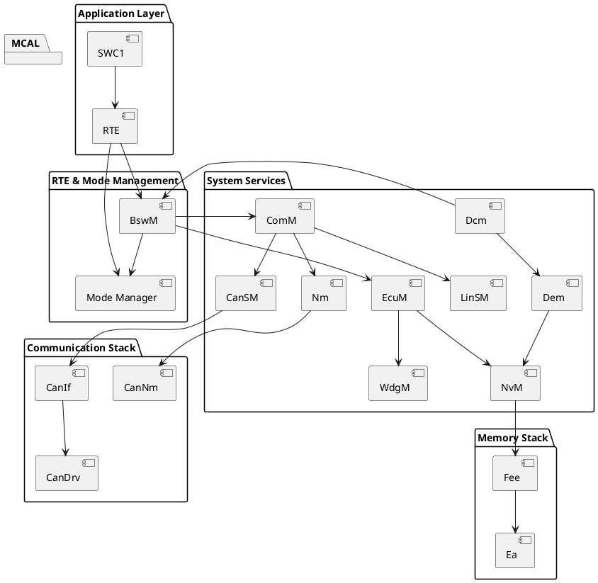

AUTOSAR中 各类manager模块之间的关系是什么

---

在 AUTOSAR 中，各类 Manager 模块（管理器）承担着系统运行时不同方面的“协调者”职责，它们构成 AUTOSAR Classic Platform 的核心管理体系。

---

## ✅ 总结（验证过）

> **Manager 模块按照职责可分为 5 类：启动/运行控制、通信管理、电源与网络管理、诊断与安全管理、资源管理。它们之间形成了主从、触发、服务调用等多种依赖关系。系统通过 EcuM（ECU 管理器）启动全流程，BSWM/ComM/Mode Management 等在中间层联动，最终驱动下层的 BSW 与上层的 Application。**

---

## 🧱 一、分类与核心模块概览（职责与接口）

| 类别 | 关键模块 | 主要职责 | 常用接口/连接模块 |
| --- | --- | --- | --- |
| 启动与模式管理 | `EcuM` 、 `Mode Manager` 、 `BSWM` | 启动流程管理、唤醒休眠、模式切换 | OS、RTE、ComM、NM、BswM |
| 通信管理 | `ComM` 、 `Nm` | 通信状态控制，网络唤醒、总线通信状态监控 | CAN/LIN/FR Drivers，PduR，BSWM |
| 电源与网络管理 | `EcuM` 、 `WdgM` 、 `NvM` | 电源控制、看门狗、非易失存储 | MCAL、Memory stack |
| 诊断与安全管理 | `Dcm` 、 `Dem` 、 `SecOC` | UDS 诊断服务、故障码管理、安全通信 | BSWM、NvM、Crypto stack |
| 资源与调度管理 | `SchM` 、 `Os` | 任务调度、BSW 排程、资源互斥 | 所有运行时 BSW 模块 |

---

## 🧩 二、模块关系图（系统架构视角）

### PlantUML 架构图

---

## 🔄 三、典型依赖关系说明

| 主模块 | 被调用或依赖的模块 | 说明 |
| --- | --- | --- |
| EcuM | WdgM, NvM, BswM | 控制上电启动、模式唤醒、非易失存储初始化、看门狗启动等 |
| ComM | Nm, CanSM, LinSM | 控制通信总线（CAN, LIN等）的 FULL / NO\_COMM 模式 |
| BswM | ComM, Dcm, Mode Manager | 执行规则触发通信、诊断、模式切换 |
| Dcm | Dem, NvM, BswM | 提供诊断服务，故障码存储，通知 BswM |
| Mode Manager | 所有 RTE 应用、BswM | 管理 OperatingMode、AppMode、CommMode 等系统模式 |

---

## 🔄 四、运行时控制流程示意（简化）

---

## 🧠 五、实际案例：诊断唤醒下的各模块联动

| 顺序 | 模块 | 动作 |
| --- | --- | --- |
| 1 | CAN 驱动 | 接收到 UDS 请求 |
| 2 | CanIf | 向上通知 PduR → Dcm |
| 3 | Dcm | 解码为诊断会话切换请求 |
| 4 | Dcm | 通知 BswM（Mode Request） |
| 5 | BswM | 启用通信（ComM\_RequestComMode） |
| 6 | ComM | 通知 CANSM/NM 切换为 FullComm |
| 7 | Dcm | 处理 UDS 服务 |
| 8 | Dem | 记录故障并写入 NvM |

---

## 📚 官方文献参考

- AUTOSAR\_SWS\_EcuM.pdf
- AUTOSAR\_SWS\_BswM.pdf
- AUTOSAR\_SWS\_ComM.pdf
- Vector DaVinci Configurator Manager Graph View
- 实际 OEM 工程（Volkswagen、Toyota）通信路径配置实践

---

如需：

- 不同 Manager 的 `.arxml` 配置样例
- 各 Manager 之间调用关系图（函数/接口级别）
- 某一 Manager 的详细交互流程图（如 BswM 触发通信）

欢迎进一步指定模块或用例，我可为你继续深入定制内容。