# 以太网协议完整笔记

## 目录
1. [以太网基础概念](#以太网基础概念)
2. [网络分层模型](#网络分层模型)
3. [数据链路层协议](#数据链路层协议)
4. [网络层协议](#网络层协议)
5. [传输层协议](#传输层协议)
6. [地址解析协议](#地址解析协议)
7. [协议关系图](#协议关系图)
8. [数据传输流程](#数据传输流程)

---

## 以太网基础概念

### 什么是以太网？
**以太网（Ethernet）** 是目前最广泛使用的局域网技术标准，定义了网络设备之间的物理连接和数据传输规则。

### 核心特征
- 🌐 **CSMA/CD** - 载波侦听多路访问/冲突检测
- 📏 **帧格式** - 标准化的数据帧结构
- 🏷️ **MAC地址** - 物理地址标识
- ⚡ **速率** - 10Mbps到400Gbps不等

---

## 网络分层模型

### OSI七层模型与以太网

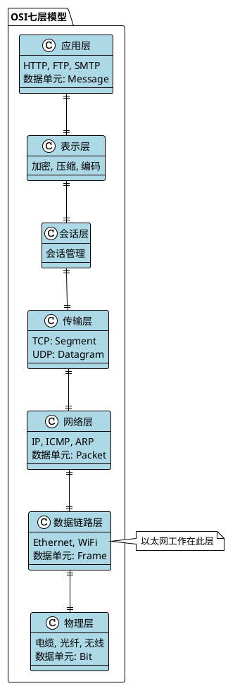

### TCP/IP四层模型

| OSI层 | TCP/IP层 | 协议示例 | 数据单元 |
|-------|----------|----------|----------|
| 应用层/表示层/会话层 | 应用层 | HTTP, FTP, DNS | Message |
| 传输层 | 传输层 | TCP, UDP | Segment/Datagram |
| 网络层 | 网络层 | IP, ICMP, ARP | Packet |
| 数据链路层/物理层 | 网络接口层 | Ethernet, WiFi | Frame |

---

## 数据链路层协议

### 以太网帧结构

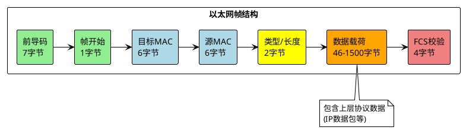

### MAC地址详解

**MAC地址格式：** `XX:XX:XX:XX:XX:XX`
- 📏 **长度**：48位（6字节）
- 🏭 **OUI**：前24位为厂商标识
- 🔢 **设备标识**：后24位为设备唯一标识
- 🌍 **全球唯一**：理论上每个网卡都有唯一MAC地址

**示例：**
```
00:1B:44:11:3A:B7
│  │  │  │  │  │
│  │  │  └──┴──┴── 设备标识 (24位)
└──┴──┴────────── OUI厂商标识 (24位)
```

---

## 网络层协议

### IP协议家族

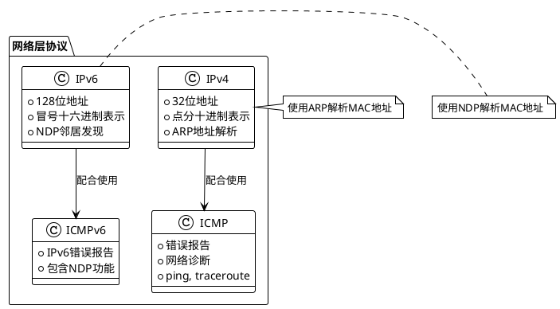

### IP数据包结构

**IPv4头部结构：**
```
 0                   1                   2                   3
 0 1 2 3 4 5 6 7 8 9 0 1 2 3 4 5 6 7 8 9 0 1 2 3 4 5 6 7 8 9 0 1
+-+-+-+-+-+-+-+-+-+-+-+-+-+-+-+-+-+-+-+-+-+-+-+-+-+-+-+-+-+-+-+-+
|Version|  IHL  |Type of Service|          Total Length         |
+-+-+-+-+-+-+-+-+-+-+-+-+-+-+-+-+-+-+-+-+-+-+-+-+-+-+-+-+-+-+-+-+
|         Identification        |Flags|      Fragment Offset    |
+-+-+-+-+-+-+-+-+-+-+-+-+-+-+-+-+-+-+-+-+-+-+-+-+-+-+-+-+-+-+-+-+
|  Time to Live |    Protocol   |         Header Checksum       |
+-+-+-+-+-+-+-+-+-+-+-+-+-+-+-+-+-+-+-+-+-+-+-+-+-+-+-+-+-+-+-+-+
|                       Source Address                          |
+-+-+-+-+-+-+-+-+-+-+-+-+-+-+-+-+-+-+-+-+-+-+-+-+-+-+-+-+-+-+-+-+
|                    Destination Address                        |
+-+-+-+-+-+-+-+-+-+-+-+-+-+-+-+-+-+-+-+-+-+-+-+-+-+-+-+-+-+-+-+-+
```

---

## 传输层协议

### TCP vs UDP 对比

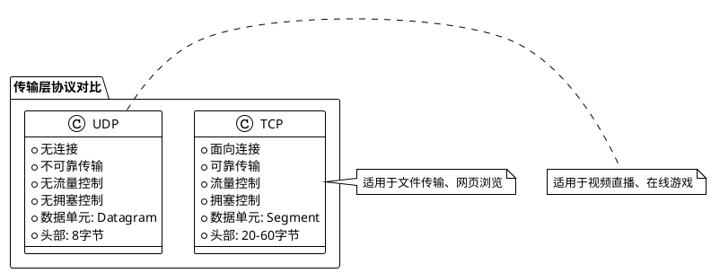

### TCP段结构详解

**为什么TCP使用Segment而不是Packet？**

1. **语义准确性**：
   - Segment = 数据流的片段
   - Packet = 独立的数据包

2. **功能特性**：
   ```plantuml
   @startuml
   !theme plain
   
   participant "应用层" as App
   participant "TCP层" as TCP  
   participant "IP层" as IP
   participant "以太网层" as Eth
   
   App -> TCP: 大数据流
   TCP -> TCP: 分割成Segments
   TCP -> IP: TCP Segment
   IP -> IP: 封装成IP Packet
   IP -> Eth: IP Packet
   Eth -> Eth: 封装成Ethernet Frame
   @enduml
   ```

3. **TCP段特点**：
   - 🔢 **序列号** - 保证顺序
   - ✅ **确认号** - 保证可靠性
   - 🪟 **窗口大小** - 流量控制
   - 🔄 **重传机制** - 错误恢复

---

## 地址解析协议

### ARP vs NDP 详细对比

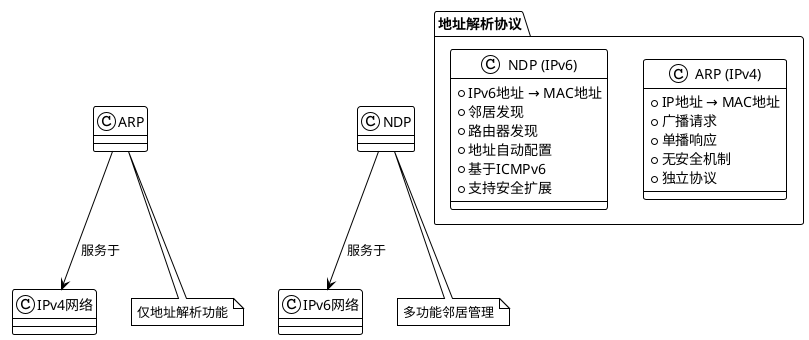

### ARP工作流程

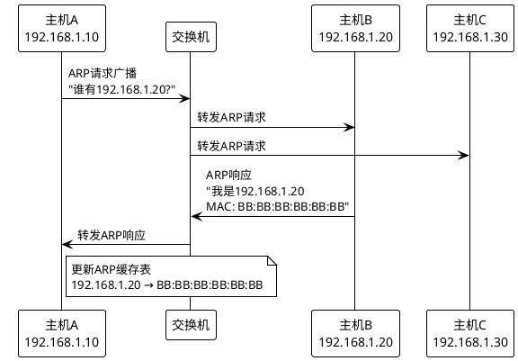

---

## 协议关系图

### 完整协议栈关系

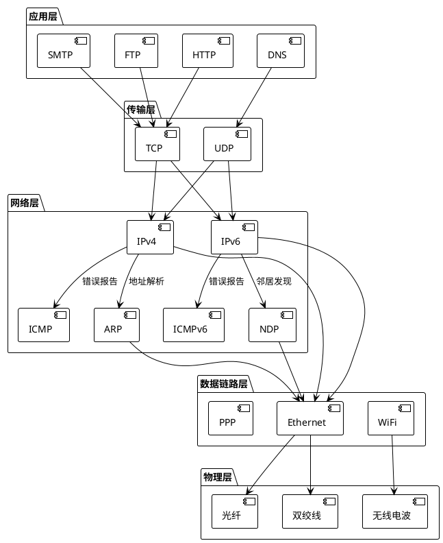

### 数据封装过程

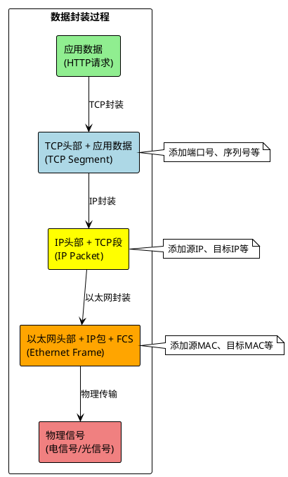

---

## 数据传输流程

### 完整通信流程示例

**场景：** 主机A (192.168.1.10) 访问网站 (www.example.com)

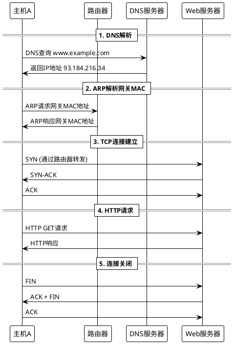

### 数据包在各层的变化

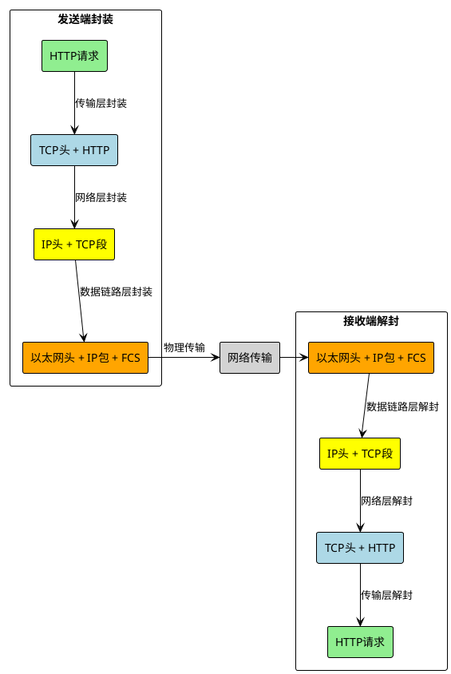

---

## 重要概念总结

### 数据单元命名规则

| 层次 | 数据单元名称 | 英文术语 | 特点 |
|------|-------------|----------|------|
| 应用层 | 消息 | Message | 应用程序间的完整信息 |
| 传输层 | 段/数据报 | Segment/Datagram | TCP用Segment，UDP用Datagram |
| 网络层 | 数据包 | Packet | 包含路由信息的数据单元 |
| 数据链路层 | 帧 | Frame | 包含物理地址的数据单元 |
| 物理层 | 比特 | Bit | 最基本的数据单位 |

### 地址类型对比

| 地址类型 | 长度 | 作用范围 | 示例 | 用途 |
|----------|------|----------|------|------|
| MAC地址 | 48位 | 局域网内 | 00:1B:44:11:3A:B7 | 数据链路层寻址 |
| IPv4地址 | 32位 | 全球 | 192.168.1.1 | 网络层路由 |
| IPv6地址 | 128位 | 全球 | 2001:db8::1 | 网络层路由 |
| 端口号 | 16位 | 主机内 | 80, 443 | 传输层进程标识 |

### 协议特点速查

```plantuml
@startuml
!theme plain
skinparam backgroundColor white

map "协议特点对比" {
  TCP => 可靠、有序、面向连接、开销大
  UDP => 快速、简单、无连接、开销小  
  IPv4 => 32位地址、使用ARP、广泛部署
  IPv6 => 128位地址、使用NDP、安全性强
  ARP => IPv4专用、广播请求、无安全
  NDP => IPv6专用、多播请求、可加密
  Ethernet => 局域网标准、CSMA/CD、帧结构
}
@enduml
```

---

## 实际应用场景

### 常见网络应用的协议选择

| 应用类型 | 传输层协议 | 原因 |
|----------|------------|------|
| 网页浏览 | TCP | 需要可靠传输，确保页面完整 |
| 文件下载 | TCP | 必须保证文件完整性 |
| 视频直播 | UDP | 实时性要求高，偶尔丢包可接受 |
| 在线游戏 | UDP | 延迟敏感，需要快速响应 |
| 邮件发送 | TCP | 邮件内容不能丢失 |
| DNS查询 | UDP | 查询简单，快速响应 |

### 网络故障排查思路

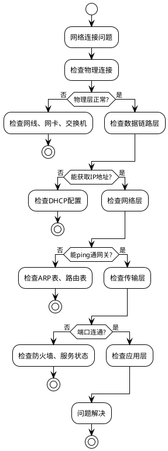

---

## 参考资料

### 相关RFC文档
- **RFC 894** - Ethernet封装标准
- **RFC 791** - IPv4协议规范  
- **RFC 2460** - IPv6协议规范
- **RFC 793** - TCP协议规范
- **RFC 768** - UDP协议规范
- **RFC 826** - ARP协议规范
- **RFC 4861** - NDP协议规范

### 学习建议
1. 🔍 **理论学习** - 掌握各层协议的基本原理
2. 🛠️ **实践操作** - 使用Wireshark抓包分析
3. 🧪 **实验环境** - 搭建虚拟网络进行测试
4. 📚 **深入研究** - 阅读RFC文档了解细节
5. 🔧 **故障排查** - 学会使用网络诊断工具

---

*最后更新：2024年* 