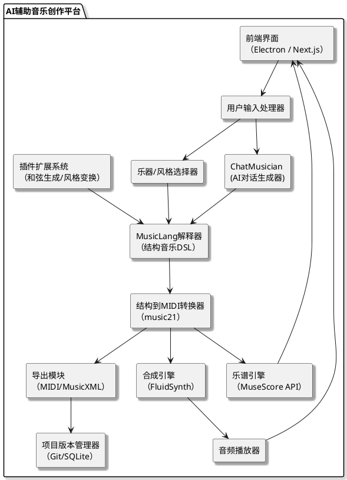

以下是一个基于 **MusicLang + ChatMusician + MuseScore** 的开源 AI 音乐谱曲技术路线详解，适合你希望实现的目标：

---

## ✅ 一、总结：为什么选择这三者组合

|工具名称|作用|是否开源|精细控制支持|生态/兼容性|
|---|---|---|---|---|
|MusicLang|类似“乐理DSL语言”的 AI 作曲语法|✅|✅（可定义和弦、风格、乐器）|中（支持导出MIDI）|
|ChatMusician|LLM驱动的音乐生成助手|✅|✅（支持结构提示、风格指定）|中（文本驱动，支持多模型）|
|MuseScore|可视化乐谱编辑与MIDI播放/导出工具|✅|手动+导入MIDI|高（主流格式支持）|

这套技术路线的优点在于：

- 📐 **结构化作曲**：可以使用 MusicLang 设定清晰的音符/和弦/时间结构。
    
- 🧠 **AI 引导生成**：利用 ChatMusician 结合语言模型进行结构化创作。
    
- 🎼 **可视化与演奏输出**：通过 MuseScore 查看、调整乐谱并导出音频。
    

---

## 🎼 二、组件详解

### 1️⃣ MusicLang：结构化 AI 乐理编程语言

**简介**：  
MusicLang 是一个音乐 DSL（Domain Specific Language），允许用 Python 类似语法描述音乐结构（调性、节奏、乐器等），非常适合 AI 编程。

**关键能力**：

- 可以定义小节、和弦、旋律、乐器。
    
- 支持生成 MIDI。
    
- 可以与 ChatGPT 等语言模型结合生成音乐结构。
    

**例子**（节选）：

python

CopyEdit

`from musiclang import Score, Chord, Note  # 创建一个简单和弦 + 音符的结构 score = Score().bar(     Chord('C', 'maj', 'I', beats=[Note('c', 4, 1), Note('e', 4, 1), Note('g', 4, 2)]) ).instrument('piano')`

**输出结果**：

- 可导出 MIDI → 供 MuseScore 导入查看/播放。
    
- 可扩展与 AI 对接，作为“输出语言”。
    

---

### 2️⃣ ChatMusician：支持 DSL+自然语言的 AI 音乐创作助手

**简介**：  
ChatMusician 是一个基于 Transformer / LLM 的音乐生成平台，内置支持多个音乐 DSL，包括 MusicLang、ABC、GuitarTab 等。

**关键能力**：

- 支持自然语言 prompt → 生成 MusicLang 格式。
    
- 支持音乐样式控制，如“爵士风格钢琴片段”、“管弦风格主题句”。
    
- 模型已支持生成音乐代码并带注释。
    

**示例 Prompt**：

> Generate an 8-bar Jazz piano loop in C major using MusicLang with walking bass and swing rhythm.

**输出示意**（缩略）：

python

CopyEdit

`Score().bar(     Chord('C', 'maj', 'I', beats=[Note('c', 3, 1), Note('e', 3, 1), Note('g', 3, 2)]) ).instrument('bass')`

**优势**：

- 能与 MusicLang 组合直接生成可播放结构。
    
- 可以“选区”设定某区域的风格、乐器。
    
- 可结合自己的规则系统，形成风格模版库。
    

---

### 3️⃣ MuseScore：谱面编辑与演奏工具

**简介**：  
MuseScore 是全球领先的免费乐谱编辑器，支持导入/导出 MIDI、MusicXML，并支持 AI 工具（如 MuseNet）的插件。

**关键能力**：

- 可导入 MusicLang 生成的 MIDI → 查看标准乐谱。
    
- 可播放并调整速度、乐器、力度等。
    
- 可手动编辑生成乐谱后输出为音频或 MusicXML。
    

**实用场景**：

- 调整演奏风格 → 保存为 WAV/MP3。
    
- 制作高质量的谱面发布/演奏。
    

---

## 🧠 三、技术组合图谱

plantuml

CopyEdit

`@startuml actor 用户 package "AI 作曲流程" {   [ChatMusician Prompt] --> [MusicLang 代码生成]   [MusicLang 代码生成] --> [MIDI 导出]   [MIDI 导出] --> [MuseScore 导入播放与调整] } @enduml`

---

## 🛠 四、建议工作流

1. **创作阶段**（ChatMusician）
    
    - 提示生成特定风格段落
        
    - 输出 MusicLang 结构代码
        
2. **结构编辑阶段**（可选手动+脚本）
    
    - 用 Python 脚本组合多个段落
        
    - 修改节拍、乐器等细节
        
3. **可视化编辑 & 导出**（MuseScore）
    
    - 将 MIDI 导入
        
    - 调整演奏效果并导出音频
        

---

## 📦 五、安装与开源链接

|名称|安装方式|GitHub链接|
|---|---|---|
|MusicLang|`pip install musiclang`|[github.com/musiclang/musiclang](https://github.com/MusicLang/musiclang)|
|ChatMusician|Hugging Face 或源码部署|[github.com/m-a-p/ChatMusician](https://github.com/m-a-p/ChatMusician)|
|MuseScore|官方下载安装包|musescore.org|

---

## 🧭 六、后续探索方向

|方向|工具建议|说明|
|---|---|---|
|自动变奏生成|MusicLang + ChatMusician|根据固定主题生成变化版本|
|风格转换（Jazz→Pop）|ChatMusician + MusicGen|可以调风格模型或约束输出|
|和弦规则建模|自定义 DSL + GPT 训练|可定制音乐和弦语法系统|
|制作完整AI音乐作品|上述组合 + Vocoder合成器|融入鼓点、贝斯、主旋律等多轨道|

---

如果你愿意，我可以帮你构建一个基础的 MusicLang 模板项目，支持区域控制、乐器选择、风格生成并自动导出 MIDI 供 MuseScore 打开。

是否需要我为你生成这个项目模板？你希望哪种风格作为初始主题？例如：

- 爵士钢琴
    
- 巴洛克弦乐
    
- 流行电子节奏
    
- Lo-fi 鼓 + 和弦结构
    

##### You said:

我要用这一技术路线搭建音乐创作平台，请在深思熟虑到每一个细节，以一个最优秀架构师的身份给我完整的plantUML，

###### ChatGPT said:

以下是以架构师视角，围绕 `🎵 MusicLang + ChatMusician + MuseScore` 构建的 **AI辅助音乐创作平台** 的完整技术架构图（采用 PlantUML），并辅以功能模块说明。此平台强调：结构可扩展性、模块解耦、AI深度集成、可视化反馈，适用于独立创作或小型团队协作。

---

## ✅ 总结（架构核心）

|模块名称|工具/框架|功能说明|
|---|---|---|
|前端 UI|Next.js / Electron|乐谱可视化、乐器选择、参数调整、AI提示输入|
|AI 作曲核心|ChatMusician + MusicLang|文本到音乐结构的转换，支持风格/乐器/节奏控制|
|结构转MIDI/乐谱|MusicLang / music21|将结构转换为可播放 MIDI 或导出 MusicXML|
|音频合成|FluidSynth / SFZ Player|根据 MIDI 与音源合成最终音频|
|乐谱编辑与展示|MuseScore (嵌入/API)|乐谱渲染和编辑，支持导出 PDF/MIDI/MusicXML|
|项目管理模块|SQLite / Git|版本管理与保存创作流程|
|插件扩展系统|Python Plugin Framework|可挂接和弦分析、节奏重写、AI风格生成器等插件模块|

---

## 📌 PlantUML 架构图

plantuml

CopyEdit

## 🧠 每个核心部分说明（技术栈建议）

### 1. 🎹 用户交互界面（前端）

- **框架**：Electron（桌面），或 Next.js（Web）
    
- **功能**：乐谱可视化、拖拽控制音轨、设定AI提示（风格、节奏）、试听按钮
    

### 2. 💬 AI 作曲模块

- **ChatMusician**
    
    - 提示词设计：“请生成一段Funk风格的吉他伴奏段，长度4小节”
        
    - 输出 MusicLang DSL
        
- **MusicLang**
    
    - 类似编程语言的音乐结构定义系统，可声明：
        
        - 和弦进行：`C:maj -> G:maj -> Am -> F`
            
        - 节奏模式：`riff(4/4, pattern="x-x-xx--")`
            
        - 乐器调用：`add_piano(pattern)`
            

### 3. 🎼 乐谱与音频引擎

- **music21**：分析 DSL -> MIDI 或 MusicXML
    
- **MuseScore**：可直接用其 CLI `mscore` 渲染 XML 为 PDF 或可视化预览
    
- **FluidSynth**：将 MIDI 转成 WAV/MP3（需要 SF2 音色）
    

### 4. 🔧 插件扩展接口

- **支持功能**：
    
    - 和弦替换插件（Jazz reharmonization）
        
    - 节奏 Humanization 插件
        
    - AI 风格学习插件（训练你自己的风格，或上传喜欢的段落）
        
- **技术建议**：基于 Python 的插件系统 + entry point 机制
    

### 5. 📂 项目与版本管理

- **使用**：Git 本地 repo + SQLite
    
- **用途**：
    
    - 保存所有 MusicLang 脚本、导出的 MIDI、PDF
        
    - 支持版本对比 / 回溯 / 快照
        

---

## 🔁 创作流程图（文字版）

1. 用户输入音乐意图（风格/乐器/段落长度）
    
2. ChatMusician 根据输入生成 MusicLang 脚本
    
3. MusicLang 构建音乐结构（节奏+和弦+旋律）
    
4. 转换为 MIDI + 乐谱（MusicXML）
    
5. 乐谱展示（MuseScore）、音频播放（FluidSynth）
    
6. 用户微调 + 插件辅助创作
    
7. 导出项目文件 + 可选择版本保存
    

---

## 🧩 未来扩展方向

| 模块        | 描述                             |
| --------- | ------------------------------ |
| AI 旋律匹配插件 | 上传 hummed melody，生成伴奏与和声       |
| 云协作系统     | 多人实时编辑同一段 MusicLang            |
| 风格迁移模块    | 将一首曲子变为不同风格：Jazz → LoFi 等      |
| 训练自定义模型   | 使用 ChatMusician 本地训练自定义风格的 LLM |
